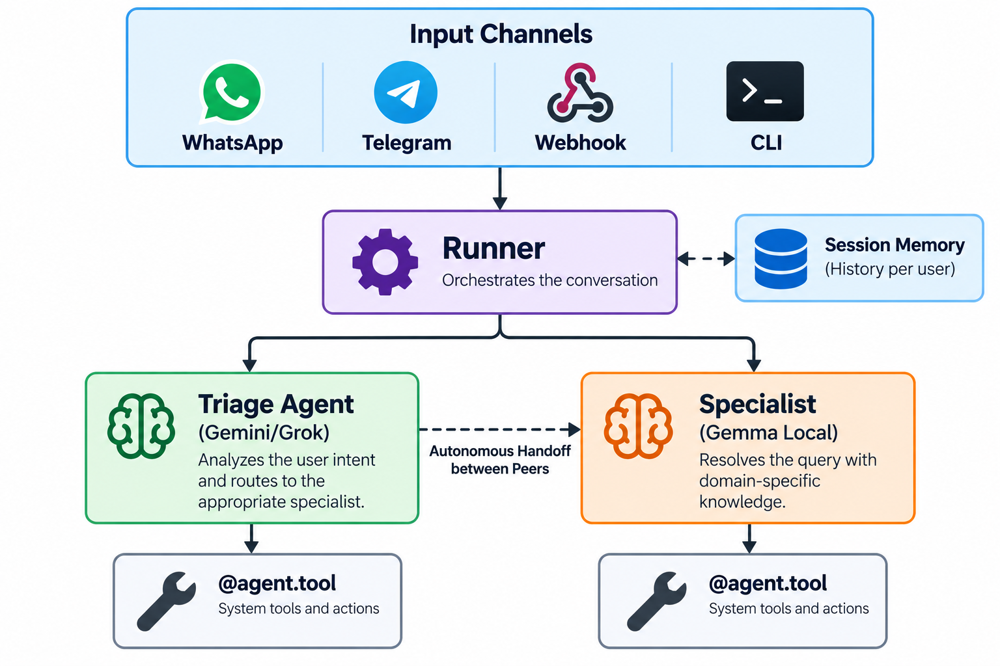
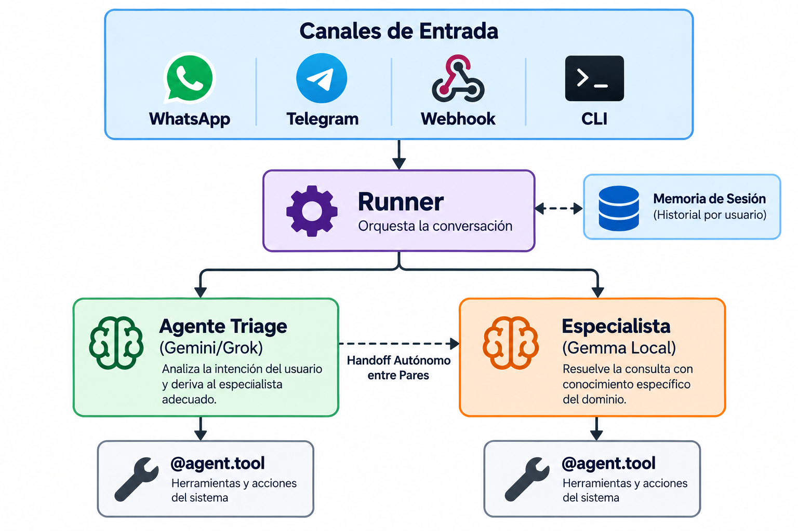

# chatflow-agent

[](https://github.com/GustavoBaranda/chatflow-agent/actions/workflows/test.yml)
[](https://pypi.org/project/chatflow-agent/)
[](https://www.python.org/downloads/)
[](https://opensource.org/licenses/MIT)
[](https://github.com/astral-sh/ruff)
[](https://mypy-lang.org/)

> **Build autonomous multi-agent swarms for WhatsApp, Telegram, and Webhooks in seconds without heavy dependency chains.**  
> *Construye equipos de agentes autonomos para WhatsApp, Telegram y Webhooks en segundos sin lidiar con dependencias monstruosas.*

```bash
pip install chatflow-agent
```

[English Documentation](#english-documentation) | [Guía en Español](#guía-completa-en-español) | [Contributing](#contributing) | [PyPI Package](https://pypi.org/project/chatflow-agent/) | [Report Issue](https://github.com/GustavoBaranda/chatflow-agent/issues)

---

## Key Pillars (Why chatflow-agent?)

* **Ultra-Lightweight Core:** Only 2 runtime dependencies (`pydantic`, `httpx`). A tiny ~72 KB package footprint that installs in seconds on Docker, serverless, and cloud VPS environments.

* **Omnichannel Native:** Production-ready connectors for **WhatsApp (Official Meta Cloud API)**, **Telegram**, **Webhooks (FastAPI)**, and interactive **CLI**.

* **Multi-Provider Freedom:** Switch between **Google Gemini**, **Google Gemma (100% free local via Ollama)**, **xAI Grok**, **OpenAI (GPT-4o)**, and **Anthropic Claude** with a single parameter. Zero vendor lock-in.

* **Production-Hardened Shields:** Native per-session concurrency locking (`asyncio.Lock`) prevents out-of-order race conditions from fast typers. Webhook anti-500 shield prevents Meta retry bombardment storms during LLM downtime.

* **Autonomous Peer Handoffs:** Agents delegate conversations dynamically based on customer intent, without rigid state machines or complex graph builders.

---

## Quickstart in 10 Seconds

```python

import asyncio

from chatflow_agent import Agent, Runner

# 1. Define specialist agents

tech_agent = Agent(name="TechSupport", model="gemini-2.5-flash", instructions="Help with bugs.")

billing_agent = Agent(name="Billing", model="gemini-2.5-flash", instructions="Help with invoices.")

# 2. Receptionist agent with autonomous peer handoffs

receptionist = Agent(

    name="Receptionist",

    model="gemini-2.5-flash",

    instructions="Greet the customer and route them to TechSupport or Billing.",

    handoffs=[tech_agent, billing_agent],

)

async def main():

    runner = Runner(starting_agent=receptionist)

    result = await runner.run_async(

        session_id="user_whatsapp_1",

        user_message="Hi! I need help with an invoice error on my account.",

    )

    print(f"[{result.active_agent_name}]: {result.content}")

    # Output: [Billing]: I would be glad to help check your invoice. Could you share your account ID?

if __name__ == "__main__":

    asyncio.run(main())

```

---

## English Documentation

### Table of Contents

1. [Overview & Architecture](#overview--architecture)

2. [API Keys & Configuration](#api-keys--configuration)

3. [Installation](#installation)

4. [Step-by-Step Quickstarts](#step-by-step-quickstarts)

   - [A. Cloud LLM (Gemini / OpenAI / Claude)](#a-cloud-llm-quickstart)

   - [B. 100% Free Local LLM (Google Gemma via Ollama)](#b-local-offline-quickstart-google-gemma)

   - [C. Multi-Agent Swarm with Handoffs](#c-multi-agent-swarm-with-handoffs)

5. [Channel Connectors](#channel-connectors)

   - [WhatsApp (Meta Cloud API)](#whatsapp-channel-meta-cloud-api)

   - [Telegram Bot](#telegram-channel)

   - [Interactive Terminal (CLI)](#interactive-terminal-cli)

6. [Production Resilience & Concurrency](#production-resilience--concurrency)

7. [Tool Idempotency & Side-Effect Handling](#tool-idempotency--side-effect-handling)

8. [Session Memory & Persistence](#session-memory--persistence)

9. [Production Starter Templates](#production-starter-templates)

10. [Contributing](#contributing)

11. [Guía Completa en Español](#guía-completa-en-español)

---

### Overview & Architecture

`chatflow-agent` is designed for developers who want the multi-agent power of OpenAI Swarm without being locked into a single provider, combined with turnkey connectors for messaging platforms like **WhatsApp** and **Telegram**.



---

### API Keys & Configuration

You can provide API keys using any of the following 3 methods:

#### 1. Direct in Python Code (Easiest)

Pass your API key directly when instantiating the `Runner` or `Agent`:

```python

# Pass to Runner (used by all agents with that provider)

runner = Runner(starting_agent=my_agent, api_key="AIzaSyYourGeminiKey")

# Or pass directly to a specific Agent:

grok_agent = Agent(

    name="GrokSpecialist",

    provider="grok",

    api_key="xai-your-key-here",

    instructions="..."

)

```

#### 2. Using a `.env` File

Create a `.env` file in your project root:

```env

# Google Gemini (Get free key at https://aistudio.google.com/)

GEMINI_API_KEY="AIzaSy..."

# OpenAI (https://platform.openai.com/api-keys)

OPENAI_API_KEY="sk-..."

# xAI Grok (https://console.x.ai/)

XAI_API_KEY="xai-..."

# Anthropic Claude (https://console.anthropic.com/)

ANTHROPIC_API_KEY="sk-ant-..."

```

Then in your script:

```python

from dotenv import load_dotenv

load_dotenv()

```

#### 3. Via Terminal Environment Variables

* **Windows (PowerShell):**

  ```powershell

  $env:GEMINI_API_KEY="AIzaSy..."

  ```

* **Linux / macOS (Bash/Zsh):**

  ```bash

  export GEMINI_API_KEY="AIzaSy..."

  ```

#### Provider Credential Reference Table

| Provider | Where to get Key | Environment Variable | In-Code Parameter | Free Tier Available? |
| :--- | :--- | :--- | :--- | :--- |
| **Google Gemini** | [Google AI Studio](https://aistudio.google.com/app/apikey) | `GEMINI_API_KEY` | `api_key="..."` | **Yes (Generous free tier)** |
| **Google Gemma (Local)** | [Ollama](https://ollama.com) | *None needed* | `provider="ollama"` | **100% Free & Offline** |
| **xAI Grok** | [xAI Console](https://console.x.ai/) | `XAI_API_KEY` | `api_key="..."` | Pay-as-you-go |
| **OpenAI** | [OpenAI Platform](https://platform.openai.com/) | `OPENAI_API_KEY` | `api_key="..."` | Pay-as-you-go |
| **Anthropic Claude** | [Anthropic Console](https://console.anthropic.com/) | `ANTHROPIC_API_KEY` | `api_key="..."` | Pay-as-you-go |

> [!WARNING]
> **Vertex AI is not supported.** `GeminiEngine` calls only the Gemini Developer API (Google AI Studio) with an API key. Application Default Credentials (ADC) and the `GOOGLE_GENAI_USE_VERTEXAI`, `GOOGLE_CLOUD_PROJECT` and `GOOGLE_CLOUD_LOCATION` variables are not used, so setups that relied on them fail with `ProviderError("Gemini API client is not configured. ...")`. Use a Gemini API key, or provide your own engine through `Runner(engine=...)`.
>
> **`GeminiEngine.client` was removed in v0.4.0.** It held the `google-genai` client, which is no longer a dependency. Assigning a fake to it no longer mocks anything. To call the SDK directly, install `google-genai` and create your own client. To mock Gemini in tests or customize HTTP, pass an `httpx.AsyncClient` with `GeminiEngine(http_client=...)`; it stays owned by you and must be used on one event loop only. See the [CHANGELOG](CHANGELOG.md) for the migration steps.

---

### Installation

Install only what you need:

```bash

# Core framework (Gemini, Gemma, Grok, OpenAI, Claude, CLI)

pip install chatflow-agent
`

# With WhatsApp Webhook connector (FastAPI + Uvicorn)

pip install "chatflow-agent[whatsapp]"

# With Telegram Bot connector (python-telegram-bot)

pip install "chatflow-agent[telegram]"

# Complete bundle (All channels & dev tools)

pip install "chatflow-agent[all]"

```

---

### Step-by-Step Quickstarts

#### A. Cloud LLM Quickstart

Save as `bot.py` and run with `python bot.py`:

```python

import asyncio

from chatflow_agent import Agent, Runner

# Define your agent

support_agent = Agent(

    name="SupportBot",

    model="gemini-2.5-flash",  # Or provider="openai", model="gpt-4o-mini"

    instructions="You are a helpful customer support agent for a retail store.",

)

# Register business tools using Python decorators and type hints

@support_agent.tool

def get_order_status(order_id: str) -> dict:

    """Look up shipping and tracking status for an order."""

    return {

        "order_id": order_id,

        "status": "Out for delivery",

        "carrier": "FedEx",

        "eta": "Today before 6:00 PM",

    }

async def main():

    # Pass api_key directly or set GEMINI_API_KEY in environment/.env

    runner = Runner(starting_agent=support_agent)

    response = await runner.run_async(

        session_id="user_session_101",

        user_message="Hi, can you check the status of my order #FDX-8821?",

    )

    print(f"[{response.active_agent_name}]: {response.content}")

if __name__ == "__main__":

    asyncio.run(main())

```

---

#### B. Local Offline Quickstart (Google Gemma)

Run 100% locally on your machine with **zero API costs** and **total privacy** using [Ollama](https://ollama.com):

1. Start Ollama with Gemma: `ollama run gemma2:9b`

2. Run this script:

```python

import asyncio

from chatflow_agent import Agent, Runner

# Connects to http://localhost:11434/v1 with no API key required

local_agent = Agent(

    name="LocalAnalyst",

    provider="ollama",

    model="gemma2:9b",

    instructions="You analyze confidential financial reports locally.",

)

@local_agent.tool

def calculate_vat(subtotal: float, rate_percentage: float = 21.0) -> dict:

    """Calculate VAT tax and total amount."""

    vat = subtotal * (rate_percentage / 100.0)

    return {"subtotal": subtotal, "vat": round(vat, 2), "total": round(subtotal + vat, 2)}

async def main():

    runner = Runner(starting_agent=local_agent)

    response = await runner.run_async(

        session_id="local_user",

        user_message="Calculate VAT for a $450 invoice.",

    )

    print(f"[{response.active_agent_name}]: {response.content}")

if __name__ == "__main__":

    asyncio.run(main())

```

---

#### C. Multi-Agent Swarm with Handoffs

Agents can autonomously delegate tasks to specialists:

```python

import asyncio

from chatflow_agent import Agent, Runner

# 1. Specialist: Technical Support

tech_agent = Agent(

    name="TechSupport",

    model="gemini-2.5-flash",

    instructions="You diagnose hardware and software issues.",

)

@tech_agent.tool

def run_diagnostics(device_id: str) -> str:

    """Checks device telemetry."""

    return f"Device {device_id}: All sensors nominal. Firmware v2.1 up to date."

# 2. Specialist: Billing & Invoices

billing_agent = Agent(

    name="Billing",

    model="gemini-2.5-flash",

    instructions="You handle invoices, subscriptions, and refund requests.",

)

# 3. Receptionist (Frontline) with handoffs to specialists

concierge = Agent(

    name="Reception",

    model="gemini-2.5-flash",

    instructions="Greet customers and transfer to TechSupport or Billing as required.",

    handoffs=[tech_agent, billing_agent],  # Swarm handoff capability

)

async def main():

    runner = Runner(starting_agent=concierge)

    # The model detects it is a technical query and hands off to TechSupport automatically

    resp = await runner.run_async(

        session_id="client_77",

        user_message="My device DEV-42 is blinking red. Can you run diagnostics?",

    )

    print(f"Active Agent: {resp.active_agent_name}")  # Output: TechSupport

    print(f"Response: {resp.content}")

if __name__ == "__main__":

    asyncio.run(main())

```

---

### Channel Connectors

#### WhatsApp Channel (Meta Cloud API)

Run a production webhook server compatible with Meta WhatsApp Business Cloud API:

```python

from chatflow_agent import Agent, Runner

from chatflow_agent.channels import WhatsAppChannel

agent = Agent(name="WhatsAppConcierge", instructions="Answer customer inquiries.")

runner = Runner(starting_agent=agent)

channel = WhatsAppChannel(

    verify_token="my_custom_webhook_secret",  # Verification token configured in Meta App

    access_token="EAA...",                    # Meta Permanent/System User Token

    app_secret="a1b2c3d4...",                 # Meta App Secret (App Dashboard -> App settings -> Basic)

    phone_number_id="109876543210987",        # WhatsApp Phone Number ID from Meta Dashboard

    fallback_message="We are experiencing a temporary delay. Please try again shortly.",

    unsupported_media_message="Currently I can only process text messages.",

)

channel.attach(runner)

if __name__ == "__main__":

    # Exposes GET /webhook (verification handshake) and POST /webhook (incoming messages)

    channel.run(host="0.0.0.0", port=8000)

```

> **Testing locally?** Use a tunnel like [ngrok](https://ngrok.com) (`ngrok http 8000`) or Cloudflare Tunnels to provide Meta with a public HTTPS URL (`https://your-domain.ngrok-free.app/webhook`).

> [!NOTE]
> **API Documentation in Development:** For security, FastAPI interactive documentation (`/docs`, `/redoc`, and `/openapi.json`) is disabled by default in production. To enable Swagger UI and OpenAPI schemas during local development or debugging, pass `enable_docs=True` when instantiating `WhatsAppChannel`:
> ```python
> channel = WhatsAppChannel(
>     ...,
>     enable_docs=True,  # Enables /docs, /redoc, and /openapi.json for local development
> )
> ```

> [!TIP]
> **Production Rate Limiting & Reverse Proxy:** To protect `/webhook` and `/health` endpoints against flood attacks, denial of service (DoS), and CPU exhaustion from unauthenticated requests without risking dropping legitimate Meta webhook bursts at the application level, always place Uvicorn behind a reverse proxy in production (such as Nginx with `limit_req_zone` or Cloudflare Rate Limiting):
> ```nginx
> limit_req_zone $binary_remote_addr zone=whatsapp_limit:10m rate=10r/s;
> location /webhook {
>     limit_req zone=whatsapp_limit burst=20 nodelay;
>     proxy_pass http://127.0.0.1:8000;
>     proxy_set_header X-Forwarded-For $proxy_add_x_forwarded_for;
> }
> ```

---

#### Telegram Channel

```python

from chatflow_agent import Agent, Runner

from chatflow_agent.channels import TelegramChannel

agent = Agent(name="TelegramBot", instructions="You assist Telegram users.")

runner = Runner(starting_agent=agent)

channel = TelegramChannel(

    token="123456:ABC-DEF1234ghIkl-zyx57W2v1u123ew11",  # From @BotFather

    fallback_message="Sorry, a temporary issue occurred. Please retry in a few moments.",

)

channel.attach(runner)

if __name__ == "__main__":

    # Runs async polling; automatically handles /start, /reset, and typing indicators

    channel.run()

```

---

#### Interactive Terminal (CLI)

Test swarms in your terminal with colored chat output:

```python

from chatflow_agent import Agent, Runner

from chatflow_agent.channels import CLIChannel

agent = Agent(name="TerminalAssistant", instructions="Answer user questions concisely.")

runner = Runner(starting_agent=agent)

channel = CLIChannel(session_id="dev_test")

channel.attach(runner)

channel.run()

```

---

### Production Resilience & Concurrency

ChatFlow includes built-in safeguards engineered specifically for real-world messaging traffic:

* **Per-Session Concurrency Lock (`asyncio.Lock`):** When a user sends multiple messages in rapid succession (e.g., three WhatsApp voice transcriptions or quick texts in 2 seconds), turns of the same session run one at a time, preventing race conditions, overlapping tool executions, or corrupted conversation histories. They run in the order they start waiting for the session (`asyncio.Lock` is fair); that is the order in which the channel starts the turns, which is usually, but not necessarily, the order the messages were sent. With `SQLiteSessionStore`, each queued turn reloads the history, active agent and metadata committed by the previous turn before it starts.
  * **Scope:** the guarantee holds within one process, one store instance and one running event loop (for example, one Uvicorn worker, a Telegram bot, or successive `Runner.run()` calls). Turns for the same session coming from several store instances on the same file, several processes, or several threads with their own event loops are **not** serialized.
  * **Turns started from inside a turn:** code started by a turn (a tool, or a task or thread the tool starts) cannot start another turn of the same session while that turn is running: `runner.run_async()` / `runner.run()` raise `ReentrantTurnError` (a `RuntimeError`) instead of waiting for a lock the current turn may be waiting on. To queue a follow-up turn for the same session, call `runner.spawn_turn(session_id, message)`: it returns an `asyncio.Task` that runs after the current turn ends. Never await that task inside the turn that spawned it; await it (or read its exception) afterwards. Turns of other sessions can be awaited from a tool normally.
  * **Deleting a session:** `delete()` and `clear()` do not wait for running turns. A turn running when its session is deleted fails with `SessionDeletedError` and leaves nothing behind; a turn waiting for that session starts a new, empty one. Deleting erases a session's data; it does not block its id, so a new message creates the session again.
  * **Turn time limit:** `await runner.run_async(session_id, message, turn_timeout=30)` limits the turn itself (keyword-only, seconds). The limit starts once the turn holds the session, so time spent waiting behind earlier turns of the same session does not count. When it expires the turn is cancelled, the session is restored to its state before the turn, and `TimeoutError` is raised. It must be a positive finite number; the default, `None`, sets no limit.
  * **WhatsApp:** each message has two separate limits. `queue_timeout_seconds` (default 120) bounds the wait behind earlier turns of the same session: if it expires, the user receives `fallback_message` and the turn is never run (the message is not added to the history and, as before, a Meta retry of the same `wamid` is discarded). `llm_timeout_seconds` (default 120) bounds the turn itself and starts once the turn holds the session: when it expires the turn is cancelled and rolled back and the user receives `fallback_message`. A reply can therefore take up to `queue_timeout_seconds + llm_timeout_seconds`. The logs tell the cases apart: `Session busy ...` (queue limit), `Turn timed out ...` (turn limit), `Dispatch backstop expired ...` (a `dispatch_async()` override that never reached `Runner.run_async()`), and `TimeoutError raised while dispatching ...` (a `TimeoutError` from the provider or other code, not a channel limit). `llm_timeout_seconds=None` or `inf` sets no turn limit.

* **Meta Anti-500 Error Shield:** Meta's webhook infrastructure retries delivery aggressively if your endpoint returns HTTP 500. `WhatsAppChannel` catches any upstream LLM outages or rate limits, returns **HTTP 200** to Meta to prevent retry storms, dispatches the configured `fallback_message` to the user, and logs clean diagnostic details.

* **Unsupported Media Handling:** Audio voice notes, photos, and PDF files are safely intercepted with `unsupported_media_message` without throwing unhandled exceptions or disrupting ongoing chat sessions.

* **Turn Failure Rollback:** If an LLM request times out, rate limits, or crashes mid-turn, ChatFlow automatically rolls back dialogue history to the last consistent turn in memory and SQLite (note: rollback reverts conversational history; external side effects of already executed tools are not rolled back), ensuring clean context without orphaned partial turns. See [Tool Idempotency & Side-Effect Handling](#tool-idempotency--side-effect-handling) for how to design tools that are safe to retry.
  * With `SQLiteSessionStore`, the rollback restores the history, active agent and metadata the turn started from, including messages pruned by the sliding window during the turn. If anything else changed the session during the turn (another context updating its metadata or agent, a reset, a delete, or a writer outside the supported scope above), only the failed turn's own changes are reverted, other writers' messages, agent and metadata are kept, and a warning is logged.

---

### Tool Idempotency & Side-Effect Handling

Tools that interact with external systems (process payments, create database records, send emails or messages, call external APIs, create remote resources, or trigger persistent business operations) may be executed again after a failed turn or a user retry. This section explains how to design them so a repeated call does not repeat the real-world effect.

#### Conversational Rollback vs. External Effects

When a turn fails, ChatFlow restores the following to the last consistent turn, in memory and in SQLite:

* session history;
* the active agent;
* session metadata.

This does **not** undo operations performed outside `chatflow-agent`. A tool may succeed and produce an external side effect, and the same turn may then fail because of a provider or network error. Since the history is rolled back, the retry no longer contains evidence that the tool already executed, so the same business operation may be requested again.

This is expected behavior in distributed systems. It is handled through idempotent tool design, not through automatic deduplication in the `Runner`.

#### Idempotent Tool Design

Identify each business operation with a stable business identifier, such as:

```text
order_id
payment_id
request_id
operation_id
```

Use it to build an idempotency key (a business operation ID) that stays the same across retries:

```python
operation_id = f"refund:{order_id}"
```

An idempotency key identifies one business operation. Reuse it for retries of that same operation, with the same semantic parameters (for example, the same order and amount); a different operation needs a different key.

> A tool only receives the arguments the model supplies, so do not let the model generate the key. Use an identifier that already exists in your system.

#### Retry-Safe Tool Design

Claim the key atomically, run the side effect, then record the result. `payment_gateway` is a placeholder for your external system.

```python
import json
import sqlite3

DB_PATH = "operations.db"

with sqlite3.connect(DB_PATH) as conn:
    conn.execute(
        """
        CREATE TABLE IF NOT EXISTS operations (
            operation_id TEXT PRIMARY KEY,
            status       TEXT NOT NULL,   -- 'pending' | 'done'
            result       TEXT
        )
        """
    )


@billing_agent.tool
def create_refund(order_id: str, amount: float) -> dict:
    """Refund an order. Safe to call more than once for the same order."""
    operation_id = f"refund:{order_id}"

    with sqlite3.connect(DB_PATH) as conn:
        try:
            # 1. Claim the key atomically.
            conn.execute(
                "INSERT INTO operations (operation_id, status) VALUES (?, 'pending')",
                (operation_id,),
            )
        except sqlite3.IntegrityError:
            # Already seen: return the stored outcome instead of repeating the effect.
            status, result = conn.execute(
                "SELECT status, result FROM operations WHERE operation_id = ?",
                (operation_id,),
            ).fetchone()
            if status == "done":
                return {**json.loads(result), "already_processed": True}
            return {"status": "in_progress", "operation_id": operation_id}

    # 2. Execute the side effect, forwarding the key downstream.
    result = payment_gateway.refund(
        order_id=order_id, amount=amount, idempotency_key=operation_id
    )

    # 3. Record the outcome.
    with sqlite3.connect(DB_PATH) as conn:
        conn.execute(
            "UPDATE operations SET status = 'done', result = ? WHERE operation_id = ?",
            (json.dumps(result), operation_id),
        )
    return result
```

* Return the stored result when the operation already ran, so the model can answer consistently instead of repeating the action.
* Forward the key to the external system when it supports one.
* **This example does not recover pending operations.** A `pending` row means either that the operation is still running or that execution was interrupted before it completed, and the example cannot tell which. Calling the tool again does not retry a pending operation; it only returns `in_progress`. Your application should reconcile or retry pending operations deliberately, using the same idempotency key.

#### Replay Protection

A tool can be called again because a turn is retried after a rollback, the user resends a message, or a channel redelivers a webhook. Idempotent tools make all of these safe: the second call finds the recorded key and returns the stored result.

#### External Transaction Tracking

Record what each tool did outside the conversation history (the `operations` table above is a minimal example): the idempotency key, the external system's ID (payment ID, message ID, remote resource ID), the status, and the result returned to the model. A history rollback does not affect this record.

#### Recommended Patterns

| Tool type | Recommended approach |
| --- | --- |
| **Payments** | Key on `payment_id` or `order_id` plus the operation; forward the key to the payment provider. |
| **Database records** | Use `UNIQUE` constraints or upserts (`INSERT ... ON CONFLICT`) on a business key. |
| **Emails / messages** | Reserve a pending delivery per `(recipient, message_kind, business_id)`, send it, then confirm the result (see the note below). |
| **External API calls** | Send the provider's idempotency key when available; otherwise look up existing state first. |
| **Remote resources** | Use deterministic names or tags derived from a business ID, and look them up before creating. |
| **Persistent business operations** | Assign an `operation_id` per business action and record it before executing. |

**Emails and messages.** Treat delivery as three separate steps: reserve a pending delivery, send the message, then confirm the result. Recording a "sent" marker *before* sending can lose a message if the process stops before delivery. If delivery succeeds but recording the result fails, a local marker alone cannot guarantee both no duplicates and guaranteed delivery; that requires an external provider that supports idempotency or reconciliation.

---

### Session Memory & Persistence

ChatFlow provides native, zero-dependency persistence to ensure conversations and active specialist agents survive server restarts, worker redeployments, and crashes.

#### In-Memory Storage (`SessionStore`)

Ideal for testing, local scripting, and ephemeral sessions:

```python

from chatflow_agent import Runner, SessionStore

runner = Runner(starting_agent=triage_agent, session_store=SessionStore(default_max_turns=20))

```

#### Persistent SQLite Storage (`SQLiteSessionStore`)

Built on Python's standard `sqlite3` library with zero additional external packages. Safely manages Windows file locks and atomic transactions:

```python

from chatflow_agent import Runner, SQLiteSessionStore

# History and active specialist agent state persist across server reboots

session_store = SQLiteSessionStore(db_path="sessions.db", default_max_turns=30)

runner = Runner(starting_agent=triage_agent, session_store=session_store)

```

**Key Persistence Features:**

* **Autonomous Handoff Survival:** If a customer is handed off to `Billing Specialist`, the active agent pointer is recorded in SQLite. When the server reboots or workers recycle, subsequent customer messages continue directly with `Billing Specialist` instead of resetting to the triage agent.

* **Sliding Window FIFO Pruning:** Maintains the latest conversation turns while safely discarding older messages in SQLite to avoid LLM context limits.

* **Omnichannel Compatibility:** Works seamlessly across WhatsApp, Telegram, Webhook APIs, and CLI.

---

### Production Starter Templates

Ready-to-run reference implementations are available in the [`examples/`](examples/) directory:

* **[examples/whatsapp_persistent_bot.py](examples/whatsapp_persistent_bot.py):** Meta Cloud API WhatsApp bot with SQLite persistence, concurrency locks, and 3-agent handoff hierarchy.

* **[examples/telegram_persistent_bot.py](examples/telegram_persistent_bot.py):** Telegram bot with state persistence across polling restarts.

* **[examples/webhook_api_service.py](examples/webhook_api_service.py):** Async REST API service with CORS, `/api/chat` and `/api/sessions/{session_id}` endpoints for React, Next.js, and mobile frontends.

* **[examples/local_gemma_cli.py](examples/local_gemma_cli.py):** 100% offline, free CLI assistant powered by Google Gemma 2 via Ollama with persistent terminal sessions.

* **[examples/multi_provider_swarm.py](examples/multi_provider_swarm.py):** Multi-provider swarm coordinating Gemini, Gemma, Grok, and Claude in a single conversational flow.

---

<a id="contributing"></a>
## 🤝 Contributing

Contributions are welcome! Whether you are fixing a bug, improving documentation, adding tests, or proposing new channel connectors, your help is appreciated.

If you would like to help improve `chatflow-agent`, check out our open issues:

- 🟢 **[Good First Issues](https://github.com/GustavoBaranda/chatflow-agent/issues?q=is%3Aissue+is%3Aopen+label%3A%22good+first+issue%22)** — Well-scoped tasks ideal for first-time contributors.
- 🟡 **[Help Wanted](https://github.com/GustavoBaranda/chatflow-agent/issues?q=is%3Aissue+is%3Aopen+label%3A%22help+wanted%22)** — Intermediate and advanced tasks looking for assistance.
- 📋 **[All Open Issues](https://github.com/GustavoBaranda/chatflow-agent/issues)** — Browse all open bug reports, enhancements, and contribution opportunities.

Please read our **[Contributing Guide](CONTRIBUTING.md)** before submitting a Pull Request for setup instructions, code style, and test requirements.

*Created and maintained by [Gustavo Baranda](https://github.com/GustavoBaranda), with contributions from the community.*

See also: [Architecture Guide](docs/ARCHITECTURE.md) · [Code of Conduct](CODE_OF_CONDUCT.md) · [Security Policy](SECURITY.md)

---

## Guía Completa en Español

### Pilares Clave (Por que chatflow-agent?)

* **Nucleo Ultra-Ligero:** Solo 3 dependencias de ejecucion (`google-genai`, `pydantic`, `httpx`). Un paquete diminuto de ~72 KB que se instala en segundos en contenedores Docker, entornos serverless y servidores VPS.

* **Nativo Omnicanal:** Conectores listos para produccion para **WhatsApp (Meta Cloud API Oficial)**, **Telegram**, **Webhooks (FastAPI)** y **CLI** interactiva.

* **Libertad Multi-Proveedor:** Alterna entre **Google Gemini**, **Google Gemma (100% gratis y local via Ollama)**, **xAI Grok**, **OpenAI (GPT-4o)** y **Anthropic Claude** con un unico parametro. Cero ataduras a proveedores.

* **Escudos Reforzados para Produccion:** Bloqueo de concurrencia nativo por sesion (`asyncio.Lock`) que previene condiciones de carrera por usuarios que escriben rapido. Escudo anti-500 en webhooks para evitar tormentas de reintentos de Meta durante caidas del LLM.

* **Handoffs Autonomos entre Agentes:** Los agentes delegan conversaciones dinamicamente segun la intencion del usuario, sin maquinas de estado rigidas ni grafos complejos.

---

### Inicio Rapido en 10 Segundos

```python
import asyncio
from chatflow_agent import Agent, Runner

# 1. Definir agentes especialistas
tech_agent = Agent(name="TechSupport", model="gemini-2.5-flash", instructions="Ayuda con errores tecnicos.")
billing_agent = Agent(name="Billing", model="gemini-2.5-flash", instructions="Ayuda con facturacion y pagos.")

# 2. Agente recepcionista con handoffs autonomos
receptionist = Agent(
    name="Receptionist",
    model="gemini-2.5-flash",
    instructions="Saluda cordialmente al cliente y derivalo a TechSupport o Billing segun su consulta.",
    handoffs=[tech_agent, billing_agent],
)

async def main():
    runner = Runner(starting_agent=receptionist)
    result = await runner.run_async(
        session_id="usuario_whatsapp_1",
        user_message="Hola! Necesito ayuda con un error en la factura de mi cuenta.",
    )
    print(f"[{result.active_agent_name}]: {result.content}")
    # Salida: [Billing]: Con gusto te ayudo a revisar tu factura. ¿Me podrias indicar tu numero de cuenta?

if __name__ == "__main__":
    asyncio.run(main())
```

---

### Tabla de Contenidos

1. [Vision General y Arquitectura](#vision-general-y-arquitectura)

2. [Configuracion de API Keys y Credenciales](#configuracion-de-api-keys-y-credenciales)

3. [Instalacion](#instalacion-1)

4. [Guias Paso a Paso (Quickstarts)](#guias-paso-a-paso-quickstarts)

   - [A. Agente Cloud con Herramientas (Tools)](#a-agente-cloud-con-herramientas)

   - [B. Agente 100% Offline y Gratuito (Google Gemma via Ollama)](#b-agente-100-offline-y-gratuito-google-gemma)

   - [C. Swarm Multi-Agente con Handoffs Autonomos](#c-swarm-multi-agente-con-handoffs-autonomos)

5. [Conectores de Canales Oficiales](#conectores-de-canales-oficiales)

   - [WhatsApp (Meta Cloud API)](#canal-de-whatsapp-meta-cloud-api)

   - [Telegram Bot](#canal-de-telegram)

   - [Terminal Interactiva (CLI)](#canal-de-terminal-interactiva-cli)

6. [Resiliencia y Concurrencia en Produccion](#resiliencia-y-concurrencia-en-produccion-1)

7. [Idempotencia de Tools y Efectos Secundarios](#idempotencia-de-tools-y-efectos-secundarios)

8. [Memoria de Sesiones y Persistencia en SQLite](#memoria-de-sesiones-y-persistencia-en-sqlite-1)

9. [Plantillas de Produccion Listas para Usar](#plantillas-de-produccion-listas-para-usar-1)

10. [Contribuciones](#contribuciones)

11. [Documentación en Inglés](#english-documentation)

---

### Vision General y Arquitectura

`chatflow-agent` fue disenado para desarrolladores que buscan la potencia multi-agente de OpenAI Swarm sin quedar atados a un unico proveedor, combinado con conectores oficiales listos para produccion en plataformas de mensajeria como **WhatsApp** y **Telegram**.



---

### Configuracion de API Keys y Credenciales

Puedes configurar tus credenciales utilizando cualquiera de estos **3 metodos**:

#### Opcion 1: Directo en tu Codigo Python (La mas rapida)

Pasa tu clave al instanciar el `Runner` o el `Agent`:

```python

# Pasándola al Runner (la usan todos los agentes de ese proveedor):

runner = Runner(starting_agent=mi_agente, api_key="AIzaSyTuClaveDeGemini")

# O a un agente especifico:

agente_grok = Agent(

    name="GrokSpecialist",

    provider="grok",

    api_key="xai-tu-clave-aqui",

    instructions="Eres un analista de datos.",

)

```

#### Opcion 2: Usando un Archivo `.env` (Recomendado en Produccion)

Crea un archivo `.env` en la raiz de tu proyecto:

```env

# Google Gemini (Obtén tu clave gratuita en https://aistudio.google.com/)

GEMINI_API_KEY="AIzaSy..."

# OpenAI (https://platform.openai.com/api-keys)

OPENAI_API_KEY="sk-..."

# xAI Grok (https://console.x.ai/)

XAI_API_KEY="xai-..."

# Anthropic Claude (https://console.anthropic.com/)

ANTHROPIC_API_KEY="sk-ant-..."

```

#### Opcion 3: Variables de Entorno en la Terminal

* **Windows (PowerShell):**

  ```powershell
  $env:GEMINI_API_KEY="AIzaSy..."
  ```

* **Linux / macOS (Bash/Zsh):**

  ```bash
  export GEMINI_API_KEY="AIzaSy..."
  ```

#### Tabla Comparativa de Proveedores y Credenciales

| Proveedor | Donde obtener la Clave | Variable de Entorno | Parametro en Codigo | Nivel Gratuito Disponible |
| :--- | :--- | :--- | :--- | :--- |
| **Google Gemini** | [Google AI Studio](https://aistudio.google.com/app/apikey) | `GEMINI_API_KEY` | `api_key="..."` | **Si (Nivel gratuito generoso)** |
| **Google Gemma (Local)** | [Ollama](https://ollama.com) | *No requiere clave* | `provider="ollama"` | **100% Gratis y Offline** |
| **xAI Grok** | [Consola de xAI](https://console.x.ai/) | `XAI_API_KEY` | `api_key="..."` | Pago por uso |
| **OpenAI** | [Plataforma OpenAI](https://platform.openai.com/) | `OPENAI_API_KEY` | `api_key="..."` | Pago por uso |
| **Anthropic Claude** | [Consola Anthropic](https://console.anthropic.com/) | `ANTHROPIC_API_KEY` | `api_key="..."` | Pago por uso |

---

### Instalacion

Instala unicamente los componentes que tu proyecto requiera:

```bash

# Nucleo base (Gemini, Gemma, Grok, OpenAI, Claude, CLI)

pip install chatflow-agent
`

# Con conector de Webhooks para WhatsApp (FastAPI + Uvicorn)

pip install "chatflow-agent[whatsapp]"

# Con conector de Bot para Telegram (python-telegram-bot)

pip install "chatflow-agent[telegram]"

# Paquete completo (Todos los canales y herramientas de desarrollo)

pip install "chatflow-agent[all]"

```

---

### Guias Paso a Paso (Quickstarts)

#### A. Agente Cloud con Herramientas

Guarda este codigo como `asistente.py` y ejecutalo con `python asistente.py`:

```python

import asyncio

from chatflow_agent import Agent, Runner

# 1. Definir el agente

agente_soporte = Agent(

    name="SoporteTienda",

    model="gemini-2.5-flash",  # O provider="openai", model="gpt-4o-mini"

    instructions="Eres un asistente cordial de atencion al cliente para una tienda online.",

)

# 2. Registrar herramientas de negocio usando decoradores y tipado estándar

@agente_soporte.tool

def consultar_pedido(pedido_id: str) -> dict:

    """Consulta el estado de despacho y envio de un pedido por su identificador."""

    return {

        "pedido_id": pedido_id,

        "estado": "En distribucion",

        "transporte": "Envios Express",

        "llegada_estimada": "Hoy antes de las 18:00 hs",

    }

async def main():

    runner = Runner(starting_agent=agente_soporte)

    respuesta = await runner.run_async(

        session_id="cliente_101",

        user_message="Hola, ¿podrias revisar en que estado se encuentra mi pedido #PED-9921?",

    )

    print(f"[{respuesta.active_agent_name}]: {respuesta.content}")

if __name__ == "__main__":

    asyncio.run(main())

```

---

#### B. Agente 100% Offline y Gratuito (Google Gemma)

Ejecuta agentes de forma local en tu propia computadora, sin costos de API y con total privacidad de datos usando [Ollama](https://ollama.com):

1. Inicia Ollama con Gemma: `ollama run gemma2:2b` (o `gemma2:9b`)

2. Ejecuta este script:

```python

import asyncio

from chatflow_agent import Agent, Runner

# Se conecta a http://localhost:11434/v1 sin requerir claves de API

agente_local = Agent(

    name="AnalistaLocal",

    provider="ollama",

    model="gemma2:2b",

    instructions="Eres un analista financiero que procesa informacion confidencial de manera local.",

)

@agente_local.tool

def calcular_iva(subtotal: float, tasa_porcentaje: float = 21.0) -> dict:

    """Calcula el impuesto de IVA y el monto total de una operacion comercial."""

    iva = subtotal * (tasa_porcentaje / 100.0)

    return {"subtotal": subtotal, "iva": round(iva, 2), "total": round(subtotal + iva, 2)}

async def main():

    runner = Runner(starting_agent=agente_local)

    respuesta = await runner.run_async(

        session_id="usuario_local",

        user_message="Calcula el IVA de una factura de 550 dolares al 21%.",

    )

    print(f"[{respuesta.active_agent_name}]: {respuesta.content}")

if __name__ == "__main__":

    asyncio.run(main())

```

---

#### C. Swarm Multi-Agente con Handoffs Autonomos

Los agentes pueden delegar la conversacion a especialistas de forma autonoma segun la intencion del usuario:

```python

import asyncio

from chatflow_agent import Agent, Runner

# 1. Especialista: Soporte Tecnico

agente_tecnico = Agent(

    name="SoporteTecnico",

    model="gemini-2.5-flash",

    instructions="Resuelves incidentes tecnicos de conectividad y servidores.",

)

@agente_tecnico.tool

def diagnosticar_nodo(nodo_id: str) -> dict:

    """Diagnostica el estado de un nodo de red."""

    return {"nodo_id": nodo_id, "estado": "Operativo", "latencia_ms": 22}

# 2. Especialista: Facturacion y Cobranzas

agente_facturacion = Agent(

    name="Facturacion",

    model="gemini-2.5-flash",

    instructions="Resuelves dudas sobre cobros, medios de pago y recibos.",

)

# 3. Recepcionista de Primera Linea (Frontline) con handoffs a especialistas

recepcionista = Agent(

    name="Recepcion",

    model="gemini-2.5-flash",

    instructions="Saludas al usuario y derivas a SoporteTecnico o Facturacion segun corresponda.",

    handoffs=[agente_tecnico, agente_facturacion],

)

async def main():

    runner = Runner(starting_agent=recepcionista)

    # El modelo detecta que es un problema tecnico y realiza la transferencia de forma automatica

    respuesta = await runner.run_async(

        session_id="cliente_77",

        user_message="Tengo una caida en el nodo SRV-04. ¿Pueden revisarlo?",

    )

    print(f"Agente Activo: {respuesta.active_agent_name}")  # Salida: SoporteTecnico

    print(f"Respuesta: {respuesta.content}")

if __name__ == "__main__":

    asyncio.run(main())

```

---

### Conectores de Canales Oficiales

#### Canal de WhatsApp (Meta Cloud API)

Servidor de webhook listo para produccion, compatible con la API oficial de WhatsApp Business en Meta Cloud:

```python

from chatflow_agent import Agent, Runner

from chatflow_agent.channels import WhatsAppChannel

agente_ventas = Agent(name="ConciergeWhatsApp", instructions="Atiende consultas comerciales.")

runner = Runner(starting_agent=agente_ventas)

canal_whatsapp = WhatsAppChannel(

    verify_token="tu_token_verificacion_meta", # Configurado en tu app de Meta Developers

    access_token="EAA...",                     # Token permanente de System User en Meta

    app_secret="a1b2c3d4...",                  # Meta App Secret (Panel de Meta -> Configuración -> Básica)

    phone_number_id="109876543210987",         # WhatsApp Phone Number ID del panel de Meta

    fallback_message="Disculpa, estamos experimentando una demora temporal. Por favor intenta en unos momentos.",

    unsupported_media_message="Por el momento solo puedo procesar mensajes de texto.",

)

canal_whatsapp.attach(runner)

if __name__ == "__main__":

    # Expone GET /webhook (verificacion de Meta) y POST /webhook (recepcion de mensajes)

    canal_whatsapp.run(host="0.0.0.0", port=8000)

```

> **¿Probando localmente?** Usa un tunel como [ngrok](https://ngrok.com) (`ngrok http 8000`) o Cloudflare Tunnels para brindarle a Meta la URL publica HTTPS (`https://tu-dominio.ngrok-free.app/webhook`).

> [!NOTE]
> **Documentación interactiva en desarrollo:** Por motivos de seguridad, la documentación interactiva de FastAPI (`/docs`, `/redoc` y `/openapi.json`) está deshabilitada por defecto en producción. Para habilitar Swagger UI y los esquemas OpenAPI durante el desarrollo local o debugging, pasa `enable_docs=True` al instanciar `WhatsAppChannel`:
> ```python
> canal_whatsapp = WhatsAppChannel(
>     ...,
>     enable_docs=True,  # Habilita /docs, /redoc y /openapi.json para desarrollo local
> )
> ```

> [!TIP]
> **Rate Limiting y Reverse Proxy en Producción:** Para proteger los endpoints `/webhook` y `/health` contra ataques de inundación, denegación de servicio (DoS) y agotamiento de CPU por peticiones no autenticadas sin riesgo de descartar ráfagas legítimas de webhooks de Meta a nivel aplicación, ubica siempre Uvicorn detrás de un reverse proxy en producción (como Nginx con `limit_req_zone` o Cloudflare Rate Limiting):
> ```nginx
> limit_req_zone $binary_remote_addr zone=whatsapp_limit:10m rate=10r/s;
> location /webhook {
>     limit_req zone=whatsapp_limit burst=20 nodelay;
>     proxy_pass http://127.0.0.1:8000;
>     proxy_set_header X-Forwarded-For $proxy_add_x_forwarded_for;
> }
> ```

---

#### Canal de Telegram

Conecta tu enjambre de agentes a un Bot de Telegram con polling asincrono y soporte nativo de comandos:

```python

from chatflow_agent import Agent, Runner

from chatflow_agent.channels import TelegramChannel

agente_bot = Agent(name="TelegramBot", instructions="Asistes a los usuarios en Telegram.")

runner = Runner(starting_agent=agente_bot)

canal_telegram = TelegramChannel(

    token="123456:ABC-DEF1234ghIkl-zyx57W2v1u123ew11",  # Token provisto por @BotFather

    fallback_message="Disculpa, ocurrio un inconveniente temporal. Por favor reintenta en breve.",

    start_message="Bienvenido al bot. ¿En que podemos ayudarte hoy?",

)

canal_telegram.attach(runner)

if __name__ == "__main__":

    # Ejecuta el bucle asincrono; gestiona /start, /reset e indicadores de escritura de forma automatica

    canal_telegram.run()

```

---

#### Canal de Terminal Interactiva (CLI)

Prueba y depura enjambres de agentes directamente en tu consola con formato legible:

```python

from chatflow_agent import Agent, Runner

from chatflow_agent.channels import CLIChannel

agente_terminal = Agent(name="AsistenteCLI", instructions="Responde de manera concisa y tecnica.")

runner = Runner(starting_agent=agente_terminal)

canal_cli = CLIChannel(session_id="prueba_desarrollo")

canal_cli.attach(runner)

canal_cli.run()

```

---

### Resiliencia y Concurrencia en Produccion

`chatflow-agent` incorpora protecciones nativas disenadas especificamente para el trafico real de canales de mensajeria:

* **Candado de Concurrencia por Sesion (`asyncio.Lock`):** Si un usuario envia varios mensajes consecutivos en pocos segundos (mensajes rapidos o transcripciones de notas de voz), los turnos de una misma sesion se ejecutan de a uno. Esto evita condiciones de carrera, ejecuciones cruzadas de herramientas y corrupcion de historiales. Se ejecutan en el orden en que empiezan a esperar la sesion (`asyncio.Lock` es justo); ese es el orden en que el canal inicia los turnos, que normalmente, aunque no siempre, coincide con el orden en que se enviaron los mensajes. Con `SQLiteSessionStore`, cada turno en espera vuelve a leer el historial, el agente activo y la metadata confirmados por el turno anterior antes de empezar.
  * **Alcance:** la garantia vale dentro de un proceso, una instancia del store y un event loop en ejecucion (por ejemplo, un worker de Uvicorn, un bot de Telegram o llamadas sucesivas a `Runner.run()`). **No** se serializan los turnos de una misma sesion que provienen de varias instancias del store sobre el mismo archivo, de varios procesos o de varios threads con su propio event loop.
  * **Turnos iniciados desde un turno:** el codigo que inicia un turno (una tool, o una tarea o thread que la tool inicia) no puede iniciar otro turno de la misma sesion mientras ese turno se ejecuta: `runner.run_async()` / `runner.run()` lanzan `ReentrantTurnError` (un `RuntimeError`) en lugar de esperar un cerrojo que el turno actual podria estar esperando. Para encolar un turno posterior de la misma sesion, usa `runner.spawn_turn(session_id, mensaje)`: devuelve una `asyncio.Task` que se ejecuta cuando termina el turno actual. Nunca esperes esa tarea dentro del turno que la creo; esperala (o lee su excepcion) despues. Los turnos de otras sesiones pueden esperarse desde una tool normalmente.
  * **Borrar una sesion:** `delete()` y `clear()` no esperan a los turnos en curso. Un turno que se esta ejecutando cuando se borra su sesion falla con `SessionDeletedError` sin dejar nada guardado; un turno que esperaba esa sesion inicia una sesion nueva y vacia. Borrar elimina los datos de la sesion; no bloquea su id, por lo que un mensaje nuevo vuelve a crearla.
  * **Limite de tiempo del turno:** `await runner.run_async(session_id, mensaje, turn_timeout=30)` limita el turno en si (solo por nombre, en segundos). El limite empieza cuando el turno tiene la sesion, por lo que el tiempo que espera detras de turnos anteriores de la misma sesion no cuenta. Al vencer, el turno se cancela, la sesion vuelve al estado previo al turno y se lanza `TimeoutError`. Debe ser un numero positivo y finito; el valor por defecto, `None`, no pone limite.
  * **WhatsApp:** cada mensaje tiene dos limites separados. `queue_timeout_seconds` (120 por defecto) limita la espera detras de turnos anteriores de la misma sesion: si vence, el usuario recibe `fallback_message` y el turno nunca se ejecuta (el mensaje no se agrega al historial y, como antes, un reintento de Meta con el mismo `wamid` se descarta). `llm_timeout_seconds` (120 por defecto) limita el turno en si y empieza cuando el turno tiene la sesion: al vencer, el turno se cancela y se revierte, y el usuario recibe `fallback_message`. Por eso una respuesta puede tardar hasta `queue_timeout_seconds + llm_timeout_seconds`. Los logs distinguen los casos: `Session busy ...` (limite de espera), `Turn timed out ...` (limite del turno), `Dispatch backstop expired ...` (un `dispatch_async()` personalizado que nunca llego a `Runner.run_async()`) y `TimeoutError raised while dispatching ...` (un `TimeoutError` del proveedor u otro codigo, no un limite del canal). `llm_timeout_seconds=None` o `inf` no pone limite al turno.

* **Escudo Anti-500 para Webhooks de Meta:** Si tu endpoint devuelve un error 500, los servidores de Meta reintentan agresivamente la entrega, saturando el servidor. `WhatsAppChannel` captura caidas o limites de cuota de los LLMs, responde **HTTP 200** a Meta para detener la tormenta de reintentos, envia al cliente un mensaje amigable (`fallback_message`) y registra el diagnostico de forma limpia.

* **Manejo Seguro de Archivos Multimedia:** Audios, fotos y documentos son interceptados con un aviso claro (`unsupported_media_message`) sin generar excepciones no controladas ni interrumpir la sesion en curso.

* **Rollback ante Fallas en el Turno:** Si una solicitud al LLM excede el tiempo de espera o falla a mitad de turno, ChatFlow revierte automaticamente el historial de conversacion al ultimo turno consistente en memoria y SQLite (nota: revierte el historial conversacional; no deshace efectos secundarios externos de tools ya ejecutadas), garantizando un contexto limpio sin turnos huerfanos. Consulta [Idempotencia de Tools y Efectos Secundarios](#idempotencia-de-tools-y-efectos-secundarios) para disenar tools seguras ante reintentos.
  * Con `SQLiteSessionStore`, el rollback restaura el historial, el agente activo y la metadata con los que empezo el turno, incluidos los mensajes que la ventana deslizante podo durante el turno. Si algo mas modifico la sesion durante el turno (otro contexto que cambio su metadata o su agente, un reset, un delete o un escritor fuera del alcance indicado arriba), solo se revierten los cambios del turno fallido, se conservan los mensajes, el agente y la metadata de los otros escritores, y se registra una advertencia.

---

### Idempotencia de Tools y Efectos Secundarios

Las tools que interactuan con sistemas externos (procesan pagos, crean registros en base de datos, envian emails o mensajes, llaman a APIs externas, crean recursos remotos o disparan operaciones de negocio persistentes) pueden ejecutarse nuevamente despues de un turno fallido o de un reintento del usuario. Esta seccion explica como disenarlas para que una llamada repetida no repita el efecto real.

#### Rollback Conversacional vs. Efectos Externos

Cuando un turno falla, ChatFlow restaura lo siguiente al ultimo turno consistente, en memoria y en SQLite:

* el historial de la sesion;
* el agente activo;
* los metadatos de la sesion.

Esto **no** deshace operaciones realizadas fuera de `chatflow-agent`. Una tool puede ejecutarse con exito y producir un efecto secundario externo, y el mismo turno puede fallar despues por un error del proveedor o de red. Como el historial se revierte, el reintento ya no contiene evidencia de que la tool se ejecuto, por lo que la misma operacion de negocio puede solicitarse otra vez.

Este es un comportamiento esperado en sistemas distribuidos. Se resuelve con un diseno idempotente de las tools, no con deduplicacion automatica en el `Runner`.

#### Diseno de Tools Idempotentes

Identifica cada operacion de negocio con un identificador de negocio estable, como:

```text
order_id
payment_id
request_id
operation_id
```

Usalo para construir una clave de idempotencia (un ID de operacion de negocio) que se mantenga igual entre reintentos:

```python
operation_id = f"refund:{order_id}"
```

Una clave de idempotencia identifica una operacion de negocio. Reutilizala para los reintentos de esa misma operacion, con los mismos parametros semanticos (por ejemplo, el mismo pedido y el mismo monto); una operacion distinta necesita una clave distinta.

> Una tool solo recibe los argumentos que entrega el modelo, por lo que no dejes que el modelo genere la clave. Usa un identificador que ya exista en tu sistema.

#### Diseno de Tools Seguras ante Reintentos

Reserva la clave de forma atomica, ejecuta el efecto secundario y luego registra el resultado. `payment_gateway` es un marcador de posicion para tu sistema externo.

```python
import json
import sqlite3

DB_PATH = "operations.db"

with sqlite3.connect(DB_PATH) as conn:
    conn.execute(
        """
        CREATE TABLE IF NOT EXISTS operations (
            operation_id TEXT PRIMARY KEY,
            status       TEXT NOT NULL,   -- 'pending' | 'done'
            result       TEXT
        )
        """
    )


@agente_facturacion.tool
def create_refund(order_id: str, amount: float) -> dict:
    """Reembolsa un pedido. Es seguro llamarla mas de una vez para el mismo pedido."""
    operation_id = f"refund:{order_id}"

    with sqlite3.connect(DB_PATH) as conn:
        try:
            # 1. Reservar la clave de forma atomica.
            conn.execute(
                "INSERT INTO operations (operation_id, status) VALUES (?, 'pending')",
                (operation_id,),
            )
        except sqlite3.IntegrityError:
            # Ya existe: devolver el resultado guardado en vez de repetir el efecto.
            status, result = conn.execute(
                "SELECT status, result FROM operations WHERE operation_id = ?",
                (operation_id,),
            ).fetchone()
            if status == "done":
                return {**json.loads(result), "already_processed": True}
            return {"status": "in_progress", "operation_id": operation_id}

    # 2. Ejecutar el efecto secundario, enviando la clave al sistema externo.
    result = payment_gateway.refund(
        order_id=order_id, amount=amount, idempotency_key=operation_id
    )

    # 3. Registrar el resultado.
    with sqlite3.connect(DB_PATH) as conn:
        conn.execute(
            "UPDATE operations SET status = 'done', result = ? WHERE operation_id = ?",
            (json.dumps(result), operation_id),
        )
    return result
```

* Devuelve el resultado guardado cuando la operacion ya se ejecuto, para que el modelo responda de forma consistente en lugar de repetir la accion.
* Envia la clave al sistema externo cuando lo soporte.
* **Este ejemplo no recupera operaciones pendientes.** Una fila `pending` significa que la operacion sigue en ejecucion o que la ejecucion se interrumpio antes de completarse, y el ejemplo no puede distinguir entre ambos casos. Llamar de nuevo a la tool no reintenta una operacion pendiente; solo devuelve `in_progress`. Tu aplicacion debe reconciliar o reintentar las operaciones pendientes de forma deliberada, usando la misma clave de idempotencia.

#### Proteccion contra Repeticiones (Replay)

Una tool puede llamarse otra vez porque un turno se reintenta despues de un rollback, el usuario reenvia un mensaje o un canal entrega nuevamente un webhook. Las tools idempotentes hacen seguros todos estos casos: la segunda llamada encuentra la clave registrada y devuelve el resultado guardado.

#### Seguimiento de Transacciones Externas

Registra lo que hizo cada tool fuera del historial de la conversacion (la tabla `operations` de arriba es un ejemplo minimo): la clave de idempotencia, el ID del sistema externo (ID de pago, de mensaje o del recurso remoto), el estado y el resultado devuelto al modelo. Un rollback del historial no afecta este registro.

#### Patrones Recomendados

| Tipo de tool | Enfoque recomendado |
| --- | --- |
| **Pagos** | Clave basada en `payment_id` u `order_id` mas la operacion; enviar la clave al proveedor de pagos. |
| **Registros en base de datos** | Restricciones `UNIQUE` o upserts (`INSERT ... ON CONFLICT`) sobre una clave de negocio. |
| **Emails / mensajes** | Reservar una entrega pendiente por `(destinatario, tipo_de_mensaje, id_de_negocio)`, enviarla y luego confirmar el resultado (ver la nota siguiente). |
| **Llamadas a APIs externas** | Enviar la clave de idempotencia del proveedor si existe; si no, consultar el estado previo primero. |
| **Recursos remotos** | Usar nombres o etiquetas deterministas derivados de un ID de negocio y buscarlos antes de crear. |
| **Operaciones de negocio persistentes** | Asignar un `operation_id` por accion de negocio y registrarlo antes de ejecutar. |

**Emails y mensajes.** Trata la entrega como tres pasos separados: reservar una entrega pendiente, enviar el mensaje y luego confirmar el resultado. Registrar una marca de "enviado" *antes* de enviar puede hacer que se pierda un mensaje si el proceso se detiene antes de la entrega. Si la entrega tiene exito pero falla el registro del resultado, una marca local por si sola no puede garantizar a la vez que no haya duplicados y que la entrega ocurra; eso requiere un proveedor externo que soporte idempotencia o reconciliacion.

---

### Memoria de Sesiones y Persistencia en SQLite

`chatflow-agent` ofrece persistencia nativa con **cero dependencias externas adicionales**, garantizando que las conversaciones y los agentes especialistas activos sobrevivan a reinicios del servidor o reciclado de procesos.

#### Almacenamiento Volatil en Memoria RAM (`SessionStore`)

Ideal para pruebas, scripts locales o sesiones efimeras:

```python

from chatflow_agent import Runner, SessionStore

runner = Runner(starting_agent=agente_recepcion, session_store=SessionStore(default_max_turns=20))

```

#### Almacenamiento Persistente en Disco SQLite (`SQLiteSessionStore`)

Basado en la libreria estandar `sqlite3` de Python. Gestiona de manera segura transacciones atomicas y bloqueos de archivo en Windows:

```python

from chatflow_agent import Runner, SQLiteSessionStore

# El historial y la derivacion al especialista activo se conservan entre reinicios del servidor

session_store = SQLiteSessionStore(db_path="conversaciones.db", default_max_turns=30)

runner = Runner(starting_agent=agente_recepcion, session_store=session_store)

```

**Ventajas clave:**

* **Persistencia del Agente Activo:** Si un cliente fue derivado a `Facturacion`, el puntero se guarda en SQLite. Al reiniciar el servidor, los nuevos mensajes continuan directamente con `Facturacion` sin volver a comenzar en la recepcion.

* **Poda por Ventana Deslizante (FIFO):** Mantiene acotado el tamano del historial en la base de datos para no desbordar la ventana de contexto de los modelos.

* **Compatibilidad Omnicanal:** Funciona exactamente igual en WhatsApp, Telegram, REST APIs y CLI.

---

### Plantillas de Produccion Listas para Usar

En el directorio [`examples/`](examples/) encontraras proyectos completos listos para clonar y ejecutar en tu entorno:

* **[examples/whatsapp_persistent_bot.py](examples/whatsapp_persistent_bot.py):** Bot de WhatsApp Business (Meta Cloud API) con persistencia SQLite, candados de concurrencia y jerarquia de 3 agentes con handoffs.

* **[examples/telegram_persistent_bot.py](examples/telegram_persistent_bot.py):** Bot de Telegram con memoria de sesion y retencion de especialista entre reinicios de polling.

* **[examples/webhook_api_service.py](examples/webhook_api_service.py):** Servicio REST API asincrono con CORS y endpoints `/api/chat` y `/api/sessions/{session_id}` listo para frontends en React, Next.js y apps moviles.

* **[examples/local_gemma_cli.py](examples/local_gemma_cli.py):** Asistente de terminal 100% offline y gratuito con Google Gemma 2 via Ollama y sesiones persistentes en SQLite.

* **[examples/multi_provider_swarm.py](examples/multi_provider_swarm.py):** Enjambre multi-proveedor que coordina Gemini, Gemma local, Grok y Claude en un unico flujo conversacional.

---

<a id="contribuciones"></a>
## 🤝 Contribuciones

¡Las contribuciones son bienvenidas! Ya sea que quieras corregir un error, mejorar la documentación, agregar pruebas o proponer nuevos conectores de canales, tu ayuda es valorada.

Si querés ayudar a mejorar `chatflow-agent`, podés revisar los Issues abiertos:

- 🟢 **[Good First Issues](https://github.com/GustavoBaranda/chatflow-agent/issues?q=is%3Aissue+is%3Aopen+label%3A%22good+first+issue%22)** — Tareas bien delimitadas, ideales para realizar una primera contribución.
- 🟡 **[Help Wanted](https://github.com/GustavoBaranda/chatflow-agent/issues?q=is%3Aissue+is%3Aopen+label%3A%22help+wanted%22)** — Tareas intermedias o avanzadas que buscan colaboradores.
- 📋 **[Todos los Issues abiertos](https://github.com/GustavoBaranda/chatflow-agent/issues)** — Consultá errores, mejoras y oportunidades de contribución disponibles.

Por favor, revisá nuestra **[Guía de contribución](CONTRIBUTING.md)** antes de enviar un Pull Request. Allí se encuentran las instrucciones de configuración, estilo de código y requisitos de pruebas.

*Creado y mantenido por [Gustavo Baranda](https://github.com/GustavoBaranda), con contribuciones de la comunidad.*

Consultá también: [Guía de Arquitectura](docs/ARCHITECTURE.md) · [Código de Conducta](CODE_OF_CONDUCT.md) · [Política de Seguridad](SECURITY.md)

---

## Author & Community / Autor y Comunidad

Created and maintained by **[Gustavo Baranda](https://github.com/GustavoBaranda)**, with contributions from the community. / Creado y mantenido por **[Gustavo Baranda](https://github.com/GustavoBaranda)**, con contribuciones de la comunidad.

If you find `chatflow-agent` useful for your projects, consider giving it a star on GitHub!  
*Si encuentras util `chatflow-agent` para tus proyectos, considera darle una estrella en GitHub!*

Contributions, issues, and feature requests are always welcome.  
*Contribuciones, reportes de errores y solicitudes de caracteristicas son siempre bienvenidos.*

---

## License / Licencia

Distributed under the **MIT License** / Distribuido bajo la **Licencia MIT**.
