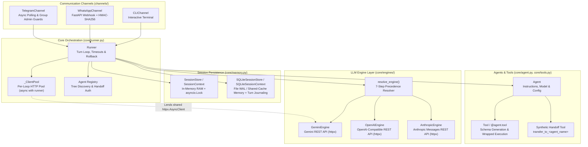
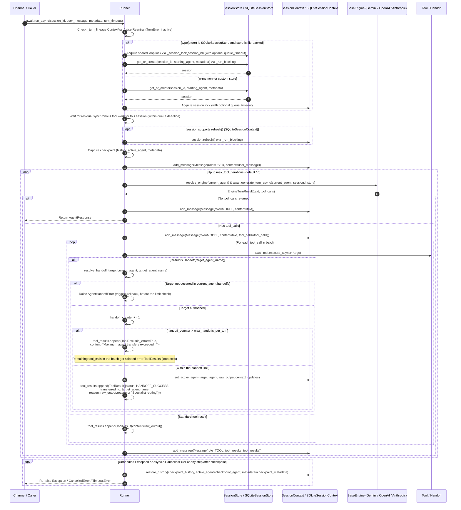

🌐 Language: **English** | [Español](es/ARCHITECTURE.md)

# Architecture Overview — `chatflow-agent`

`chatflow-agent` is an async-first, multi-provider Python framework for building conversational AI systems with multi-agent handoffs, tool schema generation and wrapped tool execution, transactional session persistence, and production-hardened messaging channels.

This document describes the internal architecture, runtime invariants, concurrency model, and subsystem boundaries implemented in `src/chatflow_agent/`.

---

## 1. Architectural Principles

1. **Async-First Execution with Event-Loop Protection:** Core evaluation (`Runner.run_async`, engines, tools, and channels) runs natively on `asyncio`. Blocking disk I/O is offloaded to a dedicated worker thread pool only for an exact, file-backed `SQLiteSessionStore` instance (`type(store) is SQLiteSessionStore`); subclasses and custom stores are not automatically offloaded.
2. **Multi-Engine Agnosticism (Zero Lock-In):** Each `Agent` resolves its LLM engine independently. A triage agent running on Gemini REST can hand off mid-conversation to a specialist running on Claude (Anthropic REST), GPT/o-series (OpenAI), Grok (xAI), DeepSeek, Groq, or a local model via Ollama/vLLM.
3. **Turn Checkpoints and Conflict-Aware Rollback:** Before evaluating a turn, `Runner` snapshots the session's message history, active agent, and metadata. If an unhandled exception or `asyncio.CancelledError` occurs mid-turn, `Runner` requests rollback through `session.restore_history(...)`. In SQLite, restoration is complete when no concurrent external writer changed the session; otherwise the conflict-aware rules in section 4.3 preserve external changes and may produce a partial restoration.
4. **Per-Session Serialization & Deadlock Prevention:** Concurrent messages for the same `session_id` serialize in arrival order through a per-session `asyncio.Lock` within one store instance and running event loop. This is not a cross-process or cross-event-loop lock. Inline re-entry into the same session from inside a tool is detected immediately via `ContextVar` lineage tracking and rejected with `ReentrantTurnError`.
5. **Secure Boundaries Where They Apply:** `WhatsAppChannel` enforces fail-closed signature validation by default, constant-time token comparisons, payload size limits, atomic message deduplication, and privacy-preserving phone masking. Provider engines separately enforce credential isolation; these WhatsApp-specific guarantees do not apply automatically to every channel.

---

## 2. System Component Diagram



---

## 3. Turn Lifecycle & Execution Flow

The following sequence diagram illustrates the exact execution path of `Runner.run_async(session_id, user_message)` from entry to completion or rollback:



---

## 4. Core Subsystems Deep Dive

### 4.1. Agents & Capability Registration (`core/agent.py`)

[`Agent`](../src/chatflow_agent/core/agent.py) is a lightweight, composable entity representing a persona or specialist skill:

- **Configuration Parameters:** `name` (required and validated as non-empty), `instructions` (a string or zero-argument callable), `model` (defaults to `"gemini-2.5-flash"`), `tools`, `handoffs`, `provider`, `base_url`, `api_key`, and `engine`. The constructor does not expose `temperature` or `timeout` parameters and does not validate `model` as non-empty.
- **Tool Registration:** Tools can be passed to `Agent(tools=[...])` as [`Tool`](../src/chatflow_agent/core/tools.py) instances or plain Python functions (automatically wrapped in `Tool(fn)`), or registered declaratively via the `@agent.tool` decorator (`@agent.tool` or `@agent.tool(name="...", description="...")`).
- **Synthetic Handoff Tools (`get_all_tools`, `_create_handoff_tool`):** For every target [`Agent`](../src/chatflow_agent/core/agent.py) listed in `agent.handoffs`, the agent synthesizes a dedicated [`Tool`](../src/chatflow_agent/core/tools.py) named `transfer_to_<sanitized_target_name>` (with deterministic disambiguation on collisions). Invoking it returns a [`Handoff`](../src/chatflow_agent/types.py) value without mutating shared state.

### 4.2. Orchestration, Concurrency & Turn Lifecycle (`core/runner.py`)

[`Runner`](../src/chatflow_agent/core/runner.py) coordinates sessions, engines, tool execution, and multi-agent transitions:

- **Agent Graph Registration & Integrity (`_register_agent_tree`, `_resolve_handoff_target`):**
  - At initialization, `Runner` traverses and registers the graph reachable from `starting_agent`. A handoff target added later is authorized only when it is declared on the current agent; its graph is validated and registered when that handoff is resolved.
  - **Duplicate Name Rejection:** If two distinct reachable `Agent` instances share a `name`, registration or late handoff resolution raises `ValueError` without partially updating the registry.
  - **Manual Registry Protection:** Names registered through `runner.register_agent(agent)` are tracked in `_manual_agent_names` and cannot be silently replaced by a late handoff mutation.
- **Reentrancy Detection (`_turn_lineage`) & Deferred Turns (`spawn_turn`):**
  - `Runner` tracks active `(session_store, session_id)` pairs in the `_turn_lineage` `ContextVar`.
  - If a tool or callback invokes `await runner.run_async(session_id, ...)` for a session that is already executing in the current call chain, `Runner` raises [`ReentrantTurnError`](../src/chatflow_agent/exceptions.py) immediately rather than deadlocking on `session.lock`.
  - Tools that need to schedule a follow-up turn for the same session can call `runner.spawn_turn(session_id, user_message, metadata=...)`. `spawn_turn` resets `_turn_lineage` and `_dispatch_limits` in a copied context and schedules an independent `asyncio.Task` (tracked in `runner._spawned_turns`) that waits for the current turn to release `session.lock`.
- **Queue Timeout vs. Turn Execution Timeout:**
  - `Runner` distinguishes between waiting for a busy session and executing the turn itself:
    - **Queue Timeout (`_SessionWaitTimeout`):** Caps how long a caller waits to acquire the session lock and, after acquiring it, for residual synchronous tool work from a prior cancelled/timed-out turn (configured via channel `_dispatch_limits`).
    - **Turn Timeout (`_TurnTimeout`):** Caps the execution of `_execute_turn()` once `session.lock` is held (configured via `run_async(..., turn_timeout=...)` or channel `llm_timeout_seconds`). Both raise `TimeoutError` on expiration.
- **Synchronous Tool Cancellation Barrier:** Synchronous tools run in worker threads and cannot be forcibly stopped by cancelling their awaiting task. `Runner` tracks their real lifetime per `(session_store, session_id)` and prevents the next turn for that session from starting until residual synchronous work finishes. This barrier is independent of the session's `asyncio.Lock` and does not serialize different sessions.
- **Handoff Verification & Loop Guards (`_resolve_handoff_target`):**
  - When a tool returns a [`Handoff`](../src/chatflow_agent/types.py), `Runner` verifies that its target is currently declared in `current_agent.handoffs` and matches the authorized instance. Unauthorized or unknown targets raise [`AgentHandoffError`](../src/chatflow_agent/exceptions.py).
  - If a turn exceeds `max_handoffs_per_turn` (default `5`), `Runner` records an error [`ToolResult`](../src/chatflow_agent/types.py), **skips any remaining tool calls in that batch** while preserving call/result parity, and lets the current agent produce a final response.
  - If `max_tool_iterations` (default `10`) is exhausted without a final text response, `Runner` appends a fallback `Role.MODEL` message to the session history and returns it in [`AgentResponse`](../src/chatflow_agent/types.py).

### 4.3. Checkpoints, Failure Atomicity & Rollback (`core/runner.py`, `core/memory.py`)

`Runner` checkpoints every turn and attempts rollback on failure as follows:

1. **Pre-Turn Refresh & Checkpoint:** After acquiring `session.lock` (and calling `session.refresh()` on `SQLiteSessionContext`), `Runner._execute_turn()` captures:
   - `checkpoint_history = list(session.history)`
   - `checkpoint_agent = session.active_agent`
   - `checkpoint_metadata = copy.deepcopy(session.metadata)`
2. **Automatic Rollback via `session.restore_history(...)`:**
   - If an unhandled `Exception` (such as [`ProviderError`](../src/chatflow_agent/exceptions.py), [`AgentHandoffError`](../src/chatflow_agent/exceptions.py), or [`SessionDeletedError`](../src/chatflow_agent/exceptions.py)) or `asyncio.CancelledError` leaves the turn body, `_execute_turn()` catches it, calls `Runner._roll_back()`, and then re-raises it. When the configured turn timeout expires, `_within()` cancels `_execute_turn()`; that internal `CancelledError` path performs the rollback before `_within()` raises `TimeoutError` to the caller.
     ```python
     session.restore_history(
         checkpoint_history,
         active_agent=checkpoint_agent,
         metadata=checkpoint_metadata,
     )
     ```
   - Rollback executes with `must_run=True` inside `_run_blocking()`, shielding the restoration until completion even if the awaiting task is cancelled mid-rollback. If `restore_history` itself fails, its exception is logged and raised so a turn is never reported as rolled back when its stored state remains dirty.
   - Tool-call failures are normally caught inside the turn, logged with a trace ID, and returned to the model as error `ToolResult` values. Rollback restores framework-managed session state, but it cannot undo external side effects already performed by a tool.
   - *(Note: `SessionContext.rollback_to(checkpoint_len)` and `SQLiteSessionContext.rollback_to(checkpoint_len)` also exist on the session classes to truncate message history by length, but `Runner._roll_back()` calls `session.restore_history(...)` to request restoration of messages pruned by `max_turns`, `active_agent`, and `metadata` together. `SessionContext` replaces the snapshot; SQLite follows the complete or conflict-aware paths below.)*
3. **Turn Journaling in `SQLiteSessionContext.restore_history()`:**
   - During a turn, `SQLiteSessionContext.add_message()` records newly inserted database row IDs in `_turn_inserted_ids` and any rows pruned by `max_turns` in `_turn_pruned_rows`.
   - Inside a `BEGIN IMMEDIATE` transaction, `restore_history()` checks whether another writer modified the session concurrently:
     - **No concurrent external writes:** Replaces the session's rows with `checkpoint_history` and restores `active_agent` and `metadata`.
     - **Concurrent external writes detected:** Deletes the turn's `_turn_inserted_ids` that are still present. It re-inserts `_turn_pruned_rows` with their original row IDs (their `created_at` is regenerated by `DEFAULT CURRENT_TIMESTAMP`, not restored) only when `removed_by_others` is empty; if another writer removed checkpoint rows, it leaves those pruned rows unrestored. It restores the active agent or metadata only when the current stored value still equals this turn's last written value, and it does not recreate a session deleted by another writer. This conflict-aware path prioritizes preserving external changes rather than guaranteeing a complete checkpoint restoration.

### 4.4. Multi-Provider Engine Resolution & Execution (`core/engines/`)

All LLM integrations implement [`BaseEngine`](../src/chatflow_agent/core/engines/base.py) (`async def generate_turn_async(agent, history) -> EngineTurnResult`).

#### 7-Step Engine Resolution Precedence (`resolve_engine`)

When `Runner` evaluates a turn for `current_agent`, [`resolve_engine()`](../src/chatflow_agent/core/engines/factory.py) selects the engine using the following strict order:

1. **Explicit Agent Engine (`agent.engine`):** Uses the `BaseEngine` instance attached directly to the agent.
2. **Explicit Provider Name (`agent.provider`):**
   - `"gemini"`, `"google"` → [`GeminiEngine`](../src/chatflow_agent/core/engines/gemini.py)
   - `"openai"`, `"grok"`, `"xai"`, `"deepseek"`, `"groq"`, `"ollama"`, `"gemma"` → [`OpenAIEngine`](../src/chatflow_agent/core/engines/openai_compatible.py)
   - `"anthropic"`, `"claude"` → [`AnthropicEngine`](../src/chatflow_agent/core/engines/anthropic.py)
3. **Custom Base URL (`agent.base_url`):** When `provider` is omitted but `base_url` is set, routes to [`OpenAIEngine`](../src/chatflow_agent/core/engines/openai_compatible.py).
4. **Explicit Runner Default Engine (`Runner(engine=...)` with `prefer_default_engine=True`):** Overrides model-prefix heuristics when the agent did not specify an explicit `engine`, `provider`, or `base_url`.
5. **Model Prefix Heuristics (`agent.model`):**
   - literal prefix `claude-` → [`AnthropicEngine`](../src/chatflow_agent/core/engines/anthropic.py)
   - `gpt-*`, `o1*`, `o3*`, `chatgpt-*`, `text-embedding-*`, `dall-e*` → [`OpenAIEngine`](../src/chatflow_agent/core/engines/openai_compatible.py) (`provider="openai"`)
   - `grok*` → [`OpenAIEngine`](../src/chatflow_agent/core/engines/openai_compatible.py) (`provider="grok"`)
   - literal prefix `deepseek-` → [`OpenAIEngine`](../src/chatflow_agent/core/engines/openai_compatible.py) (`provider="deepseek"`)
   - `gemma*`, `llama*`, `mistral*`, `qwen*`, `phi*` → [`OpenAIEngine`](../src/chatflow_agent/core/engines/openai_compatible.py) (`provider="ollama"`)
6. **Fallback Engine:** Uses `default_engine` when one was supplied and no earlier rule matched. If `agent.api_key` is set and `default_engine` is a plain [`GeminiEngine`](../src/chatflow_agent/core/engines/gemini.py) (such as the one `Runner` builds when no `engine` is passed), a copy of it that uses the agent's key is used instead of the `Runner` or environment credentials; the provider stays Gemini. Any other `default_engine` (a subclass or a custom engine) is used unchanged.
7. **Ultimate Default:** Instantiates [`GeminiEngine`](../src/chatflow_agent/core/engines/gemini.py).

#### Engine Implementations & Cross-Provider Normalization

- **[`GeminiEngine`](../src/chatflow_agent/core/engines/gemini.py):** Calls the Google Gemini REST API (`https://generativelanguage.googleapis.com/v1beta/models/{model}:generateContent`) directly via `httpx.AsyncClient` without requiring the `google-genai` SDK. Supports `GEMINI_API_KEY` / `GOOGLE_API_KEY`, coalesces consecutive user/tool turns as required by Gemini `Content` rules, and preserves `thoughtSignature` metadata on function call parts.
- **[`OpenAIEngine`](../src/chatflow_agent/core/engines/openai_compatible.py):** Calls OpenAI-compatible `/chat/completions` REST endpoints directly via `httpx.AsyncClient` without requiring the `openai` SDK package. Supports OpenAI (`OPENAI_API_KEY`), xAI Grok (`XAI_API_KEY`), DeepSeek (`DEEPSEEK_API_KEY`), Groq (`GROQ_API_KEY`), Ollama (`http://localhost:11434/v1`), vLLM, and custom OpenAI-compatible endpoints. Enforces strict credential isolation via `_resolve_api_key()` and `_is_official_endpoint()`: environment API keys are sent only to their provider's official HTTPS endpoint and never leaked to local loopback servers or custom third-party `base_url` endpoints.
- **[`AnthropicEngine`](../src/chatflow_agent/core/engines/anthropic.py):** Calls the Anthropic Messages REST API (`https://api.anthropic.com/v1/messages`, `anthropic-version: 2023-06-01`) directly via `httpx.AsyncClient` using `ANTHROPIC_API_KEY`.
- **System Prompt Normalization (`system_prompt`):** For providers with a top-level system field (`GeminiEngine` and `AnthropicEngine`), [`system_prompt()`](../src/chatflow_agent/core/engines/base.py) receives the resolved value of `agent.get_instructions()` and concatenates it with any `Role.SYSTEM` messages present in the session history.
- **Deterministic Tool-Call ID Normalization (`replacement_tool_call_id`):** When a conversation hands off between providers with incompatible tool-call ID rules (e.g., OpenAI's 40-character limit or Anthropic's `^[a-zA-Z0-9_-]{1,64}$` pattern), [`replacement_tool_call_id()`](../src/chatflow_agent/core/engines/base.py) maps non-conforming IDs deterministically to `"call_" + sha256(id)[:24]` in the outbound request while keeping the original ID intact in `session.history`.
- **Retries & Rate-Limit Backoff:** All three engines retry transient failures (`429`, `500`, `502`, `503`, `504`, plus `529` on Anthropic) and connection-establishment failures up to `max_retries=3`. Delays use exponential backoff plus jitter and honor numeric `Retry-After` values; Gemini also accepts HTTP-date values. Delays are capped by each engine's `max_delay` (default `10.0` seconds). Other request/read/write failures are not automatically retried because the request may have reached the provider. Non-retryable errors or exhausted retries raise [`ProviderError`](../src/chatflow_agent/exceptions.py).

### 4.5. Tool Introspection, Schema Generation & Validation (`core/tools.py`)

[`Tool`](../src/chatflow_agent/core/tools.py) bridges Python callables and LLM function-calling declarations:

- **Signature Introspection:** Resolves postponed annotations (`from __future__ import annotations`) via `inspect.signature(fn, eval_str=True)`. If resolution fails, it logs a warning, retains the unresolved signature, and uses the compatibility `STRING` fallback. `typing.Annotated[T, ...]` metadata is ignored for schema mapping; `functools.partial` and callable instances are supported by normal signature inspection and async-callable detection. The callable's docstring becomes the tool description, but parameter descriptions are not parsed from it.
- **Supported Type Annotations:**
  - Primitives: `str`, `int`, `float`, `bool`
  - Collections: `list[T]`, `tuple[T, ...]`, homogeneous fixed tuples such as `tuple[float, float]`, `set[T]`, `frozenset[T]`, `Sequence[T]`, `dict[K, V]`, and `Mapping[K, V]`. Unparameterized collections use `STRING` array items; heterogeneous tuples omit `items` and emit a warning.
  - Unions & Optionals: `T | None` (`nullable: True`) and multi-type `Union[A, B]` (`anyOf`)
  - Unknown non-union annotations (including `Literal`, `Enum`, `TypedDict`, dataclasses, and Pydantic models) preserve backward compatibility by mapping to `STRING`; they are not expanded into structured schemas.
- **Schema Validation & Compatibility Fallbacks (`ToolSchemaError`):** If a union contains an unsupported member (for example `int | Callable`), [`Tool`](../src/chatflow_agent/core/tools.py) raises [`ToolSchemaError`](../src/chatflow_agent/exceptions.py) at registration time because that union cannot be represented safely. Unknown non-union and unresolved annotations retain the `STRING` fallback.
- **Dual Schema Output:**
  - `to_gemini_declaration()`: Produces OpenAPI 3.0 declarations with uppercase type names (`OBJECT`, `STRING`, `INTEGER`, `NUMBER`, `BOOLEAN`, `ARRAY`).
  - `to_openai_parameters()`: Converts the canonical schema into standard JSON Schema with lowercase type names, converting `nullable: True` into type unions or `anyOf` branches. `AnthropicEngine` reuses this JSON Schema conversion via `to_anthropic_tool()`.
- **Runtime Execution & Validation (`Tool.execute_async`, `Tool.execute`, `Tool.__call__`):** Runtime argument validation is enabled by default via `validate_args=True`. Before the tool is invoked, it validates required arguments, rejects unexpected arguments when `**kwargs` is absent, coerces numeric strings to numbers (while rejecting booleans, NaN, and infinity), coerces numbers to strings for `str` parameters (while rejecting booleans and collections), supports parameters with leading underscores or named `model_config`, and preserves the backward-compatible schema/validation fallback (`STRING` / `Any`) for annotations not expressible in schema. When arguments fail validation, it raises [`ToolArgumentValidationError`](../src/chatflow_agent/exceptions.py) with redacted inputs, without invoking the underlying function or dispatching a worker thread. Omitted parameters preserve native Python default binding and mutable default semantics. With `validate_args=False`, arguments are passed through unchanged and ordinary Python call binding still rejects missing or unexpected arguments. `Tool.execute_async()` invokes `async def` callables directly and dispatches synchronous callables to a worker thread. The return value is not serialized. In `Tool.execute_async()` and `Tool.execute()`, ordinary invocation or execution exceptions derived from `Exception` are wrapped in [`ToolExecutionError`](../src/chatflow_agent/exceptions.py); `Tool.__call__` calls the function directly and does not add that wrapper. `asyncio.CancelledError`, `KeyboardInterrupt`, and `SystemExit` derive directly from `BaseException` and propagate without that wrapper.

### 4.6. Session Stores, SQLite Concurrency & Worker Offloading (`core/memory.py`)

`chatflow-agent` provides two session storage backends sharing the [`SessionContext`](../src/chatflow_agent/core/memory.py) interface:

| Feature | `SessionStore` / `SessionContext` | `SQLiteSessionStore` / `SQLiteSessionContext` |
| :--- | :--- | :--- |
| **Storage Medium** | Ephemeral in-memory RAM | SQLite database (file on disk or `:memory:`) |
| **Tables** | Python dicts (`_sessions`, `_processed_ids`) | `chatflow_sessions`, `chatflow_messages`, `chatflow_processed_messages` |
| **SQLite Pragmas** | N/A | All connections: `busy_timeout=10000` ms. File-backed only: `journal_mode=WAL`, `synchronous=NORMAL`. Shared-cache memory does not enable WAL. The implementation does not set `foreign_keys=ON`. |
| **Event-Loop I/O Model** | Direct in-memory execution on event loop | Exact file-backed `SQLiteSessionStore` instance only: offloaded to 4-thread `ThreadPoolExecutor` (`_run_blocking`)<br>Subclasses, custom stores, and `:memory:`: not automatically offloaded; `:memory:` uses a shared-cache keeper connection with `threading.RLock` on the event loop |
| **Lock Coordination** | Per-context `asyncio.Lock` | Shared weak lock registry (`_SessionLockRegistry`) per `(event_loop, session_id)` + `session.refresh()` |
| **Rollback Mechanism** | Snapshot replacement via `restore_history()` | During a journaled turn, conflict-aware rollback in `restore_history()` uses `BEGIN IMMEDIATE`; ordinary restores replace the snapshot transactionally |

- **Lock Scope:** Store-managed locks serialize a session only within one store instance and running event loop. They do not serialize separate store instances, processes, or threads with different event loops; SQLite transactions still protect individual database operations in those cases.
- **Non-Blocking File I/O (`_offloads_blocking_io` & `_run_blocking`):**
  - Only an exact, file-backed `SQLiteSessionStore` instance (`type(store) is SQLiteSessionStore`) lazily creates a 4-worker `ThreadPoolExecutor` (`thread_name_prefix="chatflow-sqlite"`). Subclasses and custom stores are not automatically offloaded.
  - For that exact-store case, `Runner` wraps store and session calls in `_run_blocking()`. If the awaiting task is cancelled while a worker-thread call is already running, `_run_blocking()` shields (`asyncio.shield`) and awaits the worker until the SQLite operation finishes so its effects are recorded in the rollback journal before re-raising `CancelledError`.
- **Concurrent Session Deletion (`SessionDeletedError`):**
  - This guard is specific to [`SQLiteSessionStore`](../src/chatflow_agent/core/memory.py) and `SQLiteSessionContext`. If `store.delete(session_id)` or `store.clear()` removes a SQLite session while a turn is running, the next `session.add_message()` inserts the message and updates the parent session in the same transaction. A zero-row parent update raises [`SessionDeletedError`](../src/chatflow_agent/exceptions.py), causing that transaction to roll back instead of storing orphaned messages or resurrecting the deleted session. The in-memory `SessionStore` does not provide this deletion guard.
- **Message Deduplication:** `SessionStore` protects its monotonic-time TTL map with a private thread lock. `SQLiteSessionStore.record_processed_message()` uses one atomic SQLite upsert for check-and-record, then purges expired IDs in the same connection transaction. Each store's `dedup_ttl_hours` controls expiration.

### 4.7. Channels & Webhook Security (`channels/`)

The provided channels inherit from [`BaseChannel`](../src/chatflow_agent/channels/base.py) (`attach(runner)`, `dispatch(session_id, message, metadata)`, `dispatch_async(session_id, message, metadata)`, and abstract `run(**kwargs)`) and raise [`ChannelError`](../src/chatflow_agent/channels/base.py) if dispatched before a `Runner` is attached. Telegram and WhatsApp use `split_message(text, max_len=4096)` to chunk long outbound replies along paragraph/line/sentence/word boundaries:

- **[`CLIChannel`](../src/chatflow_agent/channels/cli.py):** Interactive terminal channel (`run()` and `send_message()`). Supports `/reset` to clear conversation memory, displays `[Transferred to <agent>]` handoff indicators, and exits cleanly on `exit`/`quit`/`salir` or `EOFError`/`KeyboardInterrupt`.
- **[`TelegramChannel`](../src/chatflow_agent/channels/telegram.py):**
  - **Async Polling (`run()`):** Built on `python-telegram-bot` (`chatflow-agent[telegram]`, raising [`DependencyError`](../src/chatflow_agent/exceptions.py) if not installed). Handles `/start`, `/reset`, and text updates with `ChatAction.TYPING` indicators and 4,096-character message chunking.
  - **Group Chat Reset Protection:** Restricts `/reset` in `group` and `supergroup` chats to group `creator` and `administrator` members via `get_chat_member`, and offloads `get_session` / `clear_history` via `_run_blocking()` only when backed by an exact, file-backed `SQLiteSessionStore` instance (`type(store) is SQLiteSessionStore`).
- **[`WhatsAppChannel`](../src/chatflow_agent/channels/whatsapp.py):**
  - **Fail-Closed Signature & Token Verification:** Built on FastAPI and Uvicorn (`chatflow-agent[whatsapp]`, with OpenAPI `/docs` and `/redoc` disabled by default via `enable_docs=False`). Requires `app_secret` when `verify_signature=True` (the default, raising `ValueError` at initialization if omitted). Validates `hub.verify_token` on `GET /webhook` and `X-Hub-Signature-256` (`sha256=...`) on `POST /webhook` using constant-time `hmac.compare_digest`.
  - **Payload Size Guard:** Validates `Content-Length` before buffering the body (returning HTTP `411` if missing and HTTP `413` if either `Content-Length` or the raw body exceeds `max_body_size=1_048_576` bytes / 1 MiB).
  - **Atomic Deduplication & Background Dispatch:** Atomically records each incoming `wamid` via `store.record_processed_message(wamid)` before enqueuing `BackgroundTasks`, returning an immediate HTTP `200 OK` acknowledgement. This store call is offloaded via `_run_blocking()` only for an exact, file-backed `SQLiteSessionStore` instance (`type(store) is SQLiteSessionStore`); subclasses and custom stores are not automatically offloaded. This is at-most-once admission: a process crash after recording but before/during background processing can leave the message acknowledged but unprocessed. The channel enforces `queue_timeout_seconds` (default `120.0`) and `llm_timeout_seconds` (default `120.0`) via `_dispatch_limits` plus a `_DispatchBackstopTimeout` (`queue + turn + 1.0s`), sending `fallback_message` on timeout or error while masking phone numbers (`_mask_phone`) in logs.
  - **Resilient Outbound Delivery:** Chunks replies with `split_message(..., max_len=4096)` and retries HTTP `429` (honoring `Retry-After`) and connection errors (`ConnectError`, `ConnectTimeout`) with exponential backoff + jitter up to `max_outbound_retries=3` (without retrying `ReadTimeout`/`WriteTimeout` to avoid duplicate messages), while detecting 24-hour window expiration (Meta error code `131047`, triggering `on_24h_window_expired`).

### 4.8. Resource Lifecycle & Cleanup

- **Runner Connection Pooling (`async with runner:`):**
  - Entering `async with runner:` opens a reference-counted [`_ClientPool`](../src/chatflow_agent/core/engines/gemini.py) scoped to the running event loop.
  - While open, `Runner` lends this pool via the `_lent_pool` `ContextVar` to `GeminiEngine` turns that do not have a custom `http_client`, reusing TCP/TLS connections across turns.
  - Exiting the outermost `async with runner:` block on that loop calls `pool.stop_lending()` and `await pool.aclose()`, waiting for any in-flight requests to finish before closing the underlying `httpx.AsyncClient`.
- **Synchronous Wrapper (`Runner.run()`):**
  - Runs a single turn on its own event loop inside an `async with runner:` scope.
  - Before closing the connection pool scope, `_run_in_own_loop()` cancels and awaits any pending background tasks created on that loop (`_cancel_other_tasks`) so no task attempts to use the pooled client after closure.
  - Calling `Runner.run()` from inside an already running event loop raises `RuntimeError` immediately.
- **SQLite Store Closure (`SQLiteSessionStore.close()`):**
  - `store.close()` (or exiting `with SQLiteSessionStore(...) as store:`) is idempotent: it shuts down the worker `ThreadPoolExecutor` (`wait=False`) and closes the `:memory:` keeper connection. Subsequent store/context operations routed through it raise `RuntimeError` indicating that the store is closed.
- **Channel Scope Integration:**
  - `WhatsAppChannel` wraps its FastAPI `lifespan_context` (`_with_runner_scope`) in the attached runner's `async with runner:` scope so all webhook turns and startup/shutdown handlers reuse pooled connections.
  - `TelegramChannel.run()` enters `async with runner:` inside `post_init` and closes it in `post_shutdown` (or in `finish_after_polling` if interrupted by a signal before `post_shutdown` completes).

---

## 5. Exception Hierarchy (`exceptions.py`, `channels/base.py`)

All custom framework errors inherit from [`ChatFlowError`](../src/chatflow_agent/exceptions.py) and are exported at the top level of `chatflow_agent`:

```text
Exception
 └── ChatFlowError
      ├── ProviderError             (raised when communication with an LLM provider fails)
      ├── DependencyError           (.feature, .extra_package; raised when an optional extra is missing)
      ├── ToolExecutionError        (.tool_name, .original_error; raised when a tool fails at runtime)
      ├── ToolSchemaError           (raised at tool registration for an unrepresentable union schema)
      ├── AgentHandoffError         (raised on unauthorized, unknown, or mismatched handoff targets)
      ├── ReentrantTurnError        (also subclasses RuntimeError; raised on same-session inline re-entry)
      ├── SessionDeletedError       (SQLite only: raised when a stored session is deleted concurrently mid-turn)
      └── ChannelError              (channels/base.py; raised when a channel operation fails or has no Runner attached)
```

---

## 6. Package Layout (`src/chatflow_agent/`)

```text
src/chatflow_agent/
├── __init__.py                 # Public API exports (__all__)
├── memory.py                   # Public compatibility re-exports for session-store classes
├── types.py                    # Domain models: Role, Message, ToolCall, ToolResult, Handoff, AgentResponse
├── exceptions.py               # Exception hierarchy rooted at ChatFlowError
├── core/
│   ├── __init__.py
│   ├── agent.py                # Agent definition, @agent.tool decorator, synthetic handoff tools
│   ├── engine.py               # Backward-compatible engine re-exports
│   ├── runner.py               # Runner orchestration, concurrency locks, timeouts, rollback, connection pooling
│   ├── tools.py                # Tool signature introspection, schema generation, wrapped execution
│   ├── memory.py               # SessionContext, SessionStore, SQLiteSessionContext, SQLiteSessionStore, worker pool
│   └── engines/
│       ├── __init__.py
│       ├── base.py             # BaseEngine ABC, EngineTurnResult, system_prompt(), replacement_tool_call_id()
│       ├── factory.py          # 7-step resolve_engine() provider resolution
│       ├── gemini.py           # GeminiEngine (httpx REST client) & _ClientPool
│       ├── openai_compatible.py# OpenAIEngine (OpenAI, Grok, DeepSeek, Groq, Ollama, vLLM, custom base_url)
│       └── anthropic.py        # AnthropicEngine (httpx REST client for Anthropic Messages API)
└── channels/
    ├── __init__.py
    ├── base.py                 # BaseChannel abstract interface
    ├── cli.py                  # Interactive terminal channel
    ├── telegram.py             # Telegram Bot API channel (long polling)
    └── whatsapp.py             # Meta WhatsApp Cloud API channel (ASGI Webhook, HMAC-SHA256, deduplication)
```
