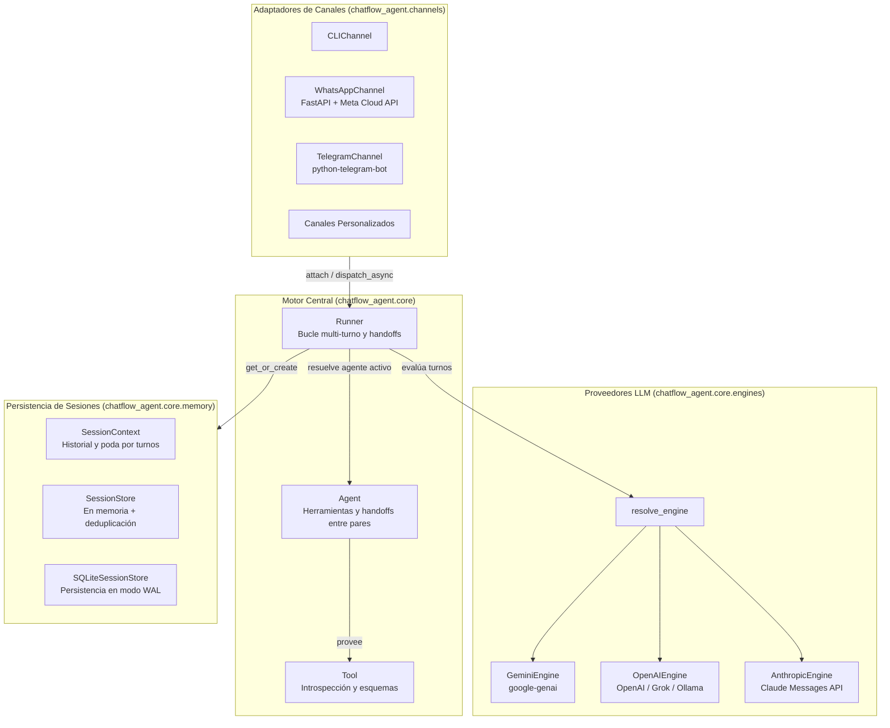

# Architecture Guide / Guía de Arquitectura

[English](#english) | [Español](#español)

---

## English

This document provides a technical walkthrough of **chatflow-agent**'s internal architecture, its component relationships, and execution lifecycles. It is designed to help contributors understand the codebase quickly and make confident modifications.

### 1. High-Level Architectural Diagram

```mermaid
graph TD
    subgraph Channels ["Channel Adapters (chatflow_agent.channels)"]
        CLI[CLIChannel]
        WA[WhatsAppChannel<br/>FastAPI + Meta Cloud API]
        TG[TelegramChannel<br/>python-telegram-bot]
        CustomChannel[Custom Channels]
    end

    subgraph Core ["Orchestration Engine (chatflow_agent.core)"]
        Runner[Runner<br/>Multi-turn loop & handoffs]
        Agent[Agent<br/>Tools & peer handoffs]
        Tool[Tool<br/>Introspection & schema]
    end

    subgraph Engines ["LLM Providers (chatflow_agent.core.engines)"]
        Factory[resolve_engine]
        Gemini[GeminiEngine<br/>Gemini REST API]
        OpenAI[OpenAIEngine<br/>OpenAI / Grok / Ollama]
        Anthropic[AnthropicEngine<br/>Claude Messages API]
    end

    subgraph Memory ["Session Persistence (chatflow_agent.core.memory)"]
        Context[SessionContext<br/>History & turn pruning]
        MemStore[SessionStore<br/>In-memory + dedup]
        SQLStore[SQLiteSessionStore<br/>Persistent WAL mode]
    end

    Channels -->|attach / dispatch_async| Runner
    Runner -->|get_or_create| Memory
    Runner -->|resolves active agent| Agent
    Agent -->|provides| Tool
    Runner -->|evaluates turns| Factory
    Factory --> Gemini
    Factory --> OpenAI
    Factory --> Anthropic
```

---

### 2. Core Components and Responsibilities

#### `Agent` (`src/chatflow_agent/core/agent.py`)
An autonomous specialist entity that defines:
- `name`: Unique identifier.
- `instructions`: System prompt (string or dynamic callable `Callable[[], str]`).
- `model`: Model name (e.g. `gemini-2.5-flash`, `gpt-4o-mini`, `gemma2:9b`).
- `tools`: Registered business functions introspected into schema declarations.
- `handoffs`: List of peer `Agent` instances. Calling `get_all_tools()` synthesizes dynamic routing functions (`transfer_to_<target_agent_name>`) that yield `Handoff` signals.

#### `Runner` (`src/chatflow_agent/core/runner.py`)
The execution coordinator. It:
1. Retrieves or instantiates the `SessionContext` for a given `session_id`.
2. Acquires the session's `asyncio.Lock` to serialize incoming user turns.
3. Appends the user message to history.
4. Loops up to `max_tool_iterations` (default: 10):
   - Resolves the appropriate `BaseEngine` for the active agent via `resolve_engine()`.
   - Calls the engine's `generate_turn_async()`.
   - If `tool_calls` are requested, executes them asynchronously (or via `asyncio.to_thread` if synchronous).
   - If a tool returns a `Handoff`, switches `session.active_agent` to the target peer.
   - Appends tool results and feeds them back to the active agent.
5. Returns the final text response wrapped in `AgentResponse`.
6. Enforces automatic history rollback (`session.rollback_to(checkpoint_len)`) if an unhandled exception occurs mid-turn.

#### `Engines` (`src/chatflow_agent/core/engines/`)
Abstracted behind `BaseEngine`:
- **`GeminiEngine`**: Asynchronous client via `httpx` calling the Gemini REST API (`generateContent`), with retry/backoff for 429, 500, 502, 503 and 504 responses and for connection failures.
- **`OpenAIEngine`**: Asynchronous HTTP client via `httpx` supporting OpenAI, xAI Grok, DeepSeek, Groq, and local Ollama/vLLM endpoints adhering to the `/chat/completions` standard.
- **`AnthropicEngine`**: Asynchronous client via `httpx` communicating with Anthropic's Messages API (`/v1/messages`).
- **`resolve_engine()`** (`factory.py`): Determines which engine executes a turn based on agent overrides (`agent.engine`), provider flags (`agent.provider`), base URLs, or model prefix heuristics.

#### `Tools` (`src/chatflow_agent/core/tools.py`)
Wraps any Python callable with automatic type introspection:
- Inspects parameters, type hints, docstrings, and default values.
- Converts Python type annotations to JSON Schema definitions compatible with LLM function declarations.
- Supports both async coroutines and sync functions (dispatched to worker threads via `asyncio.to_thread`).

#### `Memory & Session Stores` (`src/chatflow_agent/core/memory.py`)
- **`SessionContext`**: Maintains the conversation history (`list[Message]`) and active agent pointer for a single session. Applies **turn-based sliding window pruning** (`_prune_history`) ensuring that the retained window always starts with a `Role.USER` message, keeping tool call and result pairs atomic.
- **`SessionStore`**: In-memory registry with at-most-once deduplication (default 8-day TTL) and amortized memory cleanup.
- **`SQLiteSessionStore`**: Persistent database storage using Python's standard `sqlite3` in WAL mode (`PRAGMA journal_mode = WAL`) and `PRAGMA busy_timeout = 10000`, persisting turns, active specialist pointers, and processed message deduplication records.

#### `Channels` (`src/chatflow_agent/channels/`)
All channel adapters inherit from `BaseChannel`:
- **`WhatsAppChannel`**: Production-ready FastAPI webhook server. Enforces HMAC-SHA256 signature verification (`X-Hub-Signature-256`), checks `Content-Length` (1 MB default limit), immediately returns HTTP 200 to Meta, and dispatches processing to `BackgroundTasks` with safe outbound retries and anti-500 shields.
- **`TelegramChannel`**: Bot adapter using `python-telegram-bot` with polling, automatic message splitting for 4096-character limits, typing indicators, and group `/reset` admin restrictions.
- **`CLIChannel`**: Terminal-based chat loop for rapid local debugging.

---

### 3. Contributor Guide: What to Modify?

| Goal / Task | Primary Directory / Files |
| :--- | :--- |
| **Add a new Channel Adapter** (e.g. Discord, Slack, Twilio) | `src/chatflow_agent/channels/` Inherit from `BaseChannel` in `base.py`. |
| **Add or Update an LLM Provider Engine** | `src/chatflow_agent/core/engines/` Inherit from `BaseEngine`, register in `factory.py`. |
| **Improve Tool Introspection / Schemas** | `src/chatflow_agent/core/tools.py` |
| **Enhance Memory or Storage Backend** (e.g. Redis) | `src/chatflow_agent/core/memory.py` Implement `BaseSessionStore`. |
| **Adjust Swarm Execution / Handoff Logic** | `src/chatflow_agent/core/runner.py` and `agent.py` |
| **Add Core Types or Enums** | `src/chatflow_agent/types.py` |

---

## Español

Este documento describe la arquitectura interna de **chatflow-agent**, la relación entre sus componentes y el ciclo de vida de ejecución. Su propósito es ayudar a los colaboradores a comprender el código fuente de forma ágil y realizar modificaciones con seguridad.

### 1. Diagrama de Arquitectura

---

### 2. Componentes Principales y Responsabilidades

#### `Agent` (`src/chatflow_agent/core/agent.py`)
Entidad autónoma especialista que encapsula:
- `name`: Identificador único.
- `instructions`: Prompt de sistema (texto o función dinámica `Callable[[], str]`).
- `model`: Nombre del modelo (ej. `gemini-2.5-flash`, `gpt-4o-mini`, `gemma2:9b`).
- `tools`: Herramientas registradas introspeccionadas para el modelo.
- `handoffs`: Agentes pares. El método `get_all_tools()` sintetiza funciones de enrutamiento (`transfer_to_<nombre_agente>`) que retornan señales de tipo `Handoff`.

#### `Runner` (`src/chatflow_agent/core/runner.py`)
Coordinador del ciclo conversacional:
1. Recupera o instancia el `SessionContext` para un `session_id`.
2. Adquiere el `asyncio.Lock` de la sesión para serializar mensajes entrantes.
3. Añade el mensaje del usuario al historial.
4. Ejecuta un bucle de hasta `max_tool_iterations` (por defecto: 10):
   - Resuelve el motor `BaseEngine` correspondiente mediante `resolve_engine()`.
   - Llama a `generate_turn_async()`.
   - Si se solicitan `tool_calls`, las ejecuta asíncronamente (o en un hilo secundario con `asyncio.to_thread` si son síncronas).
   - Si una herramienta devuelve un `Handoff`, cambia `session.active_agent` al agente destino.
   - Añade los resultados de las herramientas y los envía de nuevo al modelo.
5. Retorna la respuesta final en un objeto `AgentResponse`.
6. Aplica reversión automática (`session.rollback_to(checkpoint_len)`) si ocurre un error no capturado durante el turno.

#### `Engines` (`src/chatflow_agent/core/engines/`)
Implementaciones que heredan de `BaseEngine`:
- **`GeminiEngine`**: Conecta con Google Gemini usando el SDK oficial `google-genai` con reintentos exponenciales.
- **`OpenAIEngine`**: Cliente HTTP asíncrono con `httpx` compatible con OpenAI, xAI Grok, DeepSeek, Groq y Ollama local.
- **`AnthropicEngine`**: Cliente HTTP asíncrono con `httpx` para la Messages API de Anthropic Claude.
- **`resolve_engine()`** (`factory.py`): Resuelve dinámicamente el motor a utilizar según la configuración del agente o prefijos del modelo.

#### `Tools` (`src/chatflow_agent/core/tools.py`)
Encapsula funciones de Python con introspección automática:
- Analiza parámetros, pistas de tipo (type hints), docstrings y valores por defecto.
- Mapea anotaciones de tipos de Python a esquemas JSON compatibles con function calling.
- Admite tanto corrutinas `async def` como funciones regulares `def`.

#### `Memory & Session Stores` (`src/chatflow_agent/core/memory.py`)
- **`SessionContext`**: Administra el historial de mensajes y el puntero al agente activo. Aplica **poda por turnos completos** (`_prune_history`), asegurando que la ventana conservada siempre comience con un mensaje `Role.USER`, manteniendo atómicos los pares de llamadas y resultados de herramientas.
- **`SessionStore`**: Almacén en memoria con deduplicación at-most-once (TTL por defecto: 8 días) y limpieza amortizada.
- **`SQLiteSessionStore`**: Base de datos SQLite persistente con modo WAL (`PRAGMA journal_mode = WAL`) y `PRAGMA busy_timeout = 10000`, guardando turnos, agente activo y registros de deduplicación.

#### `Channels` (`src/chatflow_agent/channels/`)
Adaptadores que heredan de `BaseChannel`:
- **`WhatsAppChannel`**: Servidor de webhooks FastAPI con verificación HMAC-SHA256 (`X-Hub-Signature-256`), límite de payload de 1 MB, respuesta inmediata HTTP 200 a Meta y despacho en segundo plano (`BackgroundTasks`).
- **`TelegramChannel`**: Adaptador para bots con `python-telegram-bot`, división de mensajes de más de 4.096 caracteres, acción de escritura y restricción de `/reset` para administradores en grupos.
- **`CLIChannel`**: Terminal interactiva para depuración rápida.

---

### 3. Guía para Colaboradores: ¿Qué Módulo Modificar?

| Objetivo o Tarea | Directorio / Archivos Principales |
| :--- | :--- |
| **Agregar un nuevo Conector de Canal** (ej. Discord, Slack, Twilio) | `src/chatflow_agent/channels/` Heredar de `BaseChannel` en `base.py`. |
| **Agregar o Actualizar un Proveedor de LLM** | `src/chatflow_agent/core/engines/` Heredar de `BaseEngine`, registrar en `factory.py`. |
| **Mejorar Tipado o Esquemas de Herramientas** | `src/chatflow_agent/core/tools.py` |
| **Incorporar un Nuevo Backend de Persistencia** (ej. Redis) | `src/chatflow_agent/core/memory.py` Implementar `BaseSessionStore`. |
| **Ajustar el Ciclo de Ejecución de Agentes o Handoffs** | `src/chatflow_agent/core/runner.py` y `agent.py` |
| **Modificar Tipos o Modelos de Dominio** | `src/chatflow_agent/types.py` |
