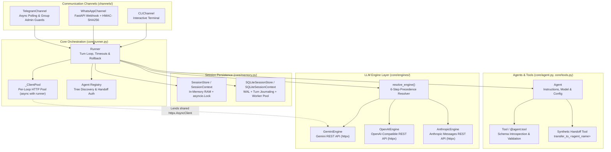
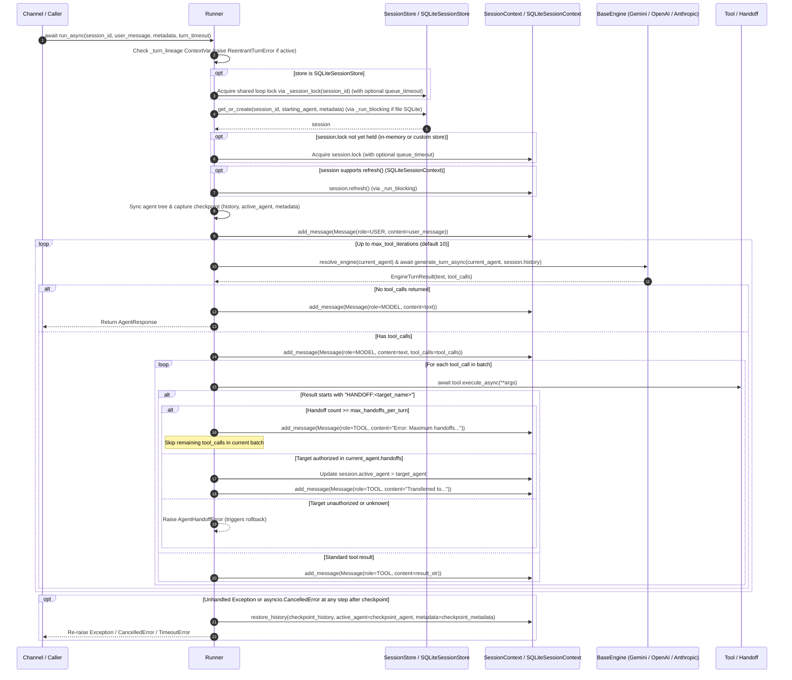

🌐 Language: **English** | [Español](es/ARCHITECTURE.md)

# Architecture Overview — `chatflow-agent`

`chatflow-agent` is an async-first, multi-provider Python framework for building conversational AI systems with multi-agent handoffs, strongly typed tool execution, transactional session persistence, and production-hardened messaging channels.

This document describes the internal architecture, runtime invariants, concurrency model, and subsystem boundaries implemented in `src/chatflow_agent/`.

---

## 1. Architectural Principles

1. **Async-First Execution with Event-Loop Protection:** Core evaluation (`Runner.run_async`, engines, tools, and channels) runs natively on `asyncio`. Blocking disk I/O in file-backed `SQLiteSessionStore` is offloaded to a dedicated worker thread pool so disk latency or SQLite lock waits never stall the event loop.
2. **Multi-Engine Agnosticism (Zero Lock-In):** Each `Agent` resolves its LLM engine independently. A triage agent running on Gemini REST can hand off mid-conversation to a specialist running on Claude (Anthropic REST), GPT/o-series (OpenAI), Grok (xAI), DeepSeek, Groq, or a local model via Ollama/vLLM.
3. **Failure-Atomic Turns:** Before evaluating a turn, `Runner` snapshots the session's message history, active agent, and metadata. If any unhandled exception or `asyncio.CancelledError` occurs mid-turn, `Runner` restores the session to its pre-turn checkpoint via `session.restore_history(...)`.
4. **Strict Per-Session Serialization & Deadlock Prevention:** Concurrent messages for the same `session_id` serialize in arrival order through a per-session `asyncio.Lock`. Inline re-entry into the same session from inside a tool is detected immediately via `ContextVar` lineage tracking and rejected with `ReentrantTurnError`.
5. **Secure-by-Default Boundaries:** Webhook and messaging channels enforce fail-closed signature validation (`verify_signature=True`), constant-time token comparisons (`hmac.compare_digest`), payload size limits (`max_body_size`), atomic message deduplication, privacy-preserving phone masking, and strict provider credential isolation.

---

## 2. System Component Diagram




---

## 3. Turn Lifecycle & Execution Flow

The following sequence diagram illustrates the exact execution path of `Runner.run_async(session_id, user_message)` from entry to completion or rollback:



---

## 4. Core Subsystems Deep Dive

### 4.1. Agents & Capability Registration (`core/agent.py`)

[`Agent`](../src/chatflow_agent/core/agent.py) is a lightweight, composable entity representing a persona or specialist skill:

- **Configuration Parameters:** `name` (required, non-empty string), `instructions` (system prompt), `model` (defaults to `"gemini-2.5-flash"`, validated non-empty), `provider`, `api_key`, `base_url`, `engine`, `temperature` (defaults to `0.2`), `timeout` (`float | None`), `tools`, and `handoffs`.
- **Tool Registration:** Tools can be passed to `Agent(tools=[...])` as [`Tool`](../src/chatflow_agent/core/tools.py) instances or plain Python functions (automatically wrapped in `Tool(fn)`), or registered declaratively via the `@agent.tool` decorator (`@agent.tool` or `@agent.tool(name="...", description="...")`).
- **Synthetic Handoff Tools (`_register_handoff`):** For every target [`Agent`](../src/chatflow_agent/core/agent.py) listed in `agent.handoffs`, the agent synthesizes a dedicated [`Tool`](../src/chatflow_agent/core/tools.py) named `transfer_to_<sanitized_target_name>`. When invoked by the LLM, this tool returns the sentinel string `f"HANDOFF:{target.name}"` without mutating shared state.
- **Safe Cloning (`agent.clone(**overrides)`):** Creates a copy of the agent with independent `tools` and `handoffs` lists while allowing callers to override any configuration attribute (`model`, `temperature`, `instructions`, `api_key`, etc.).

### 4.2. Orchestration, Concurrency & Turn Lifecycle (`core/runner.py`)

[`Runner`](../src/chatflow_agent/core/runner.py) coordinates sessions, engines, tool execution, and multi-agent transitions:

- **Agent Graph Discovery & Registry Integrity (`_discover_agents`, `_sync_agent_tree`):**
  - At initialization and at the start of every turn, `Runner` traverses the `handoffs` graph reachable from `starting_agent` and from the session's `active_agent`.
  - **Duplicate Name Rejection:** If two distinct `Agent` instances in the reachable graph share the same `name`, `Runner` raises `ValueError` immediately.
  - **Explicit Registry Protection:** Agents registered via `runner.register_agent(agent)` are stored in `_explicit_agents` and cannot be silently overwritten by late mutations to an agent's `handoffs` list.
- **Reentrancy Detection (`_turn_lineage`) & Deferred Turns (`spawn_turn`):**
  - `Runner` tracks active `(session_store, session_id)` pairs in the `_turn_lineage` `ContextVar`.
  - If a tool or callback invokes `await runner.run_async(session_id, ...)` for a session that is already executing in the current call chain, `Runner` raises [`ReentrantTurnError`](../src/chatflow_agent/exceptions.py) immediately rather than deadlocking on `session.lock`.
  - Tools that need to schedule a follow-up turn for the same session can call `runner.spawn_turn(session_id, user_message, metadata=...)`. `spawn_turn` resets `_turn_lineage` and `_dispatch_limits` in a copied context and schedules an independent `asyncio.Task` (tracked in `runner._spawned_turns`) that waits for the current turn to release `session.lock`.
- **Queue Timeout vs. Turn Execution Timeout:**
  - `Runner` distinguishes between waiting for a busy session and executing the turn itself:
    - **Queue Timeout (`_SessionWaitTimeout`):** Caps how long a caller waits to acquire `session.lock` (configured via channel `_dispatch_limits`).
    - **Turn Timeout (`_TurnTimeout`):** Caps the execution of `_execute_turn()` once `session.lock` is held (configured via `run_async(..., turn_timeout=...)` or channel `llm_timeout_seconds`). Both raise `TimeoutError` on expiration.
- **Handoff Verification & Loop Guards (`_resolve_handoff_target`):**
  - When a tool returns `"HANDOFF:<target_name>"`, `Runner` verifies that `<target_name>` is currently declared in `current_agent.handoffs` and matches the registered instance. Unauthorized or unknown targets raise [`AgentHandoffError`](../src/chatflow_agent/exceptions.py).
  - If a turn reaches `max_handoffs_per_turn` (default `5`), `Runner` records an error [`ToolResult`](../src/chatflow_agent/types.py) (`"Error: Maximum handoffs per turn (N) exceeded..."`), **skips any remaining tool calls in that batch**, and lets the current agent produce a final response.
  - If `max_tool_iterations` (default `10`) is exhausted without a final text response, `Runner` appends a fallback `Role.MODEL` message to the session history and returns it in [`AgentResponse`](../src/chatflow_agent/types.py).

### 4.3. Checkpoints, Failure Atomicity & Rollback (`core/runner.py`, `core/memory.py`)

Every turn in `Runner` is failure-atomic:

1. **Pre-Turn Refresh & Checkpoint:** After acquiring `session.lock` (and calling `session.refresh()` on `SQLiteSessionContext`), `Runner._execute_turn()` captures:
   - `checkpoint_history = list(session.history)`
   - `checkpoint_agent = session.active_agent`
   - `checkpoint_metadata = copy.deepcopy(session.metadata)`
2. **Automatic Rollback via `session.restore_history(...)`:**
   - If any unhandled `Exception` (such as [`ProviderError`](../src/chatflow_agent/exceptions.py), [`ToolExecutionError`](../src/chatflow_agent/exceptions.py), [`AgentHandoffError`](../src/chatflow_agent/exceptions.py), [`SessionDeletedError`](../src/chatflow_agent/exceptions.py), or `TimeoutError`) or `asyncio.CancelledError` escapes `_execute_turn()`, `Runner._roll_back()` invokes:
     ```python
     session.restore_history(
         checkpoint_history,
         active_agent=checkpoint_agent,
         metadata=checkpoint_metadata,
     )
     ```
   - Rollback executes with `must_run=True` inside `_run_blocking()`, shielding the restoration until completion even if the awaiting task is cancelled mid-rollback. If `restore_history` itself fails, its exception is logged and raised so a turn is never reported as rolled back when its stored state remains dirty.
   - *(Note: `SessionContext.rollback_to(checkpoint_len)` and `SQLiteSessionContext.rollback_to(checkpoint_len)` also exist on the session classes to truncate message history by length, but `Runner._roll_back()` calls `session.restore_history(...)` so that messages pruned by `max_turns`, `active_agent`, and `metadata` are all restored atomically.)*
3. **Turn Journaling in `SQLiteSessionContext.restore_history()`:**
   - During a turn, `SQLiteSessionContext.add_message()` records newly inserted database row IDs in `_turn_inserted_ids` and any rows pruned by `max_turns` in `_turn_pruned_rows`.
   - Inside a `BEGIN IMMEDIATE` transaction, `restore_history()` checks whether another writer modified the session concurrently:
     - **No concurrent external writes:** Replaces the session's rows with `checkpoint_history` and restores `active_agent` and `metadata`.
     - **Concurrent external writes detected:** Deletes only `_turn_inserted_ids` and re-inserts `_turn_pruned_rows` with their original row IDs and timestamps, reverting the failed turn's changes without clobbering messages committed by another store instance.

### 4.4. Multi-Provider Engine Resolution & Execution (`core/engines/`)

All LLM integrations implement [`BaseEngine`](../src/chatflow_agent/core/engines/base.py) (`async def generate_turn_async(agent, history) -> EngineTurnResult`).

#### 6-Step Engine Resolution Precedence (`resolve_engine`)

When `Runner` evaluates a turn for `current_agent`, [`resolve_engine()`](../src/chatflow_agent/core/engines/factory.py) selects the engine using the following strict order:

1. **Explicit Agent Engine (`agent.engine`):** Uses the `BaseEngine` instance attached directly to the agent.
2. **Explicit Provider Name (`agent.provider`):**
   - `"gemini"`, `"google"` → [`GeminiEngine`](../src/chatflow_agent/core/engines/gemini.py)
   - `"openai"`, `"grok"`, `"xai"`, `"deepseek"`, `"groq"`, `"ollama"`, `"vllm"`, `"openai_compatible"` → [`OpenAIEngine`](../src/chatflow_agent/core/engines/openai_compatible.py)
   - `"anthropic"`, `"claude"` → [`AnthropicEngine`](../src/chatflow_agent/core/engines/anthropic.py)
3. **Custom Base URL (`agent.base_url`):** When `provider` is omitted but `base_url` is set, routes to [`OpenAIEngine`](../src/chatflow_agent/core/engines/openai_compatible.py).
4. **Explicit Runner Default Engine (`Runner(engine=...)` with `prefer_default_engine=True`):** Overrides model-prefix heuristics when the agent did not specify an explicit `engine`, `provider`, or `base_url`.
5. **Model Prefix Heuristics (`agent.model`):**
   - `claude*` → [`AnthropicEngine`](../src/chatflow_agent/core/engines/anthropic.py)
   - `gpt-*`, `o1*`, `o3*`, `o4*`, `chatgpt-*` → [`OpenAIEngine`](../src/chatflow_agent/core/engines/openai_compatible.py) (`provider="openai"`)
   - `grok*` → [`OpenAIEngine`](../src/chatflow_agent/core/engines/openai_compatible.py) (`provider="grok"`)
   - `deepseek*` → [`OpenAIEngine`](../src/chatflow_agent/core/engines/openai_compatible.py) (`provider="deepseek"`)
   - `llama*`, `mixtral*`, `qwen*`, `mistral*`, `phi*`, `codellama*`, `gemma2*`, `gemma3*` → [`OpenAIEngine`](../src/chatflow_agent/core/engines/openai_compatible.py) (`provider="ollama"`)
   - `gemini*` → [`GeminiEngine`](../src/chatflow_agent/core/engines/gemini.py)
6. **Fallback Default:** Uses `default_engine` (when `prefer_default_engine=False`) or instantiates [`GeminiEngine`](../src/chatflow_agent/core/engines/gemini.py).

#### Engine Implementations & Cross-Provider Normalization

- **[`GeminiEngine`](../src/chatflow_agent/core/engines/gemini.py):** Calls the Google Gemini REST API (`https://generativelanguage.googleapis.com/v1beta/models/{model}:generateContent`) directly via `httpx.AsyncClient` without requiring the `google-genai` SDK. Supports `GEMINI_API_KEY` / `GOOGLE_API_KEY`, coalesces consecutive user/tool turns as required by Gemini `Content` rules, and preserves `thoughtSignature` metadata on function call parts.
- **[`OpenAIEngine`](../src/chatflow_agent/core/engines/openai_compatible.py):** Calls OpenAI-compatible `/chat/completions` REST endpoints directly via `httpx.AsyncClient` without requiring the `openai` SDK package. Supports OpenAI (`OPENAI_API_KEY`), xAI Grok (`XAI_API_KEY`), DeepSeek (`DEEPSEEK_API_KEY`), Groq (`GROQ_API_KEY`), Ollama (`http://localhost:11434/v1`), vLLM, and custom OpenAI-compatible endpoints. Enforces strict credential isolation via `_resolve_api_key()` and `_is_official_endpoint()`: environment API keys are sent only to their provider's official HTTPS endpoint and never leaked to local loopback servers or custom third-party `base_url` endpoints.
- **[`AnthropicEngine`](../src/chatflow_agent/core/engines/anthropic.py):** Calls the Anthropic Messages REST API (`https://api.anthropic.com/v1/messages`, `anthropic-version: 2023-06-01`) directly via `httpx.AsyncClient` using `ANTHROPIC_API_KEY`.
- **System Prompt Normalization (`system_prompt`):** For providers with a top-level system field (`GeminiEngine` and `AnthropicEngine`), [`system_prompt()`](../src/chatflow_agent/core/engines/base.py) concatenates `agent.instructions` followed by any `Role.SYSTEM` messages present in the session history.
- **Deterministic Tool-Call ID Normalization (`replacement_tool_call_id`):** When a conversation hands off between providers with incompatible tool-call ID rules (e.g., OpenAI's 40-character limit or Anthropic's `^[a-zA-Z0-9_-]{1,64}$` pattern), [`replacement_tool_call_id()`](../src/chatflow_agent/core/engines/base.py) maps non-conforming IDs deterministically to `"call_" + sha256(id)[:24]` in the outbound request while keeping the original ID intact in `session.history`.
- **Retries & Rate-Limit Backoff:** All three engines retry transient failures (`429`, `500`, `502`, `503`, `504`, plus `529` on Anthropic) and network transport errors up to `max_retries=3` using exponential backoff (`2**attempt` seconds) while honoring server `Retry-After` headers (capped at `60.0` seconds). Non-retryable errors or exhausted retries raise [`ProviderError`](../src/chatflow_agent/exceptions.py).

### 4.5. Tool Introspection, Schema Generation & Validation (`core/tools.py`)

[`Tool`](../src/chatflow_agent/core/tools.py) bridges Python callables and LLM function-calling declarations:

- **Signature Introspection:** Resolves postponed annotations (`from __future__ import annotations`) via `inspect.signature(fn, eval_str=True)`, unwraps `typing.Annotated[T, ...]` and `functools.partial`, and extracts parameter descriptions from Google, Sphinx, or NumPy docstrings.
- **Supported Type Annotations:**
  - Primitives: `str`, `int`, `float`, `bool`
  - Collections: `list[T]`, `tuple[T, ...]`, ` tuple[T1, T2]`, `set[T]`, `frozenset[T]`, `Sequence[T]`, `dict[K, V]`, `Mapping[K, V]`
  - Constrained types: `Literal[...]`, `Enum` subclasses
  - Unions & Optionals: `T | None` (`nullable: True`) and multi-type `Union[A, B]` (`anyOf`)
  - Structured types: `TypedDict`, `@dataclass`, and `pydantic.BaseModel` (flattening nested `$defs` / `$ref` schemas while detecting recursive self-references).
- **Schema Validation (`ToolSchemaError`):** If a type annotation contains an unsupported union member (e.g., `int | Callable`), [`Tool`](../src/chatflow_agent/core/tools.py) raises [`ToolSchemaError`](../src/chatflow_agent/exceptions.py) at registration time rather than silently degrading the schema.
- **Dual Schema Output:**
  - `to_gemini_declaration()`: Produces OpenAPI 3.0 declarations with uppercase type names (`OBJECT`, `STRING`, `INTEGER`, `NUMBER`, `BOOLEAN`, `ARRAY`).
  - `to_openai_parameters()`: Converts the canonical schema into standard JSON Schema with lowercase type names, converting `nullable: True` into type unions or `anyOf` branches. `AnthropicEngine` reuses this JSON Schema conversion via `to_anthropic_tool()`.
- **Runtime Execution (`Tool.execute_async`):** Validates required arguments, rejects unexpected keyword arguments when `**kwargs` is absent, validates argument types (including `Enum`, `Literal`, `TypedDict`, `dataclass`, and `BaseModel` hydration), runs sync or `async def` functions, and serializes outputs to `str`. Unexpected exceptions inside the tool function are wrapped in [`ToolExecutionError`](../src/chatflow_agent/exceptions.py).

### 4.6. Session Stores, SQLite Concurrency & Worker Offloading (`core/memory.py`)

`chatflow-agent` provides two session storage backends sharing the [`SessionContext`](../src/chatflow_agent/core/memory.py) interface:

| Feature | `SessionStore` / `SessionContext` | `SQLiteSessionStore` / `SQLiteSessionContext` |
| :--- | :--- | :--- |
| **Storage Medium** | Ephemeral in-memory RAM | SQLite database (file on disk or `:memory:`) |
| **Tables** | Python dicts (`_sessions`, `_processed_messages`) | `chatflow_sessions`, `chatflow_messages`, `chatflow_processed_messages` |
| **SQLite Pragmas** | N/A | `journal_mode=WAL`, `synchronous=NORMAL`, `foreign_keys=ON`, `busy_timeout=5000` |
| **Event-Loop I/O Model** | Direct in-memory execution on event loop | File-backed: offloaded to 4-thread `ThreadPoolExecutor` (`_run_blocking`)<br>`:memory:`: shared-cache keeper connection with `threading.RLock` on event loop |
| **Lock Coordination** | Per-context `asyncio.Lock` | Shared weak lock registry (`_SessionLockRegistry`) per `(event_loop, session_id)` + `session.refresh()` |
| **Rollback Mechanism** | Snapshot replacement via `restore_history()` | Transactional `BEGIN IMMEDIATE` journal via `restore_history()` |

- **Non-Blocking File I/O (`_offloads_blocking_io` & `_run_blocking`):**
  - A file-backed `SQLiteSessionStore` lazily creates a 4-worker `ThreadPoolExecutor` (`thread_name_prefix="chatflow-sqlite"`).
  - `Runner` wraps store and session calls in `_run_blocking()`. If the awaiting task is cancelled while a worker-thread call is already running, `_run_blocking()` shields and awaits the worker until the SQLite operation finishes so its effects are recorded in the rollback journal before re-raising `CancelledError`.
- **Concurrent Session Deletion (`SessionDeletedError`):**
  - If `store.delete(session_id)` or `store.clear()` removes a session while a turn is running, the next `session.add_message()` checks for the parent row in `chatflow_sessions` inside `BEGIN IMMEDIATE` and raises [`SessionDeletedError`](../src/chatflow_agent/exceptions.py) instead of inserting orphaned messages or resurrecting the deleted session.

### 4.7. Channels & Webhook Security (`channels/`)

All channels inherit from [`BaseChannel`](../src/chatflow_agent/channels/base.py) (`attach(runner)`, `dispatch(session_id, message, metadata)`, `dispatch_async(session_id, message, metadata)`, and abstract `run(**kwargs)`), raising [`ChannelError`](../src/chatflow_agent/channels/base.py) if dispatched before a `Runner` is attached and using `split_message(text, max_len=4096)` to chunk long outbound replies along natural paragraph/line/sentence/word boundaries:

- **[`CLIChannel`](../src/chatflow_agent/channels/cli.py):** Interactive terminal channel (`run()` and `send_message()`). Supports `/reset` to clear conversation memory, displays `[Transferred to <agent>]` handoff indicators, and exits cleanly on `exit`/`quit`/`salir` or `EOFError`/`KeyboardInterrupt`.
- **[`TelegramChannel`](../src/chatflow_agent/channels/telegram.py):**
  - **Async Polling (`run()`):** Built on `python-telegram-bot` (`chatflow-agent[telegram]`, raising [`DependencyError`](../src/chatflow_agent/exceptions.py) if not installed). Handles `/start`, `/reset`, and text updates with `ChatAction.TYPING` indicators and 4,096-character message chunking.
  - **Group Chat Reset Protection:** Restricts `/reset` in `group` and `supergroup` chats to group `creator` and `administrator` members via `get_chat_member`, and offloads `get_session` / `clear_history` via `_run_blocking()` when backed by a file `SQLiteSessionStore`.
- **[`WhatsAppChannel`](../src/chatflow_agent/channels/whatsapp.py):**
  - **Fail-Closed Signature & Token Verification:** Built on FastAPI and Uvicorn (`chatflow-agent[whatsapp]`, with OpenAPI `/docs` and `/redoc` disabled by default via `enable_docs=False`). Requires `app_secret` when `verify_signature=True` (the default, raising `ValueError` at initialization if omitted). Validates `hub.verify_token` on `GET /webhook` and `X-Hub-Signature-256` (`sha256=...`) on `POST /webhook` using constant-time `hmac.compare_digest`.
  - **Payload Size Guard:** Validates `Content-Length` before buffering the body (returning HTTP `411` if missing and HTTP `413` if either `Content-Length` or the raw body exceeds `max_body_size=1_048_576` bytes / 1 MiB).
  - **Atomic Deduplication & Background Dispatch:** Atomically records each incoming `wamid` via `store.record_processed_message(wamid)` (offloaded via `_run_blocking()` for file SQLite) before enqueuing `BackgroundTasks`, returning an immediate HTTP `200 OK` acknowledgement. Enforces `queue_timeout_seconds` (default `120.0`) and `llm_timeout_seconds` (default `120.0`) via `_dispatch_limits` plus a `_DispatchBackstopTimeout` (`queue + turn + 1.0s`), sending `fallback_message` on timeout or error while masking phone numbers (`_mask_phone`) in logs.
  - **Resilient Outbound Delivery:** Chunks replies with `split_message(..., max_len=4096)` and retries HTTP `429` (honoring `Retry-After`) and connection errors (`ConnectError`, `ConnectTimeout`) with exponential backoff + jitter up to `max_outbound_retries=3` (without retrying `ReadTimeout`/`WriteTimeout` to avoid duplicate messages), while detecting 24-hour window expiration (Meta error code `131047`, triggering `on_24h_window_expired`).

### 4.8. Resource Lifecycle & Cleanup

- **Runner Connection Pooling (`async with runner:`):**
  - Entering `async with runner:` opens a reference-counted [`_ClientPool`](../src/chatflow_agent/core/engines/gemini.py) scoped to the running event loop.
  - While open, `Runner` lends this pool via the `_lent_pool` `ContextVar` to `GeminiEngine` turns that do not have a custom `http_client`, reusing TCP/TLS connections across turns.
  - Exiting the outermost `async with runner:` block on that loop calls `pool.stop_lending()` and `await pool.aclose()`, waiting for any in-flight requests to finish before closing the underlying `httpx.AsyncClient`.
- **Synchronous Wrapper (`Runner.run()`):**
  - Runs a single turn on its own event loop inside an `async with runner:` scope.
  - Before closing the connection pool scope, `_run_in_own_loop()` cancels and awaits any pending background tasks created on that loop (`_cancel_other_tasks`) so no task attempts to use the pooled client after closure.
  - Calling `Runner.run()` from inside an already running event loop raises `RuntimeError` immediately.
- **SQLite Store Closure (`SQLiteSessionStore.close()`):**
  - `store.close()` (or exiting `with SQLiteSessionStore(...) as store:`) is idempotent: it shuts down the worker `ThreadPoolExecutor` (`wait=False`) and closes the `:memory:` keeper connection. Subsequent calls on the closed store or its contexts raise `sqlite3.ProgrammingError`.
- **Channel Scope Integration:**
  - `WhatsAppChannel` wraps its FastAPI `lifespan_context` (`_with_runner_scope`) in the attached runner's `async with runner:` scope so all webhook turns and startup/shutdown handlers reuse pooled connections.
  - `TelegramChannel.run()` enters `async with runner:` inside `post_init` and closes it in `post_shutdown` (or in `finish_after_polling` if interrupted by a signal before `post_shutdown` completes).

---

## 5. Exception Hierarchy (`exceptions.py`, `channels/base.py`)

All custom framework errors inherit from [`ChatFlowError`](../src/chatflow_agent/exceptions.py) and are exported at the top level of `chatflow_agent`:

```text
Exception
 └── ChatFlowError
      ├── ProviderError             (raised when communication with an LLM provider fails)
      ├── DependencyError           (.feature, .extra_package; raised when an optional extra is missing)
      ├── ToolExecutionError        (.tool_name, .original_error; raised when a tool fails at runtime)
      ├── ToolSchemaError           (raised at tool registration on invalid/unmappable parameter schemas)
      ├── AgentHandoffError         (raised on unauthorized, unknown, or mismatched handoff targets)
      ├── ReentrantTurnError        (also subclasses RuntimeError; raised on same-session inline re-entry)
      ├── SessionDeletedError       (raised when a session is deleted concurrently mid-turn)
      └── ChannelError              (channels/base.py; raised when a channel operation fails or has no Runner attached)
```

---

## 6. Package Layout (`src/chatflow_agent/`)

```text
src/chatflow_agent/
├── __init__.py                 # Public API exports (__all__)
├── types.py                    # Domain models: Role, Message, ToolCall, ToolResult, Handoff, AgentResponse
├── exceptions.py               # Exception hierarchy rooted at ChatFlowError
├── core/
│   ├── __init__.py
│   ├── agent.py                # Agent definition, @agent.tool decorator, synthetic handoff registration, clone()
│   ├── runner.py               # Runner orchestration, concurrency locks, timeouts, rollback, connection pooling
│   ├── tools.py                # Tool signature introspection, OpenAPI/JSON Schema generation, runtime validation
│   ├── memory.py               # SessionContext, SessionStore, SQLiteSessionContext, SQLiteSessionStore, worker pool
│   └── engines/
│       ├── __init__.py
│       ├── base.py             # BaseEngine ABC, EngineTurnResult, system_prompt(), replacement_tool_call_id()
│       ├── factory.py          # 6-step resolve_engine() provider resolution
│       ├── gemini.py           # GeminiEngine (httpx REST client) & _ClientPool
│       ├── openai_compatible.py# OpenAIEngine (OpenAI, Grok, DeepSeek, Groq, Ollama, vLLM, custom base_url)
│       └── anthropic.py        # AnthropicEngine (httpx REST client for Anthropic Messages API)
└── channels/
    ├── __init__.py
    ├── base.py                 # BaseChannel abstract interface
    ├── cli.py                  # Interactive terminal channel
    ├── telegram.py             # Telegram Bot API channel (Long Polling & ASGI Webhook)
    └── whatsapp.py             # Meta WhatsApp Cloud API channel (ASGI Webhook, HMAC-SHA256, deduplication)
```
