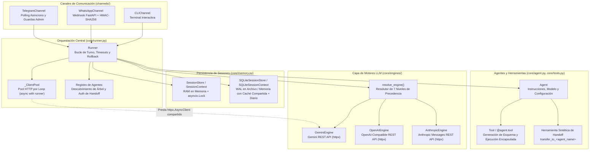
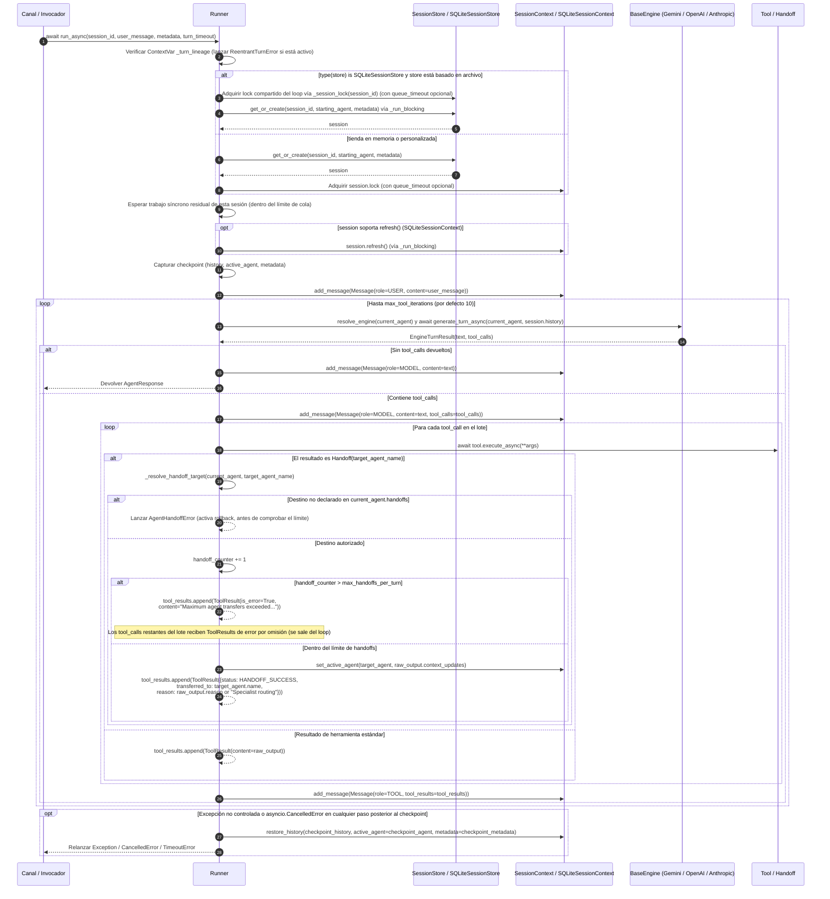

🌐 Idioma: [English](../ARCHITECTURE.md) | **Español**

# Descripción de Arquitectura — `chatflow-agent`

`chatflow-agent` es un framework Python asíncrono y multiproveedor para construir sistemas de IA conversacional con transferencias (*handoffs*) entre múltiples agentes, generación de esquemas y ejecución encapsulada de herramientas, persistencia transaccional de sesiones y canales de mensajería endurecidos para producción.

Este documento describe la arquitectura interna, las invariantes en tiempo de ejecución, el modelo de concurrencia y los límites entre subsistemas implementados en `src/chatflow_agent/`.

---

## 1. Principios Arquitectónicos

1. **Ejecución Asíncrona con Protección del Bucle de Eventos:** La evaluación central (`Runner.run_async`, motores, herramientas y canales) se ejecuta de forma nativa sobre `asyncio`. Las operaciones bloqueantes de disco se descargan a un pool dedicado de hilos trabajadores únicamente para una instancia exacta de `SQLiteSessionStore` basada en archivo (`type(store) is SQLiteSessionStore`); las subclases y tiendas personalizadas no se descargan automáticamente.
2. **Agnosticismo Multiproveedor (Cero Lock-In):** Cada `Agent` resuelve su motor LLM de forma independiente. Un agente de triaje ejecutándose en Gemini REST puede transferir la conversación en medio de un turno a un especialista ejecutándose en Claude (Anthropic REST), GPT/serie-o (OpenAI), Grok (xAI), DeepSeek, Groq o un modelo local mediante Ollama/vLLM.
3. **Checkpoints de Turno y Rollback Consciente de Conflictos:** Antes de evaluar un turno, `Runner` captura una instantánea (*checkpoint*) del historial de mensajes, el agente activo y los metadatos de la sesión. Si ocurre una excepción no controlada o `asyncio.CancelledError` a mitad del turno, `Runner` solicita el rollback mediante `session.restore_history(...)`. En SQLite, la restauración es completa cuando ningún escritor externo concurrente modificó la sesión; de lo contrario, las reglas conscientes de conflictos de la sección 4.3 preservan los cambios externos y pueden producir una restauración parcial.
4. **Serialización por Sesión y Prevención de Interbloqueos (*Deadlocks*):** Los mensajes concurrentes para un mismo `session_id` se serializan en orden de llegada mediante un `asyncio.Lock` por sesión dentro de una instancia de tienda y un bucle de eventos en ejecución. No es un lock entre procesos ni entre bucles de eventos. La reentrada en línea sobre la misma sesión desde dentro de una herramienta se detecta de inmediato mediante seguimiento de linaje en `ContextVar` y se rechaza con `ReentrantTurnError`.
5. **Fronteras Seguras Donde Corresponden:** `WhatsAppChannel` aplica por defecto validación de firmas *fail-closed*, comparación de tokens en tiempo constante, límites de tamaño de payload, deduplicación atómica de mensajes y enmascaramiento de teléfonos para privacidad. Los motores de proveedor aplican por separado el aislamiento de credenciales; estas garantías específicas de WhatsApp no se aplican automáticamente a todos los canales.

---

## 2. Diagrama de Componentes del Sistema



---

## 3. Ciclo de Vida de un Turno y Flujo de Ejecución

El siguiente diagrama de secuencia ilustra la ruta de ejecución exacta de `Runner.run_async(session_id, user_message)` desde la entrada hasta su finalización o reversión (*rollback*):



---

## 4. Análisis Profundo de Subsistemas Centrales

### 4.1. Agentes y Registro de Capacidades (`core/agent.py`)

[`Agent`](../../src/chatflow_agent/core/agent.py) es una entidad ligera y componible que representa un rol o habilidad especialista:

- **Parámetros de Configuración:** `name` (obligatorio y validado como no vacío), `instructions` (cadena o invocable sin argumentos), `model` (por defecto `"gemini-2.5-flash"`), `tools`, `handoffs`, `provider`, `base_url`, `api_key` y `engine`. El constructor no expone parámetros `temperature` ni `timeout` y no valida que `model` sea no vacío.
- **Registro de Herramientas:** Las herramientas pueden pasarse a `Agent(tools=[...])` como instancias de [`Tool`](../../src/chatflow_agent/core/tools.py) o funciones puras de Python (envueltas automáticamente en `Tool(fn)`), o bien registrarse declarativamente mediante el decorador `@agent.tool` (`@agent.tool` o `@agent.tool(name="...", description="...")`).
- **Herramientas Sintéticas de Handoff (`get_all_tools`, `_create_handoff_tool`):** Por cada [`Agent`](../../src/chatflow_agent/core/agent.py) destino listado en `agent.handoffs`, el agente sintetiza una instancia dedicada de [`Tool`](../../src/chatflow_agent/core/tools.py) llamada `transfer_to_<sanitized_target_name>` (con desambiguación determinista ante colisiones). Al invocarla devuelve un valor [`Handoff`](../../src/chatflow_agent/types.py) sin mutar estado compartido.

### 4.2. Orquestación, Concurrencia y Ciclo de Vida del Turno (`core/runner.py`)

[`Runner`](../../src/chatflow_agent/core/runner.py) coordina las sesiones, los motores, la ejecución de herramientas y las transiciones multiagente:

- **Registro del Grafo de Agentes e Integridad (`_register_agent_tree`, `_resolve_handoff_target`):**
  - Al inicializarse, `Runner` recorre y registra el grafo alcanzable desde `starting_agent`. Un destino añadido posteriormente solo se autoriza si está declarado en el agente actual; su grafo se valida y registra al resolver ese handoff.
  - **Rechazo de Nombres Duplicados:** Si dos instancias distintas y alcanzables de `Agent` comparten un `name`, el registro o la resolución tardía lanza `ValueError` sin actualizar parcialmente el registro.
  - **Protección del Registro Manual:** Los nombres registrados mediante `runner.register_agent(agent)` se rastrean en `_manual_agent_names` y no pueden ser reemplazados silenciosamente por una mutación tardía de handoff.
- **Detección de Reentrancia (`_turn_lineage`) y Turnos Diferidos (`spawn_turn`):**
  - `Runner` rastrea los pares `(session_store, session_id)` activos en la `ContextVar` `_turn_lineage`.
  - Si una herramienta o callback invoca `await runner.run_async(session_id, ...)` para una sesión que ya se está ejecutando en la cadena de llamadas actual, `Runner` lanza [`ReentrantTurnError`](../../src/chatflow_agent/exceptions.py) de inmediato en lugar de bloquearse indefinidamente esperando `session.lock`.
  - Las herramientas que necesiten programar un turno de seguimiento para su misma sesión pueden invocar `runner.spawn_turn(session_id, user_message, metadata=...)`. `spawn_turn` limpia `_turn_lineage` y `_dispatch_limits` en una copia del contexto y programa una `asyncio.Task` independiente (retenida en `runner._spawned_turns`) que esperará a que el turno actual libere `session.lock`.
- **Timeout de Cola vs. Timeout de Ejecución del Turno:**
  - `Runner` distingue entre el tiempo de espera por una sesión ocupada y la ejecución del turno en sí:
    - **Timeout de Cola (`_SessionWaitTimeout`):** Limita cuánto tiempo espera un invocador para adquirir el lock de sesión y, después de adquirirlo, por trabajo síncrono residual de un turno anterior cancelado o vencido (configurado mediante `_dispatch_limits` desde los canales).
    - **Timeout de Turno (`_TurnTimeout`):** Limita la ejecución de `_execute_turn()` una vez adquirido `session.lock` (configurado mediante `run_async(..., turn_timeout=...)` o `llm_timeout_seconds` del canal). Ambos lanzan `TimeoutError` al expirar.
- **Barrera de Cancelación para Herramientas Síncronas:** Las herramientas síncronas se ejecutan en hilos trabajadores y no pueden detenerse a la fuerza al cancelar la tarea que las espera. `Runner` rastrea su vida real por `(session_store, session_id)` e impide que comience el siguiente turno de esa sesión hasta que termine el trabajo síncrono residual. Esta barrera es independiente del `asyncio.Lock` de la sesión y no serializa sesiones distintas.
- **Verificación de Handoffs y Guardas de Bucle (`_resolve_handoff_target`):**
  - Cuando una herramienta devuelve un [`Handoff`](../../src/chatflow_agent/types.py), `Runner` verifica que su destino esté declarado actualmente en `current_agent.handoffs` y coincida con la instancia autorizada. Los destinos no autorizados o desconocidos lanzan [`AgentHandoffError`](../../src/chatflow_agent/exceptions.py).
  - Si un turno excede `max_handoffs_per_turn` (por defecto `5`), `Runner` registra un [`ToolResult`](../../src/chatflow_agent/types.py) de error, **omite las llamadas a herramientas restantes de ese lote** preservando la paridad llamada/resultado y permite que el agente actual genere una respuesta final.
  - Si se agota `max_tool_iterations` (por defecto `10`) sin una respuesta de texto final, `Runner` añade un mensaje de respaldo `Role.MODEL` al historial de la sesión y lo devuelve en [`AgentResponse`](../../src/chatflow_agent/types.py).

### 4.3. Checkpoints, Atomicidad ante Fallos y Rollback (`core/runner.py`, `core/memory.py`)

`Runner` crea un checkpoint para cada turno e intenta revertirlo ante fallos de la siguiente manera:

1. **Refresco Previo y Checkpoint:** Tras adquirir `session.lock` (y llamar a `session.refresh()` en `SQLiteSessionContext`), `Runner._execute_turn()` captura:
   - `checkpoint_history = list(session.history)`
   - `checkpoint_agent = session.active_agent`
   - `checkpoint_metadata = copy.deepcopy(session.metadata)`
2. **Reversión Automática mediante `session.restore_history(...)`:**
   - Si una `Exception` no controlada (como [`ProviderError`](../../src/chatflow_agent/exceptions.py), [`AgentHandoffError`](../../src/chatflow_agent/exceptions.py) o [`SessionDeletedError`](../../src/chatflow_agent/exceptions.py)) o `asyncio.CancelledError` sale del cuerpo del turno, `_execute_turn()` la captura, llama a `Runner._roll_back()` y luego vuelve a lanzarla. Cuando vence el timeout configurado del turno, `_within()` cancela `_execute_turn()`; esa ruta interna de `CancelledError` realiza el rollback antes de que `_within()` lance `TimeoutError` al llamador.
     ```python
     session.restore_history(
         checkpoint_history,
         active_agent=checkpoint_agent,
         metadata=checkpoint_metadata,
     )
     ```
   - El rollback se ejecuta con `must_run=True` dentro de `_run_blocking()`, protegiendo la restauración hasta su finalización incluso si la tarea que espera es cancelada durante el proceso. Si `restore_history` falla por sí mismo, su excepción se registra en el log y se propaga para que un turno nunca se reporte como revertido si su estado almacenado quedó inconsistente.
   - Los fallos de llamadas a herramientas normalmente se capturan dentro del turno, se registran con un ID de traza y se devuelven al modelo como valores `ToolResult` de error. El rollback restaura el estado de sesión administrado por el framework, pero no puede deshacer efectos externos ya producidos por una herramienta.
   - *(Nota: `SessionContext.rollback_to(checkpoint_len)` y `SQLiteSessionContext.rollback_to(checkpoint_len)` también existen en las clases de sesión para truncar el historial por longitud, pero `Runner._roll_back()` invoca `session.restore_history(...)` para solicitar conjuntamente la restauración de los mensajes podados por `max_turns`, `active_agent` y `metadata`. `SessionContext` reemplaza la instantánea; SQLite sigue las rutas completa o consciente de conflictos descritas a continuación.)*
3. **Diario por Turno en `SQLiteSessionContext.restore_history()`:**
   - Durante un turno, `SQLiteSessionContext.add_message()` registra en `_turn_inserted_ids` los IDs de las filas insertadas en la base de datos y en `_turn_pruned_rows` cualquier fila podada por `max_turns`.
   - Dentro de una transacción `BEGIN IMMEDIATE`, `restore_history()` comprueba si otro escritor modificó la sesión concurrentemente:
     - **Sin escrituras externas concurrentes:** Reemplaza las filas de la sesión con `checkpoint_history` y restaura `active_agent` y `metadata`.
     - **Con escrituras externas concurrentes detectadas:** Elimina los `_turn_inserted_ids` del turno que todavía estén presentes. Reinserta `_turn_pruned_rows` con sus IDs de fila originales (su `created_at` se regenera mediante `DEFAULT CURRENT_TIMESTAMP`, no se restaura) solamente cuando `removed_by_others` está vacío; si otro escritor eliminó filas del checkpoint, deja esas filas podadas sin restaurar. Restaura el agente activo o los metadatos únicamente cuando el valor almacenado actual todavía coincide con el último valor escrito por este turno, y no recrea una sesión eliminada por otro escritor. Esta ruta consciente de conflictos prioriza preservar los cambios externos en vez de garantizar una restauración completa del checkpoint.

### 4.4. Resolución Multiproveedor y Ejecución de Motores (`core/engines/`)

Todas las integraciones LLM implementan [`BaseEngine`](../../src/chatflow_agent/core/engines/base.py) (`async def generate_turn_async(agent, history) -> EngineTurnResult`).

#### Precedencia de 7 Niveles en la Resolución de Motores (`resolve_engine`)

Cuando `Runner` evalúa un turno para `current_agent`, [`resolve_engine()`](../../src/chatflow_agent/core/engines/factory.py) selecciona el motor siguiendo este orden estricto:

1. **Motor Explícito en el Agente (`agent.engine`):** Utiliza la instancia de `BaseEngine` asignada directamente al agente.
2. **Nombre de Proveedor Explícito (`agent.provider`):**
   - `"gemini"`, `"google"` → [`GeminiEngine`](../../src/chatflow_agent/core/engines/gemini.py)
   - `"openai"`, `"grok"`, `"xai"`, `"deepseek"`, `"groq"`, `"ollama"`, `"gemma"` → [`OpenAIEngine`](../../src/chatflow_agent/core/engines/openai_compatible.py)
   - `"anthropic"`, `"claude"` → [`AnthropicEngine`](../../src/chatflow_agent/core/engines/anthropic.py)
3. **URL Base Personalizada (`agent.base_url`):** Cuando se omite `provider` pero se define `base_url`, enruta hacia [`OpenAIEngine`](../../src/chatflow_agent/core/engines/openai_compatible.py).
4. **Motor por Defecto Explícito del Runner (`Runner(engine=...)` con `prefer_default_engine=True`):** Tiene prioridad sobre las heurísticas de prefijo de modelo cuando el agente no especificó un `engine`, `provider` o `base_url` explícito.
5. **Heurísticas por Prefijo de Modelo (`agent.model`):**
   - prefijo literal `claude-` → [`AnthropicEngine`](../../src/chatflow_agent/core/engines/anthropic.py)
   - `gpt-*`, `o1*`, `o3*`, `chatgpt-*`, `text-embedding-*`, `dall-e*` → [`OpenAIEngine`](../../src/chatflow_agent/core/engines/openai_compatible.py) (`provider="openai"`)
   - `grok*` → [`OpenAIEngine`](../../src/chatflow_agent/core/engines/openai_compatible.py) (`provider="grok"`)
   - prefijo literal `deepseek-` → [`OpenAIEngine`](../../src/chatflow_agent/core/engines/openai_compatible.py) (`provider="deepseek"`)
   - `gemma*`, `llama*`, `mistral*`, `qwen*`, `phi*` → [`OpenAIEngine`](../../src/chatflow_agent/core/engines/openai_compatible.py) (`provider="ollama"`)
6. **Motor de Fallback:** Utiliza `default_engine` cuando se proporcionó uno y ninguna regla anterior coincidió. Si `agent.api_key` está definida y `default_engine` es un [`GeminiEngine`](../../src/chatflow_agent/core/engines/gemini.py) estándar (como el que `Runner` crea cuando no se le pasa `engine`), se usa una copia de ese motor con la clave del agente en lugar de las credenciales del `Runner` o del entorno; el proveedor sigue siendo Gemini. Cualquier otro `default_engine` (una subclase o un motor personalizado) se usa sin cambios.
7. **Valor por Defecto Final:** Instancia [`GeminiEngine`](../../src/chatflow_agent/core/engines/gemini.py).

#### Implementaciones de Motores y Normalización entre Proveedores

- **[`GeminiEngine`](../../src/chatflow_agent/core/engines/gemini.py):** Invoca directamente la API REST de Google Gemini (`https://generativelanguage.googleapis.com/v1beta/models/{model}:generateContent`) mediante `httpx.AsyncClient` sin requerir el SDK `google-genai`. Soporta `GEMINI_API_KEY` / `GOOGLE_API_KEY`, fusiona turnos consecutivos de usuario/herramienta según exigen las reglas de `Content` de Gemini y preserva metadatos `thoughtSignature` en las partes de llamada a función.
- **[`OpenAIEngine`](../../src/chatflow_agent/core/engines/openai_compatible.py):** Invoca directamente endpoints REST `/chat/completions` compatibles con OpenAI mediante `httpx.AsyncClient` sin requerir el paquete SDK `openai`. Soporta OpenAI (`OPENAI_API_KEY`), xAI Grok (`XAI_API_KEY`), DeepSeek (`DEEPSEEK_API_KEY`), Groq (`GROQ_API_KEY`), Ollama (`http://localhost:11434/v1`), vLLM y endpoints personalizados compatibles con OpenAI. Aplica aislamiento estricto de credenciales mediante `_resolve_api_key()` e `_is_official_endpoint()`: las claves API de variables de entorno se envían únicamente al endpoint HTTPS oficial de cada proveedor y nunca se filtran a servidores locales en loopback ni a URLs `base_url` de terceros.
- **[`AnthropicEngine`](../../src/chatflow_agent/core/engines/anthropic.py):** Invoca directamente la API REST Anthropic Messages (`https://api.anthropic.com/v1/messages`, `anthropic-version: 2023-06-01`) mediante `httpx.AsyncClient` usando `ANTHROPIC_API_KEY`.
- **Normalización del Prompt de Sistema (`system_prompt`):** Para los proveedores con un campo de sistema de nivel superior (`GeminiEngine` y `AnthropicEngine`), [`system_prompt()`](../../src/chatflow_agent/core/engines/base.py) recibe el valor resuelto de `agent.get_instructions()` y lo concatena con cualquier mensaje `Role.SYSTEM` presente en el historial de la sesión.
- **Normalización Determinista de IDs de Tool Calls (`replacement_tool_call_id`):** Cuando una conversación realiza un handoff entre proveedores con reglas incompatibles para los IDs de llamadas a herramientas (por ejemplo, el límite de 40 caracteres de OpenAI o el patrón `^[a-zA-Z0-9_-]{1,64}$` de Anthropic), [`replacement_tool_call_id()`](../../src/chatflow_agent/core/engines/base.py) transforma de manera determinista los IDs no conformes a `"call_" + sha256(id)[:24]` en la petición saliente manteniendo intacto el ID original dentro de `session.history`.
- **Reintentos y Backoff ante Límites de Tasa:** Los tres motores reintentan fallos transitorios (`429`, `500`, `502`, `503`, `504`, además de `529` en Anthropic) y fallos al establecer la conexión hasta `max_retries=3`. Las demoras usan backoff exponencial con jitter y respetan valores numéricos de `Retry-After`; Gemini también admite fechas HTTP. Las demoras se limitan mediante el `max_delay` de cada motor (por defecto `10.0` segundos). Otros fallos de petición, lectura o escritura no se reintentan automáticamente porque la petición podría haber llegado al proveedor. Los errores no recuperables o los reintentos agotados lanzan [`ProviderError`](../../src/chatflow_agent/exceptions.py).

### 4.5. Introspección de Herramientas, Generación de Esquemas y Validación (`core/tools.py`)

[`Tool`](../../src/chatflow_agent/core/tools.py) conecta invocables de Python con declaraciones de llamado a funciones para LLMs:

- **Introspección de Firmas:** Resuelve anotaciones pospuestas (`from __future__ import annotations`) mediante `inspect.signature(fn, eval_str=True)`. Si la resolución falla, registra una advertencia, conserva la firma sin resolver y usa el fallback compatible `STRING`. Los metadatos de `typing.Annotated[T, ...]` se ignoran al mapear el esquema; `functools.partial` y las instancias invocables se admiten mediante la inspección normal de firmas y la detección de invocables asíncronos. El docstring del invocable se usa como descripción de la herramienta, pero no se extraen de él descripciones de parámetros.
- **Anotaciones de Tipo Soportadas:**
  - Primitivos: `str`, `int`, `float`, `bool`
  - Colecciones: `list[T]`, `tuple[T, ...]`, tuplas fijas homogéneas como `tuple[float, float]`, `set[T]`, `frozenset[T]`, `Sequence[T]`, `dict[K, V]` y `Mapping[K, V]`. Las colecciones sin parametrizar usan elementos `STRING`; las tuplas heterogéneas omiten `items` y emiten una advertencia.
  - Uniones y Opcionales: `T | None` (`nullable: True`) y uniones multitipo `Union[A, B]` (`anyOf`)
  - Las anotaciones desconocidas fuera de una unión (incluidos `Literal`, `Enum`, `TypedDict`, dataclasses y modelos Pydantic) conservan compatibilidad mapeándose a `STRING`; no se expanden a esquemas estructurados.
- **Validación de Esquemas y Fallbacks Compatibles (`ToolSchemaError`):** Si una unión contiene un miembro no soportado (por ejemplo, `int | Callable`), [`Tool`](../../src/chatflow_agent/core/tools.py) lanza [`ToolSchemaError`](../../src/chatflow_agent/exceptions.py) al registrarse porque esa unión no puede representarse de forma segura. Las anotaciones desconocidas fuera de una unión y las no resueltas conservan el fallback `STRING`.
- **Salida Dual de Esquemas:**
  - `to_gemini_declaration()`: Genera declaraciones OpenAPI 3.0 con nombres de tipo en mayúsculas (`OBJECT`, `STRING`, `INTEGER`, `NUMBER`, `BOOLEAN`, `ARRAY`).
  - `to_openai_parameters()`: Convierte el esquema canónico a JSON Schema estándar con nombres de tipo en minúsculas, transformando `nullable: True` en uniones de tipos o ramas `anyOf`. `AnthropicEngine` reutiliza esta conversión JSON Schema a través de `to_anthropic_tool()`.
- **Ejecución y Validación en Tiempo de Ejecución (`Tool.execute_async`, `Tool.execute`, `Tool.__call__`):** La validación de argumentos en tiempo de ejecución está habilitada por defecto mediante `validate_args=True`. Antes de invocar la herramienta, valida argumentos obligatorios, rechaza argumentos inesperados cuando no existe `**kwargs`, convierte cadenas numéricas a números (rechazando booleanos, NaN e infinito), convierte números a cadenas en parámetros `str` (rechazando booleanos y colecciones), soporta parámetros con guion bajo inicial o llamados `model_config`, y preserva el fallback compatible hacia atrás de esquema/validación (`STRING` / `Any`) para anotaciones no expresables en esquema. Ante fallos de validación, lanza [`ToolArgumentValidationError`](../../src/chatflow_agent/exceptions.py) con entradas redactadas, sin invocar la función ni enviarla a un hilo trabajador. Los parámetros omitidos preservan el enlace nativo de valores predeterminados y la semántica de valores mutables en Python. Con `validate_args=False`, los argumentos se pasan sin cambios y el enlazado normal de llamadas de Python sigue rechazando argumentos faltantes o inesperados. `Tool.execute_async()` invoca directamente los invocables `async def` y envía los invocables síncronos a un hilo trabajador. El valor de retorno no se serializa. En `Tool.execute_async()` y `Tool.execute()`, las excepciones ordinarias de invocación o ejecución derivadas de `Exception` se envuelven en [`ToolExecutionError`](../../src/chatflow_agent/exceptions.py); `Tool.__call__` llama directamente a la función y no agrega ese envoltorio. `asyncio.CancelledError`, `KeyboardInterrupt` y `SystemExit` derivan directamente de `BaseException` y se propagan sin ese envoltorio.

### 4.6. Tiendas de Sesiones, Concurrencia en SQLite y Descarga a Hilos (`core/memory.py`)

`chatflow-agent` proporciona dos backends de almacenamiento de sesiones que comparten la interfaz [`SessionContext`](../../src/chatflow_agent/core/memory.py):

| Característica | `SessionStore` / `SessionContext` | `SQLiteSessionStore` / `SQLiteSessionContext` |
| :--- | :--- | :--- |
| **Medio de Almacenamiento** | Memoria RAM efímera | Base de datos SQLite (archivo en disco o `:memory:`) |
| **Tablas** | Diccionarios Python (`_sessions`, `_processed_ids`) | `chatflow_sessions`, `chatflow_messages`, `chatflow_processed_messages` |
| **Pragmas SQLite** | N/A | Todas las conexiones: `busy_timeout=10000` ms. Solo archivos: `journal_mode=WAL`, `synchronous=NORMAL`. La memoria con caché compartida no habilita WAL. La implementación no configura `foreign_keys=ON`. |
| **Modelo de I/O en el Event Loop** | Ejecución directa en memoria sobre el bucle de eventos | Solo instancia exacta de `SQLiteSessionStore` basada en archivo: descargada a `ThreadPoolExecutor` de 4 hilos (`_run_blocking`)<br>Subclases, tiendas personalizadas y `:memory:`: no se descargan automáticamente; `:memory:` usa una conexión *keeper* con caché compartida y `threading.RLock` en el bucle de eventos |
| **Coordinación de Locks** | `asyncio.Lock` por contexto | Registro débil compartido (`_SessionLockRegistry`) por `(event_loop, session_id)` + `session.refresh()` |
| **Mecanismo de Rollback** | Reemplazo de instantánea vía `restore_history()` | Durante un turno con diario, el rollback consciente de conflictos en `restore_history()` usa `BEGIN IMMEDIATE`; las restauraciones ordinarias reemplazan la instantánea transaccionalmente |

- **Alcance de los Locks:** Los locks administrados por la tienda serializan una sesión solo dentro de una instancia de tienda y un bucle de eventos en ejecución. No serializan instancias separadas, procesos ni hilos con bucles de eventos distintos; en esos casos las transacciones SQLite siguen protegiendo cada operación individual de base de datos.
- **I/O de Archivo No Bloqueante (`_offloads_blocking_io` y `_run_blocking`):**
  - Solamente una instancia exacta de `SQLiteSessionStore` basada en archivo (`type(store) is SQLiteSessionStore`) crea de forma perezosa un `ThreadPoolExecutor` de 4 trabajadores (`thread_name_prefix="chatflow-sqlite"`). Las subclases y tiendas personalizadas no se descargan automáticamente.
  - Para ese caso de tienda exacta, `Runner` envuelve las llamadas a la tienda y a la sesión en `_run_blocking()`. Si la tarea que espera es cancelada mientras una operación ya se está ejecutando en un hilo trabajador, `_run_blocking()` protege (`asyncio.shield`) y espera al trabajador hasta que la operación SQLite termine para que sus efectos queden registrados en el diario de rollback antes de relanzar `CancelledError`.
- **Eliminación Concurrente de Sesiones (`SessionDeletedError`):**
  - Esta guarda es específica de [`SQLiteSessionStore`](../../src/chatflow_agent/core/memory.py) y `SQLiteSessionContext`. Si `store.delete(session_id)` o `store.clear()` elimina una sesión SQLite durante un turno, la siguiente llamada a `session.add_message()` inserta el mensaje y actualiza la sesión padre en la misma transacción. Una actualización de cero filas lanza [`SessionDeletedError`](../../src/chatflow_agent/exceptions.py), lo que revierte esa transacción en lugar de almacenar mensajes huérfanos o revivir la sesión eliminada. `SessionStore` en memoria no ofrece esta guarda de eliminación.
- **Deduplicación de Mensajes:** `SessionStore` protege su mapa TTL basado en tiempo monotónico mediante un lock privado de hilo. `SQLiteSessionStore.record_processed_message()` usa un único *upsert* SQLite atómico para comprobar y registrar, y luego purga los IDs vencidos en la misma transacción de conexión. El valor `dedup_ttl_hours` de cada tienda controla la expiración.

### 4.7. Canales y Seguridad en Webhooks (`channels/`)

Los canales provistos heredan de [`BaseChannel`](../../src/chatflow_agent/channels/base.py) (`attach(runner)`, `dispatch(session_id, message, metadata)`, `dispatch_async(session_id, message, metadata)` y el método abstracto `run(**kwargs)`) y lanzan [`ChannelError`](../../src/chatflow_agent/channels/base.py) si se despacha un mensaje antes de vincular un `Runner`. Telegram y WhatsApp usan `split_message(text, max_len=4096)` para fragmentar respuestas largas respetando saltos de párrafo, línea, oración o palabra:

- **[`CLIChannel`](../../src/chatflow_agent/channels/cli.py):** Canal interactivo de terminal (`run()` y `send_message()`). Soporta `/reset` para limpiar la memoria de conversación, muestra indicadores `[Transferred to <agent>]` cuando ocurre un handoff y finaliza limpiamente ante `exit`/`quit`/`salir` o `EOFError`/`KeyboardInterrupt`.
- **[`TelegramChannel`](../../src/chatflow_agent/channels/telegram.py):**
  - **Polling Asíncrono (`run()`):** Construido sobre `python-telegram-bot` (`chatflow-agent[telegram]`, lanzando [`DependencyError`](../../src/chatflow_agent/exceptions.py) si no está instalado). Gestiona `/start`, `/reset` y mensajes de texto con indicadores `ChatAction.TYPING` y fragmentación de mensajes a 4.096 caracteres.
  - **Protección de `/reset` en Grupos:** Restringe el comando `/reset` en chats de tipo `group` y `supergroup` a miembros con rol `creator` o `administrator` mediante `get_chat_member`, y descarga `get_session` / `clear_history` vía `_run_blocking()` únicamente cuando utiliza una instancia exacta de `SQLiteSessionStore` basada en archivo (`type(store) is SQLiteSessionStore`).
- **[`WhatsAppChannel`](../../src/chatflow_agent/channels/whatsapp.py):**
  - **Verificación *Fail-Closed* de Firma y Token:** Construido sobre FastAPI y Uvicorn (`chatflow-agent[whatsapp]`, con rutas OpenAPI `/docs` y `/redoc` deshabilitadas por defecto mediante `enable_docs=False`). Exige `app_secret` cuando `verify_signature=True` (valor por defecto, lanzando `ValueError` al inicializarse si se omite). Valida `hub.verify_token` en `GET /webhook` y `X-Hub-Signature-256` (`sha256=...`) en `POST /webhook` usando comparación en tiempo constante `hmac.compare_digest`.
  - **Guarda de Tamaño de Payload:** Valida `Content-Length` antes de leer el cuerpo en memoria (devolviendo HTTP `411` si falta la cabecera y HTTP `413` si `Content-Length` o el cuerpo crudo superan `max_body_size=1_048_576` bytes / 1 MiB).
  - **Deduplicación Atómica y Despacho en Segundo Plano:** Registra atómicamente cada `wamid` entrante mediante `store.record_processed_message(wamid)` antes de encolar `BackgroundTasks`, devolviendo un acuse inmediato HTTP `200 OK`. Esta llamada a la tienda se descarga vía `_run_blocking()` únicamente para una instancia exacta de `SQLiteSessionStore` basada en archivo (`type(store) is SQLiteSessionStore`); las subclases y tiendas personalizadas no se descargan automáticamente. Esta es una admisión *at-most-once*: una caída del proceso después del registro pero antes o durante el procesamiento en segundo plano puede dejar el mensaje confirmado pero sin procesar. El canal aplica `queue_timeout_seconds` (por defecto `120.0`) y `llm_timeout_seconds` (por defecto `120.0`) mediante `_dispatch_limits` más un `_DispatchBackstopTimeout` (`queue + turn + 1.0s`), enviando `fallback_message` ante timeout o error y enmascarando los números telefónicos (`_mask_phone`) en los logs.
  - **Entrega Saliente Resiliente:** Fragmenta respuestas con `split_message(..., max_len=4096)` y reintenta respuestas HTTP `429` (respetando `Retry-After`) y errores de conexión (`ConnectError`, `ConnectTimeout`) con backoff exponencial + jitter hasta `max_outbound_retries=3` (sin reintentar `ReadTimeout`/`WriteTimeout` para evitar duplicados), detectando además el vencimiento de la ventana de 24 horas (código Meta `131047`, invocando `on_24h_window_expired`).

### 4.8. Ciclo de Vida de Recursos y Limpieza

- **Pool de Conexiones del Runner (`async with runner:`):**
  - Entrar en `async with runner:` abre un [`_ClientPool`](../../src/chatflow_agent/core/engines/gemini.py) con conteo de referencias asociado al bucle de eventos en ejecución.
  - Mientras permanece abierto, `Runner` presta este pool mediante la `ContextVar` `_lent_pool` a los turnos de `GeminiEngine` que no posean un `http_client` personalizado, reutilizando las conexiones TCP/TLS entre turnos.
  - Al salir del bloque `async with runner:` más externo en ese bucle, se invoca `pool.stop_lending()` y `await pool.aclose()`, esperando a que terminen las peticiones en vuelo antes de cerrar el `httpx.AsyncClient` subyacente.
- **Wrapper Síncrono (`Runner.run()`):**
  - Ejecuta un único turno en su propio bucle de eventos dentro de un ámbito `async with runner:`.
  - Antes de cerrar el ámbito del pool de conexiones, `_run_in_own_loop()` cancela y espera cualquier tarea en segundo plano pendiente creada en ese bucle (`_cancel_other_tasks`) para que ninguna tarea intente usar el cliente compartido tras su cierre.
  - Invocar `Runner.run()` desde dentro de un bucle de eventos ya activo lanza `RuntimeError` de inmediato.
- **Cierre de Tienda SQLite (`SQLiteSessionStore.close()`):**
  - `store.close()` (o salir de `with SQLiteSessionStore(...) as store:`) es idempotente: apaga el `ThreadPoolExecutor` de hilos trabajadores (`wait=False`) y cierra la conexión *keeper* de `:memory:`. Las operaciones posteriores de tienda o contexto enrutadas a través de ella lanzan `RuntimeError` indicando que la tienda está cerrada.
- **Integración del Ámbito en Canales:**
  - `WhatsAppChannel` envuelve el `lifespan_context` de FastAPI (`_with_runner_scope`) dentro del ámbito `async with runner:` del Runner vinculado para que todos los turnos del webhook y los manejadores de inicio/apagado reutilicen las conexiones del pool.
  - `TelegramChannel.run()` entra en `async with runner:` dentro de `post_init` y lo cierra en `post_shutdown` (o en `finish_after_polling` si una señal interrumpe el proceso antes de que `post_shutdown` termine).

---

## 5. Jerarquía de Excepciones (`exceptions.py`, `channels/base.py`)

Todos los errores propios del framework heredan de [`ChatFlowError`](../../src/chatflow_agent/exceptions.py) y se exportan en el nivel superior de `chatflow_agent`:

```text
Exception
 └── ChatFlowError
      ├── ProviderError             (lanzada cuando falla la comunicación con un proveedor LLM)
      ├── DependencyError           (.feature, .extra_package; lanzada cuando falta un extra opcional)
      ├── ToolExecutionError        (.tool_name, .original_error; lanzada cuando una herramienta falla en ejecución)
      ├── ToolSchemaError           (lanzada al registrar una unión cuyo esquema no puede representarse)
      ├── AgentHandoffError         (lanzada ante destinos de handoff no autorizados, desconocidos o inconsistentes)
      ├── ReentrantTurnError        (también hereda de RuntimeError; lanzada ante reentrada en línea en la misma sesión)
      ├── SessionDeletedError       (solo SQLite: lanzada cuando una sesión almacenada se elimina durante un turno)
      └── ChannelError              (channels/base.py; lanzada cuando falla una operación de canal o no hay Runner vinculado)
```

---

## 6. Estructura del Paquete (`src/chatflow_agent/`)

```text
src/chatflow_agent/
├── __init__.py                 # Exportaciones de la API pública (__all__)
├── memory.py                   # Reexportaciones públicas de compatibilidad para las clases de sesión
├── types.py                    # Modelos de dominio: Role, Message, ToolCall, ToolResult, Handoff, AgentResponse
├── exceptions.py               # Jerarquía de excepciones con raíz en ChatFlowError
├── core/
│   ├── __init__.py
│   ├── agent.py                # Definición de Agent, decorador @agent.tool, herramientas de handoff sintéticas
│   ├── engine.py               # Reexportaciones de motores para compatibilidad hacia atrás
│   ├── runner.py               # Orquestación de Runner, locks de concurrencia, timeouts, rollback, pool de conexiones
│   ├── tools.py                # Introspección de firmas, generación de esquemas y ejecución encapsulada de Tool
│   ├── memory.py               # SessionContext, SessionStore, SQLiteSessionContext, SQLiteSessionStore, pool de hilos
│   └── engines/
│       ├── __init__.py
│       ├── base.py             # ABC BaseEngine, EngineTurnResult, system_prompt(), replacement_tool_call_id()
│       ├── factory.py          # Resolución de proveedores resolve_engine() de 7 niveles
│       ├── gemini.py           # GeminiEngine (cliente REST httpx) y _ClientPool
│       ├── openai_compatible.py# OpenAIEngine (OpenAI, Grok, DeepSeek, Groq, Ollama, vLLM, base_url personalizado)
│       └── anthropic.py        # AnthropicEngine (cliente REST httpx para Anthropic Messages API)
└── channels/
    ├── __init__.py
    ├── base.py                 # Interfaz abstracta BaseChannel
    ├── cli.py                  # Canal interactivo de terminal
    ├── telegram.py             # Canal Telegram Bot API (long polling)
    └── whatsapp.py             # Canal Meta WhatsApp Cloud API (Webhook ASGI, HMAC-SHA256, deduplicación)
```
