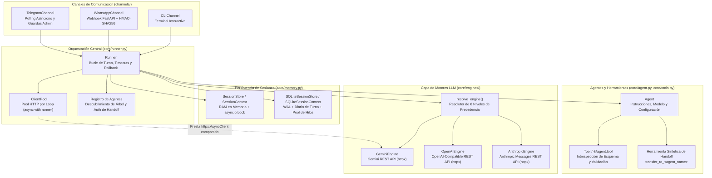
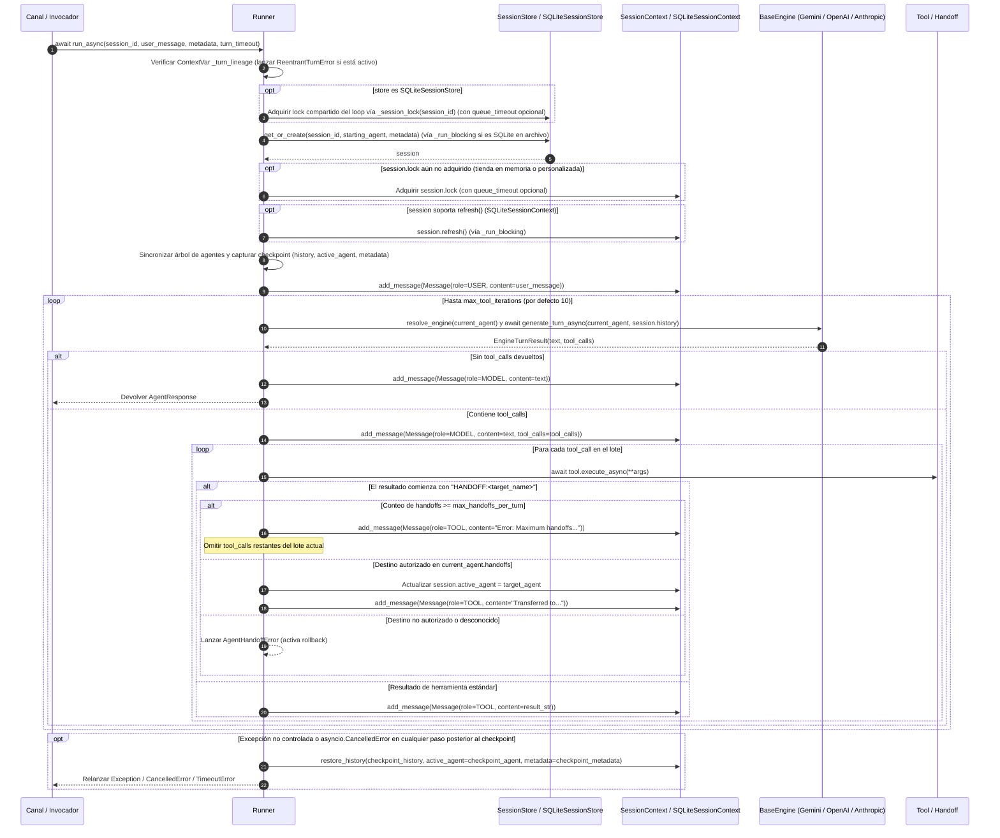

🌐 Idioma: [English](../ARCHITECTURE.md) | **Español**

# Descripción de Arquitectura — `chatflow-agent`

`chatflow-agent` es un framework Python asíncrono y multiproveedor para construir sistemas de IA conversacional con transferencias (*handoffs*) entre múltiples agentes, ejecución de herramientas fuertemente tipadas, persistencia transaccional de sesiones y canales de mensajería endurecidos para producción.

Este documento describe la arquitectura interna, las invariantes en tiempo de ejecución, el modelo de concurrencia y los límites entre subsistemas implementados en `src/chatflow_agent/`.

---

## 1. Principios Arquitectónicos

1. **Ejecución Asíncrona con Protección del Bucle de Eventos:** La evaluación central (`Runner.run_async`, motores, herramientas y canales) se ejecuta de forma nativa sobre `asyncio`. Las operaciones bloqueantes de disco en `SQLiteSessionStore` basado en archivos se descargan a un pool dedicado de hilos trabajadores para que la latencia de disco o las esperas de bloqueo de SQLite nunca detengan el bucle de eventos.
2. **Agnosticismo Multiproveedor (Cero Lock-In):** Cada `Agent` resuelve su motor LLM de forma independiente. Un agente de triaje ejecutándose en Gemini REST puede transferir la conversación en medio de un turno a un especialista ejecutándose en Claude (Anthropic REST), GPT/serie-o (OpenAI), Grok (xAI), DeepSeek, Groq o un modelo local mediante Ollama/vLLM.
3. **Turnos Atómicos ante Fallos:** Antes de evaluar un turno, `Runner` captura una instantánea (*checkpoint*) del historial de mensajes, el agente activo y los metadatos de la sesión. Si ocurre cualquier excepción no controlada o `asyncio.CancelledError` a mitad del turno, `Runner` restaura la sesión a su estado previo mediante `session.restore_history(...)`.
4. **Serialización Estricta por Sesión y Prevención de Interbloqueos (*Deadlocks*):** Los mensajes concurrentes para un mismo `session_id` se serializan en orden de llegada a través de un `asyncio.Lock` por sesión. La reentrada en línea sobre la misma sesión desde dentro de una herramienta se detecta de inmediato mediante seguimiento de linaje en `ContextVar` y se rechaza con `ReentrantTurnError`.
5. **Fronteras Seguras por Defecto:** Los canales de webhook y mensajería aplican validación de firmas *fail-closed* (`verify_signature=True`), comparación de tokens en tiempo constante (`hmac.compare_digest`), límites de tamaño de payload (`max_body_size`), deduplicación atómica de mensajes, enmascaramiento de teléfonos para privacidad y aislamiento estricto de credenciales por proveedor.

---

## 2. Diagrama de Componentes del Sistema




---

## 3. Ciclo de Vida de un Turno y Flujo de Ejecución

El siguiente diagrama de secuencia ilustra la ruta de ejecución exacta de `Runner.run_async(session_id, user_message)` desde la entrada hasta su finalización o reversión (*rollback*):



---

## 4. Análisis Profundo de Subsistemas Centrales

### 4.1. Agentes y Registro de Capacidades (`core/agent.py`)

[`Agent`](../../src/chatflow_agent/core/agent.py) es una entidad ligera y componible que representa un rol o habilidad especialista:

- **Parámetros de Configuración:** `name` (obligatorio, cadena no vacía), `instructions` (prompt de sistema), `model` (por defecto `"gemini-2.5-flash"`, validado como no vacío), `provider`, `api_key`, `base_url`, `engine`, `temperature` (por defecto `0.2`), `timeout` (`float | None`), `tools` y `handoffs`.
- **Registro de Herramientas:** Las herramientas pueden pasarse a `Agent(tools=[...])` como instancias de [`Tool`](../../src/chatflow_agent/core/tools.py) o funciones puras de Python (envueltas automáticamente en `Tool(fn)`), o bien registrarse declarativamente mediante el decorador `@agent.tool` (`@agent.tool` o `@agent.tool(name="...", description="...")`).
- **Herramientas Sintéticas de Handoff (`_register_handoff`):** Por cada [`Agent`](../../src/chatflow_agent/core/agent.py) destino listado en `agent.handoffs`, el agente sintetiza una instancia dedicada de [`Tool`](../../src/chatflow_agent/core/tools.py) llamada `transfer_to_<sanitized_target_name>`. Cuando el LLM la invoca, esta herramienta devuelve la cadena centinela `f"HANDOFF:{target.name}"` sin mutar estado compartido.
- **Clonación Segura (`agent.clone(**overrides)`):** Crea una copia del agente con listas `tools` y `handoffs` independientes, permitiendo sobreescribir cualquier atributo de configuración (`model`, `temperature`, `instructions`, `api_key`, etc.).

### 4.2. Orquestación, Concurrencia y Ciclo de Vida del Turno (`core/runner.py`)

[`Runner`](../../src/chatflow_agent/core/runner.py) coordina las sesiones, los motores, la ejecución de herramientas y las transiciones multiagente:

- **Descubrimiento del Grafo de Agentes e Integridad del Registro (`_discover_agents`, `_sync_agent_tree`):**
  - Al inicializarse y al comienzo de cada turno, `Runner` recorre el grafo de `handoffs` alcanzable desde `starting_agent` y desde el `active_agent` de la sesión.
  - **Rechazo de Nombres Duplicados:** Si dos instancias distintas de `Agent` en el grafo alcanzable comparten el mismo `name`, `Runner` lanza `ValueError` de inmediato.
  - **Protección del Registro Explícito:** Los agentes registrados mediante `runner.register_agent(agent)` se almacenan en `_explicit_agents` y no pueden ser sobreescritos silenciosamente por mutaciones tardías en la lista `handoffs` de otro agente.
- **Detección de Reentrancia (`_turn_lineage`) y Turnos Diferidos (`spawn_turn`):**
  - `Runner` rastrea los pares `(session_store, session_id)` activos en la `ContextVar` `_turn_lineage`.
  - Si una herramienta o callback invoca `await runner.run_async(session_id, ...)` para una sesión que ya se está ejecutando en la cadena de llamadas actual, `Runner` lanza [`ReentrantTurnError`](../../src/chatflow_agent/exceptions.py) de inmediato en lugar de bloquearse indefinidamente esperando `session.lock`.
  - Las herramientas que necesiten programar un turno de seguimiento para su misma sesión pueden invocar `runner.spawn_turn(session_id, user_message, metadata=...)`. `spawn_turn` limpia `_turn_lineage` y `_dispatch_limits` en una copia del contexto y programa una `asyncio.Task` independiente (retenida en `runner._spawned_turns`) que esperará a que el turno actual libere `session.lock`.
- **Timeout de Cola vs. Timeout de Ejecución del Turno:**
  - `Runner` distingue entre el tiempo de espera por una sesión ocupada y la ejecución del turno en sí:
    - **Timeout de Cola (`_SessionWaitTimeout`):** Limita cuánto tiempo espera un invocador para adquirir `session.lock` (configurado mediante `_dispatch_limits` desde los canales).
    - **Timeout de Turno (`_TurnTimeout`):** Limita la ejecución de `_execute_turn()` una vez adquirido `session.lock` (configurado mediante `run_async(..., turn_timeout=...)` o `llm_timeout_seconds` del canal). Ambos lanzan `TimeoutError` al expirar.
- **Verificación de Handoffs y Guardas de Bucle (`_resolve_handoff_target`):**
  - Cuando una herramienta devuelve `"HANDOFF:<target_name>"`, `Runner` verifica que `<target_name>` esté declarado actualmente en `current_agent.handoffs` y coincida con la instancia registrada. Los destinos no autorizados o desconocidos lanzan [`AgentHandoffError`](../../src/chatflow_agent/exceptions.py).
  - Si un turno alcanza `max_handoffs_per_turn` (por defecto `5`), `Runner` registra un [`ToolResult`](../../src/chatflow_agent/types.py) de error (`"Error: Maximum handoffs per turn (N) exceeded..."`), **omite las llamadas a herramientas restantes de ese lote** y permite que el agente actual genere una respuesta final.
  - Si se agota `max_tool_iterations` (por defecto `10`) sin una respuesta de texto final, `Runner` añade un mensaje de respaldo `Role.MODEL` al historial de la sesión y lo devuelve en [`AgentResponse`](../../src/chatflow_agent/types.py).

### 4.3. Checkpoints, Atomicidad ante Fallos y Rollback (`core/runner.py`, `core/memory.py`)

Cada turno en `Runner` es atómico frente a fallos:

1. **Refresco Previo y Checkpoint:** Tras adquirir `session.lock` (y llamar a `session.refresh()` en `SQLiteSessionContext`), `Runner._execute_turn()` captura:
   - `checkpoint_history = list(session.history)`
   - `checkpoint_agent = session.active_agent`
   - `checkpoint_metadata = copy.deepcopy(session.metadata)`
2. **Reversión Automática mediante `session.restore_history(...)`:**
   - Si cualquier `Exception` no controlada (como [`ProviderError`](../../src/chatflow_agent/exceptions.py), [`ToolExecutionError`](../../src/chatflow_agent/exceptions.py), [`AgentHandoffError`](../../src/chatflow_agent/exceptions.py), [`SessionDeletedError`](../../src/chatflow_agent/exceptions.py) o `TimeoutError`) o `asyncio.CancelledError` escapa de `_execute_turn()`, `Runner._roll_back()` invoca:
     ```python
     session.restore_history(
         checkpoint_history,
         active_agent=checkpoint_agent,
         metadata=checkpoint_metadata,
     )
     ```
   - El rollback se ejecuta con `must_run=True` dentro de `_run_blocking()`, protegiendo la restauración hasta su finalización incluso si la tarea que espera es cancelada durante el proceso. Si `restore_history` falla por sí mismo, su excepción se registra en el log y se propaga para que un turno nunca se reporte como revertido si su estado almacenado quedó inconsistente.
   - *(Nota: `SessionContext.rollback_to(checkpoint_len)` y `SQLiteSessionContext.rollback_to(checkpoint_len)` también existen en las clases de sesión para truncar el historial por longitud, pero `Runner._roll_back()` invoca `session.restore_history(...)` para restaurar de forma atómica tanto los mensajes podados por `max_turns` como `active_agent` y `metadata`.)*
3. **Diario por Turno en `SQLiteSessionContext.restore_history()`:**
   - Durante un turno, `SQLiteSessionContext.add_message()` registra en `_turn_inserted_ids` los IDs de las filas insertadas en la base de datos y en `_turn_pruned_rows` cualquier fila podada por `max_turns`.
   - Dentro de una transacción `BEGIN IMMEDIATE`, `restore_history()` comprueba si otro escritor modificó la sesión concurrentemente:
     - **Sin escrituras externas concurrentes:** Reemplaza las filas de la sesión con `checkpoint_history` y restaura `active_agent` y `metadata`.
     - **Con escrituras externas concurrentes detectadas:** Elimina únicamente `_turn_inserted_ids` y reïnserta `_turn_pruned_rows` con sus IDs de fila y marcas de tiempo originales, revirtiendo los cambios del turno fallido sin sobrescribir los mensajes confirmados por otra instancia de tienda.

### 4.4. Resolución Multiproveedor y Ejecución de Motores (`core/engines/`)

Todas las integraciones LLM implementan [`BaseEngine`](../../src/chatflow_agent/core/engines/base.py) (`async def generate_turn_async(agent, history) -> EngineTurnResult`).

#### Precedencia de 6 Niveles en la Resolución de Motores (`resolve_engine`)

Cuando `Runner` evalúa un turno para `current_agent`, [`resolve_engine()`](../../src/chatflow_agent/core/engines/factory.py) selecciona el motor siguiendo este orden estricto:

1. **Motor Explícito en el Agente (`agent.engine`):** Utiliza la instancia de `BaseEngine` asignada directamente al agente.
2. **Nombre de Proveedor Explícito (`agent.provider`):**
   - `"gemini"`, `"google"` → [`GeminiEngine`](../../src/chatflow_agent/core/engines/gemini.py)
   - `"openai"`, `"grok"`, `"xai"`, `"deepseek"`, `"groq"`, `"ollama"`, `"vllm"`, `"openai_compatible"` → [`OpenAIEngine`](../../src/chatflow_agent/core/engines/openai_compatible.py)
   - `"anthropic"`, `"claude"` → [`AnthropicEngine`](../../src/chatflow_agent/core/engines/anthropic.py)
3. **URL Base Personalizada (`agent.base_url`):** Cuando se omite `provider` pero se define `base_url`, enruta hacia [`OpenAIEngine`](../../src/chatflow_agent/core/engines/openai_compatible.py).
4. **Motor por Defecto Explícito del Runner (`Runner(engine=...)` con `prefer_default_engine=True`):** Tiene prioridad sobre las heurísticas de prefijo de modelo cuando el agente no especificó un `engine`, `provider` o `base_url` explícito.
5. **Heurísticas por Prefijo de Modelo (`agent.model`):**
   - `claude*` → [`AnthropicEngine`](../../src/chatflow_agent/core/engines/anthropic.py)
   - `gpt-*`, `o1*`, `o3*`, `o4*`, `chatgpt-*` → [`OpenAIEngine`](../../src/chatflow_agent/core/engines/openai_compatible.py) (`provider="openai"`)
   - `grok*` → [`OpenAIEngine`](../../src/chatflow_agent/core/engines/openai_compatible.py) (`provider="grok"`)
   - `deepseek*` → [`OpenAIEngine`](../../src/chatflow_agent/core/engines/openai_compatible.py) (`provider="deepseek"`)
   - `llama*`, `mixtral*`, `qwen*`, `mistral*`, `phi*`, `codellama*`, `gemma2*`, `gemma3*` → [`OpenAIEngine`](../../src/chatflow_agent/core/engines/openai_compatible.py) (`provider="ollama"`)
   - `gemini*` → [`GeminiEngine`](../../src/chatflow_agent/core/engines/gemini.py)
6. **Fallback por Defecto:** Utiliza `default_engine` (cuando `prefer_default_engine=False`) o instancia [`GeminiEngine`](../../src/chatflow_agent/core/engines/gemini.py).

#### Implementaciones de Motores y Normalización entre Proveedores

- **[`GeminiEngine`](../../src/chatflow_agent/core/engines/gemini.py):** Invoca directamente la API REST de Google Gemini (`https://generativelanguage.googleapis.com/v1beta/models/{model}:generateContent`) mediante `httpx.AsyncClient` sin requerir el SDK `google-genai`. Soporta `GEMINI_API_KEY` / `GOOGLE_API_KEY`, fusiona turnos consecutivos de usuario/herramienta según exigen las reglas de `Content` de Gemini y preserva metadatos `thoughtSignature` en las partes de llamada a función.
- **[`OpenAIEngine`](../../src/chatflow_agent/core/engines/openai_compatible.py):** Invoca directamente endpoints REST `/chat/completions` compatibles con OpenAI mediante `httpx.AsyncClient` sin requerir el paquete SDK `openai`. Soporta OpenAI (`OPENAI_API_KEY`), xAI Grok (`XAI_API_KEY`), DeepSeek (`DEEPSEEK_API_KEY`), Groq (`GROQ_API_KEY`), Ollama (`http://localhost:11434/v1`), vLLM y endpoints personalizados compatibles con OpenAI. Aplica aislamiento estricto de credenciales mediante `_resolve_api_key()` e `_is_official_endpoint()`: las claves API de variables de entorno se envían únicamente al endpoint HTTPS oficial de cada proveedor y nunca se filtran a servidores locales en loopback ni a URLs `base_url` de terceros.
- **[`AnthropicEngine`](../../src/chatflow_agent/core/engines/anthropic.py):** Invoca directamente la API REST Anthropic Messages (`https://api.anthropic.com/v1/messages`, `anthropic-version: 2023-06-01`) mediante `httpx.AsyncClient` usando `ANTHROPIC_API_KEY`.
- **Normalización del Prompt de Sistema (`system_prompt`):** Para los proveedores con un campo de sistema de nivel superior (`GeminiEngine` y `AnthropicEngine`), [`system_prompt()`](../../src/chatflow_agent/core/engines/base.py) concatena `agent.instructions` seguido de cualquier mensaje `Role.SYSTEM` presente en el historial de la sesión.
- **Normalización Determinista de IDs de Tool Calls (`replacement_tool_call_id`):** Cuando una conversación realiza un handoff entre proveedores con reglas incompatibles para los IDs de llamadas a herramientas (por ejemplo, el límite de 40 caracteres de OpenAI o el patrón `^[a-zA-Z0-9_-]{1,64}$` de Anthropic), [`replacement_tool_call_id()`](../../src/chatflow_agent/core/engines/base.py) transforma de manera determinista los IDs no conformes a `"call_" + sha256(id)[:24]` en la petición saliente manteniendo intacto el ID original dentro de `session.history`.
- **Reintentos y Backoff ante Límites de Tasa:** Los tres motores reintentan fallos transitorios (`429`, `500`, `502`, `503`, `504`, además de `529` en Anthropic) y errores de transporte de red hasta `max_retries=3` utilizando backoff exponencial (`2**attempt` segundos) y respetando cabeceras `Retry-After` del servidor (con tope de `60.0` segundos). Los errores no recuperables o los reintentos agotados lanzan [`ProviderError`](../../src/chatflow_agent/exceptions.py).

### 4.5. Introspección de Herramientas, Generación de Esquemas y Validación (`core/tools.py`)

[`Tool`](../../src/chatflow_agent/core/tools.py) conecta invocables de Python con declaraciones de llamado a funciones para LLMs:

- **Introspección de Firmas:** Resuelve anotaciones pospuestas (`from __future__ import annotations`) mediante `inspect.signature(fn, eval_str=True)`, desenvuelve `typing.Annotated[T, ...]` y `functools.partial`, y extrae descripciones de parámetros desde docstrings en formato Google, Sphinx o NumPy.
- **Anotaciones de Tipo Soportadas:**
  - Primitivos: `str`, `int`, `float`, `bool`
  - Colecciones: `list[T]`, `tuple[T, ...]`, `tuple[T1, T2]`, `set[T]`, `frozenset[T]`, `Sequence[T]`, `dict[K, V]`, `Mapping[K, V]`
  - Tipos restringidos: `Literal[...]`, subclases de `Enum`
  - Uniones y Opcionales: `T | None` (`nullable: True`) y uniones multitipo `Union[A, B]` (`anyOf`)
  - Tipos estructurados: `TypedDict`, `@dataclass` y `pydantic.BaseModel` (aplanando esquemas `$defs` / `$ref` anidados y detectando autorreferencias recursivas).
- **Validación de Esquemas (`ToolSchemaError`):** Si una anotación de tipo contiene un miembro de unión no soportado (por ejemplo, `int | Callable`), [`Tool`](../../src/chatflow_agent/core/tools.py) lanza [`ToolSchemaError`](../../src/chatflow_agent/exceptions.py) en el momento del registro en lugar de degradar silenciosamente el esquema.
- **Salida Dual de Esquemas:**
  - `to_gemini_declaration()`: Genera declaraciones OpenAPI 3.0 con nombres de tipo en mayúsculas (`OBJECT`, `STRING`, `INTEGER`, `NUMBER`, `BOOLEAN`, `ARRAY`).
  - `to_openai_parameters()`: Convierte el esquema canónico a JSON Schema estándar con nombres de tipo en minúsculas, transformando `nullable: True` en uniones de tipos o ramas `anyOf`. `AnthropicEngine` reutiliza esta conversión JSON Schema a través de `to_anthropic_tool()`.
- **Ejecución en Tiempo de Ejecución (`Tool.execute_async`):** Valida argumentos obligatorios, rechaza argumentos con nombre inesperados cuando no existe `**kwargs`, valida tipos de argumentos (incluyendo hidratación de `Enum`, `Literal`, `TypedDict`, `dataclass` y `BaseModel`), ejecuta funciones síncronas o `async def` y serializa las salidas a `str`. Las excepciones inesperadas dentro de la herramienta se envuelven en [`ToolExecutionError`](../../src/chatflow_agent/exceptions.py).

### 4.6. Tiendas de Sesiones, Concurrencia en SQLite y Descarga a Hilos (`core/memory.py`)

`chatflow-agent` proporciona dos backends de almacenamiento de sesiones que comparten la interfaz [`SessionContext`](../../src/chatflow_agent/core/memory.py):

| Característica | `SessionStore` / `SessionContext` | `SQLiteSessionStore` / `SQLiteSessionContext` |
| :--- | :--- | :--- |
| **Medio de Almacenamiento** | Memoria RAM efímera | Base de datos SQLite (archivo en disco o `:memory:`) |
| **Tablas** | Diccionarios Python (`_sessions`, `_processed_messages`) | `chatflow_sessions`, `chatflow_messages`, `chatflow_processed_messages` |
| **Pragmas SQLite** | N/A | `journal_mode=WAL`, `synchronous=NORMAL`, `foreign_keys=ON`, `busy_timeout=5000` |
| **Modelo de I/O en el Event Loop** | Ejecución directa en memoria sobre el bucle de eventos | En archivo: descargado a `ThreadPoolExecutor` de 4 hilos (`_run_blocking`)<br>`:memory:`: conexión *keeper* con caché compartida y `threading.RLock` en el bucle de eventos |
| **Coordinación de Locks** | `asyncio.Lock` por contexto | Registro débil compartido (`_SessionLockRegistry`) por `(event_loop, session_id)` + `session.refresh()` |
| **Mecanismo de Rollback** | Reemplazo de instantánea vía `restore_history()` | Diario transaccional `BEGIN IMMEDIATE` vía `restore_history()` |

- **I/O de Archivo No Bloqueante (`_offloads_blocking_io` y `_run_blocking`):**
  - Un `SQLiteSessionStore` respaldado en archivo crea de forma perezosa un `ThreadPoolExecutor` de 4 trabajadores (`thread_name_prefix="chatflow-sqlite"`).
  - `Runner` envuelve las llamadas a la tienda y a la sesión en `_run_blocking()`. Si la tarea que espera es cancelada mientras una operación ya se está ejecutando en un hilo trabajador, `_run_blocking()` protege (`asyncio.shield`) y espera al trabajador hasta que la operación SQLite termine para que sus efectos queden registrados en el diario de rollback antes de relanzar `CancelledError`.
- **Eliminación Concurrente de Sesiones (`SessionDeletedError`):**
  - Si `store.delete(session_id)` o `store.clear()` elimina una sesión mientras un turno está en curso, la siguiente llamada a `session.add_message()` verifica la existencia de la fila padre en `chatflow_sessions` dentro de `BEGIN IMMEDIATE` y lanza [`SessionDeletedError`](../../src/chatflow_agent/exceptions.py) en lugar de insertar mensajes huérfanos o revivir la sesión eliminada.

### 4.7. Canales y Seguridad en Webhooks (`channels/`)

Todos los canales heredan de [`BaseChannel`](../../src/chatflow_agent/channels/base.py) (`attach(runner)`, `dispatch(session_id, message, metadata)`, `dispatch_async(session_id, message, metadata)` y el método abstracto `run(**kwargs)`), lanzando [`ChannelError`](../../src/chatflow_agent/channels/base.py) si se despacha un mensaje antes de vincular un `Runner` y utilizando `split_message(text, max_len=4096)` para fragmentar respuestas largas respetando saltos de párrafo, línea, oración o palabra:

- **[`CLIChannel`](../../src/chatflow_agent/channels/cli.py):** Canal interactivo de terminal (`run()` y `send_message()`). Soporta `/reset` para limpiar la memoria de conversación, muestra indicadores `[Transferred to <agent>]` cuando ocurre un handoff y finaliza limpiamente ante `exit`/`quit`/`salir` o `EOFError`/`KeyboardInterrupt`.
- **[`TelegramChannel`](../../src/chatflow_agent/channels/telegram.py):**
  - **Polling Asíncrono (`run()`):** Construido sobre `python-telegram-bot` (`chatflow-agent[telegram]`, lanzando [`DependencyError`](../../src/chatflow_agent/exceptions.py) si no está instalado). Gestiona `/start`, `/reset` y mensajes de texto con indicadores `ChatAction.TYPING` y fragmentación de mensajes a 4.096 caracteres.
  - **Protección de `/reset` en Grupos:** Restringe el comando `/reset` en chats de tipo `group` y `supergroup` a miembros con rol `creator` o `administrator` mediante `get_chat_member`, y descarga `get_session` / `clear_history` vía `_run_blocking()` cuando utiliza un `SQLiteSessionStore` basado en archivo.
- **[`WhatsAppChannel`](../../src/chatflow_agent/channels/whatsapp.py):**
  - **Verificación *Fail-Closed* de Firma y Token:** Construido sobre FastAPI y Uvicorn (`chatflow-agent[whatsapp]`, con rutas OpenAPI `/docs` y `/redoc` deshabilitadas por defecto mediante `enable_docs=False`). Exige `app_secret` cuando `verify_signature=True` (valor por defecto, lanzando `ValueError` al inicializarse si se omite). Valida `hub.verify_token` en `GET /webhook` y `X-Hub-Signature-256` (`sha256=...`) en `POST /webhook` usando comparación en tiempo constante `hmac.compare_digest`.
  - **Guarda de Tamaño de Payload:** Valida `Content-Length` antes de leer el cuerpo en memoria (devolviendo HTTP `411` si falta la cabecera y HTTP `413` si `Content-Length` o el cuerpo crudo superan `max_body_size=1_048_576` bytes / 1 MiB).
  - **Deduplicación Atómica y Despacho en Segundo Plano:** Registra atómicamente cada `wamid` entrante mediante `store.record_processed_message(wamid)` (descargado vía `_run_blocking()` en SQLite de archivo) antes de encolar `BackgroundTasks`, devolviendo un acuse inmediato HTTP `200 OK`. Aplica `queue_timeout_seconds` (por defecto `120.0`) y `llm_timeout_seconds` (por defecto `120.0`) mediante `_dispatch_limits` más un `_DispatchBackstopTimeout` (`cola + turno + 1.0s`), enviando `fallback_message` ante timeout o error y enmascarando los números telefónicos (`_mask_phone`) en los logs.
  - **Entrega Saliente Resiliente:** Fragmenta respuestas con `split_message(..., max_len=4096)` y reintenta respuestas HTTP `429` (respetando `Retry-After`) y errores de conexión (`ConnectError`, `ConnectTimeout`) con backoff exponencial + jitter hasta `max_outbound_retries=3` (sin reintentar `ReadTimeout`/`WriteTimeout` para evitar duplicados), detectando además el vencimiento de la ventana de 24 horas (código Meta `131047`, invocando `on_24h_window_expired`).

### 4.8. Ciclo de Vida de Recursos y Limpieza

- **Pool de Conexiones del Runner (`async with runner:`):**
  - Entrar en `async with runner:` abre un [`_ClientPool`](../../src/chatflow_agent/core/engines/gemini.py) con conteo de referencias asociado al bucle de eventos en ejecución.
  - Mientras permanece abierto, `Runner` presta este pool mediante la `ContextVar` `_lent_pool` a los turnos de `GeminiEngine` que no posean un `http_client` personalizado, reutilizando las conexiones TCP/TLS entre turnos.
  - Al salir del bloque `async with runner:` más externo en ese bucle, se invoca `pool.stop_lending()` y `await pool.aclose()`, esperando a que terminen las peticiones en vuelo antes de cerrar el `httpx.AsyncClient` subyacente.
- **Wrapper Síncrono (`Runner.run()`):**
  - Ejecuta un único turno en su propio bucle de eventos dentro de un ámbito `async with runner:`.
  - Antes de cerrar el ámbito del pool de conexiones, `_run_in_own_loop()` cancela y espera cualquier tarea en segundo plano pendiente creada en ese bucle (`_cancel_other_tasks`) para que ninguna tarea intente usar el cliente compartido tras su cierre.
  - Invocar `Runner.run()` desde dentro de un bucle de eventos ya activo lanza `RuntimeError` de inmediato.
- **Cierre de Tienda SQLite (`SQLiteSessionStore.close()`):**
  - `store.close()` (o salir de `with SQLiteSessionStore(...) as store:`) es idempotente: apaga el `ThreadPoolExecutor` de hilos trabajadores (`wait=False`) y cierra la conexión *keeper* de `:memory:`. Las llamadas posteriores sobre la tienda cerrada o sus contextos lanzan `sqlite3.ProgrammingError`.
- **Integración del Ámbito en Canales:**
  - `WhatsAppChannel` envuelve el `lifespan_context` de FastAPI (`_with_runner_scope`) dentro del ámbito `async with runner:` del Runner vinculado para que todos los turnos del webhook y los manejadores de inicio/apagado reutilicen las conexiones del pool.
  - `TelegramChannel.run()` entra en `async with runner:` dentro de `post_init` y lo cierra en `post_shutdown` (o en `finish_after_polling` si una señal interrumpe el proceso antes de que `post_shutdown` termine).

---

## 5. Jerarquía de Excepciones (`exceptions.py`, `channels/base.py`)

Todos los errores propios del framework heredan de [`ChatFlowError`](../../src/chatflow_agent/exceptions.py) y se exportan en el nivel superior de `chatflow_agent`:

```text
Exception
 └── ChatFlowError
      ├── ProviderError             (lanzada cuando falla la comunicación con un proveedor LLM)
      ├── DependencyError           (.feature, .extra_package; lanzada cuando falta un extra opcional)
      ├── ToolExecutionError        (.tool_name, .original_error; lanzada cuando una herramienta falla en ejecución)
      ├── ToolSchemaError           (lanzada al registrar herramientas con esquemas de parámetros inválidos/no mapeables)
      ├── AgentHandoffError         (lanzada ante destinos de handoff no autorizados, desconocidos o inconsistentes)
      ├── ReentrantTurnError        (también hereda de RuntimeError; lanzada ante reentrada en línea en la misma sesión)
      ├── SessionDeletedError       (lanzada cuando una sesión se elimina concurrentemente a mitad de turno)
      └── ChannelError              (channels/base.py; lanzada cuando falla una operación de canal o no hay Runner vinculado)
```

---

## 6. Estructura del Paquete (`src/chatflow_agent/`)

```text
src/chatflow_agent/
├── __init__.py                 # Exportaciones de la API pública (__all__)
├── types.py                    # Modelos de dominio: Role, Message, ToolCall, ToolResult, Handoff, AgentResponse
├── exceptions.py               # Jerarquía de excepciones con raíz en ChatFlowError
├── core/
│   ├── __init__.py
│   ├── agent.py                # Definición de Agent, decorador @agent.tool, registro de handoffs sintéticos, clone()
│   ├── runner.py               # Orquestación de Runner, locks de concurrencia, timeouts, rollback, pool de conexiones
│   ├── tools.py                # Introspección de firmas de Tool, generación OpenAPI/JSON Schema, validación en ejecución
│   ├── memory.py               # SessionContext, SessionStore, SQLiteSessionContext, SQLiteSessionStore, pool de hilos
│   └── engines/
│       ├── __init__.py
│       ├── base.py             # ABC BaseEngine, EngineTurnResult, system_prompt(), replacement_tool_call_id()
│       ├── factory.py          # Resolución de proveedores resolve_engine() de 6 niveles
│       ├── gemini.py           # GeminiEngine (cliente REST httpx) y _ClientPool
│       ├── openai_compatible.py# OpenAIEngine (OpenAI, Grok, DeepSeek, Groq, Ollama, vLLM, base_url personalizado)
│       └── anthropic.py        # AnthropicEngine (cliente REST httpx para Anthropic Messages API)
└── channels/
    ├── __init__.py
    ├── base.py                 # Interfaz abstracta BaseChannel
    ├── cli.py                  # Canal interactivo de terminal
    ├── telegram.py             # Canal Telegram Bot API (Long Polling y Webhook ASGI)
    └── whatsapp.py             # Canal Meta WhatsApp Cloud API (Webhook ASGI, HMAC-SHA256, deduplicación)
```
